---
lab:
    title: 'Lab 00: Prepare the lab environment'
    module: 'Module 0 - Setup'
---

# Lab 00 - Prepare the lab environment

## Lab introduction

Before we build anything, we need a place for our agents to live and some data for them to work with.

No agents yet. In this lab you set up the **foundations**:

- a Copilot Studio environment you can build in,
- a SharePoint site with four Contoso IT policies,
- a SharePoint list where employees log IT requests.

Every lab after this one builds on them, so take your time here.

## Estimated timing: 30 minutes

## Lab scenario

You work for **Contoso**, a company with offices in Casablanca, Paris, Madrid, Dubai and Lisbon. The IT Service Desk is drowning in repetitive questions ("How do I reset my password?", "How long does Visio take?") and in requests that someone has to read, classify and route by hand.

Your manager asks you to build agents that help. Step by step.

## Working alone or as a team?

These labs work for one person, or for a whole team sharing one tenant and one Copilot Studio environment.

| Who | Does what |
|---|---|
| **Trainer**, once, before the session | Tasks 2-5: the site, the policies, the **IT Requests** template list, the billing plan. Also sets **themself as everyone's manager** in Entra ID (Lab 06 approvals). |
| **Each learner** | Task 1 (check access) and **Task 6** (create your own list). |
| **One person on their own** | Tasks 1-5. Skip Task 6. |

Why one list per learner? Think of the **IT Requests** list as a whiteboard. One person writing on it is fine. Eight people writing on it at the same time, and erasing each other's work, is chaos. That's what happens in Lab 08: every learner's autonomous agent would react to **every** new item, triage it and overwrite the others.

The rule for a team is simple:

- **Share** the site and the **Documents** library. Agents only *read* them.
- **Own** your list: `IT Requests - XX`, where XX is your initials.
- **Name** everything you build with your initials: `Contoso Service Desk - XX`, `Contoso License Advisor - XX`, `Request software approval - XX`, `Contoso Triage Agent - XX`. Otherwise, in Lab 07 you'll see eight agents called "Contoso License Advisor" and pick the wrong one.

## Job skills

- Task 1: Check your access and pick your Copilot Studio environment
- Task 2: Create the Contoso IT Hub SharePoint site
- Task 3: Upload the Contoso IT policies
- Task 4: Create the IT Requests list
- Task 5: Give the environment Copilot Credits (admin)
- Task 6: Create your own IT Requests list (team only)

---

## Task 1: Check your access and pick your Copilot Studio environment

Why start here? Because 90% of "the lab doesn't work" problems are a missing license or the wrong environment.

1. Sign in to [https://m365.cloud.microsoft](https://m365.cloud.microsoft) with your lab account.

1. In the left pane, look for **New agent** (it may sit under **Agents & Skills**). If you see it, Agent Builder is available to you. ✅

1. Open a new browser tab and go to [https://copilotstudio.microsoft.com](https://copilotstudio.microsoft.com).

1. If you're asked to pick a country/region or start a trial, follow the prompts. The **Home** page greets you with three tiles: **Agent**, **Workflow** and **App (preview)**. Notice the **Uses Copilot Credits** label - everything you build here consumes credits. ✅

   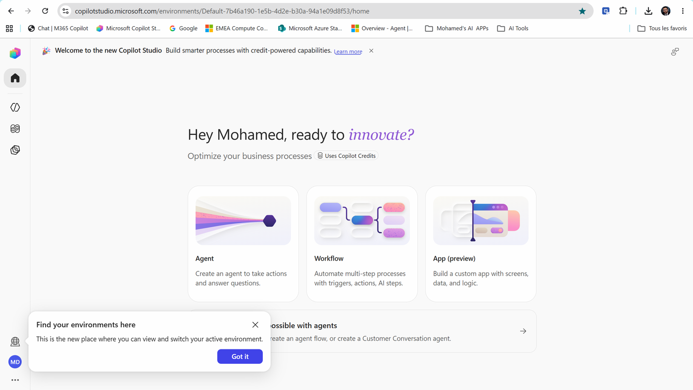

1. A tip appears: **Find your environments here**. The environment picker now lives in the **left rail** (the globe icon above your initials), not in the top-right corner. Select **Got it**, then select the **globe** icon.

1. The **Switch environment** panel shows your **Current environment**. Here it's the tenant's **default** environment.

   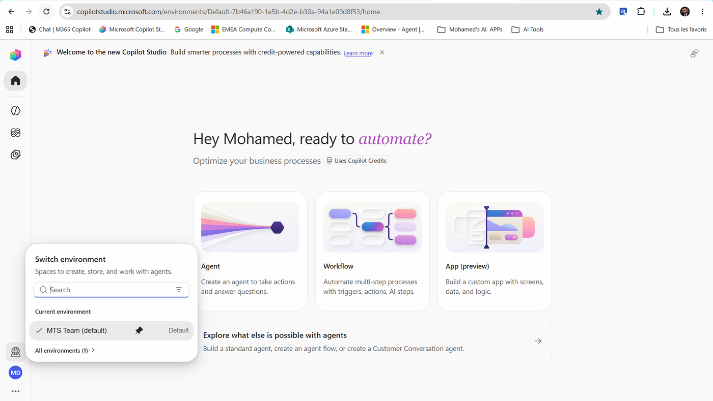

1. Expand **All environments** to see every environment you can build in.

   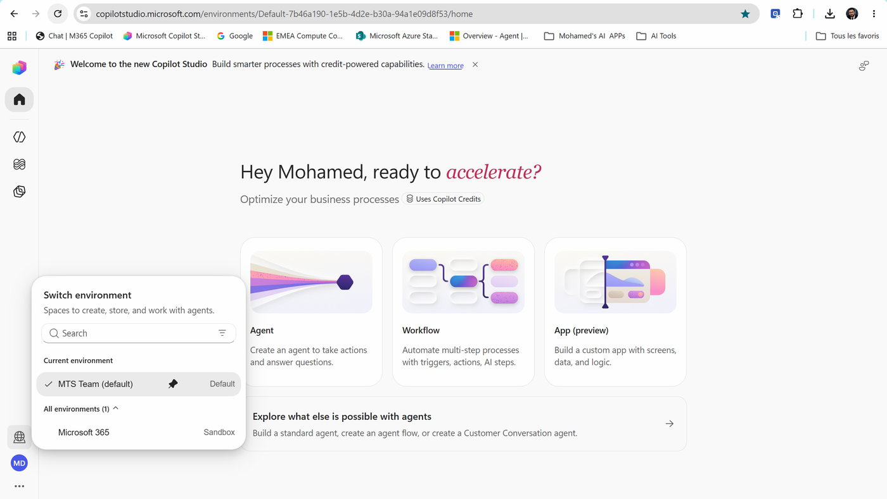

1. Select the environment you'll use for Labs 03 to 09 and **write its name down**.

   > **Which environment should I pick?**
   > - Copying an agent from Agent Builder (Lab 03) and building in Copilot Studio both need an environment **with a Dataverse database**.
   > - In a **demo or lab tenant**, the default environment is fine.
   > - In a **production tenant**, prefer a dedicated environment (a **Sandbox** or **Developer** environment such as the one in the screenshot). The default environment is shared by everyone in the company - not where you want test agents and test connectors.
   >
   > Not sure your environment has Dataverse? Ask your trainer, or check it in the [Power Platform admin center](https://admin.powerplatform.microsoft.com) > **Environments**.

> **Two engines, one studio.** Look at the bottom of the Home page: **Explore what else is possible with agents - Build a standard agent, create an agent flow, or create a Customer Conversation agent.** Copilot Studio runs agents on a **harness** - the runtime between your design and the AI model.
> - The **Microsoft Copilot harness** (behind the **Agent** tile - the default) takes a goal, plans the steps, calls tools, and recovers when something fails.
> - The **standard harness** ("standard agent") follows the topics and paths you draw.
> - The **Customer Conversation harness** is built for customer-facing voice and chat.
>
> We use the **Agent** tile in this course. You may also see the old name, **GitHub Copilot harness**, in older docs - it was renamed to **Microsoft Copilot harness**. Same runtime, and your data isn't sent to the GitHub Copilot service.

---

## Task 2: Create the Contoso IT Hub SharePoint site

1. Open the SharePoint start page: `https://<your-tenant>.sharepoint.com` (or the app launcher > **SharePoint**).

1. In the left rail, select **Build**. The **Start building** page opens. Select the **Site** card.

   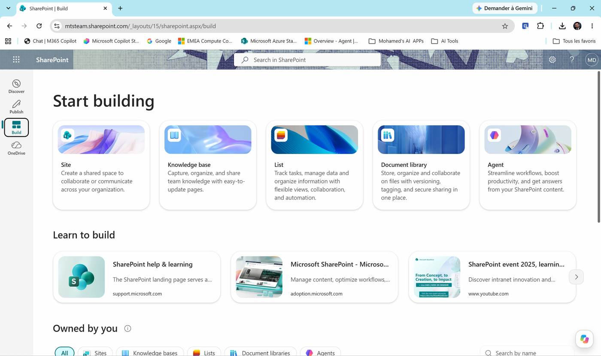

1. In **Select a site template**, keep **Team site** selected and choose **Standard team**.

   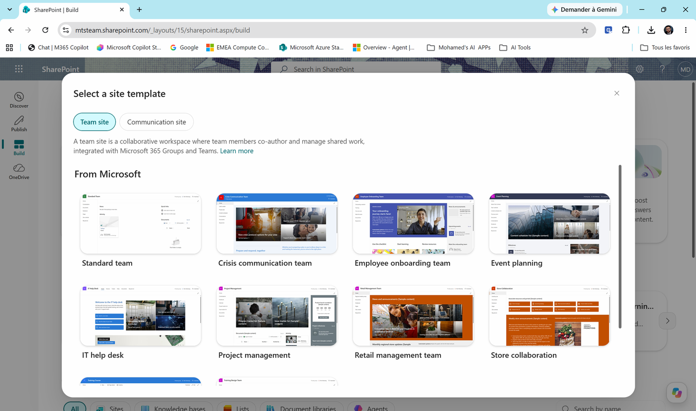

   > **Why a team site and not the "IT help desk" template?** The IT help desk template ships with its own pages and lists. We want a clean site so you build - and understand - every piece yourself.

1. Review the preview and select **Use template**.

   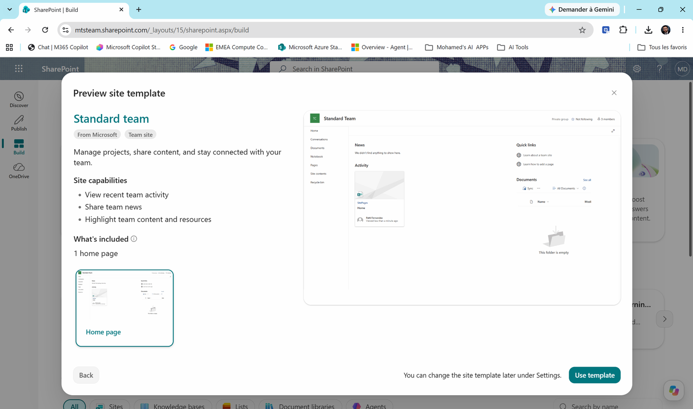

1. Fill in **Set up your site**:

   | Setting | Value |
   |---|---|
   | Site name | `Contoso IT Hub` |
   | Site description | `Policies and requests for the Contoso IT Service Desk` |
   | Group email address | `ContosoITHub` (filled in for you) |
   | Site address | `.../sites/ContosoITHub` (filled in for you) |
   | Privacy settings | **Private - only members can access this site** |

   Wait for the green check marks (**The site name is available**, **The group alias is available**, **The site address is available**), then select **Create site**.

   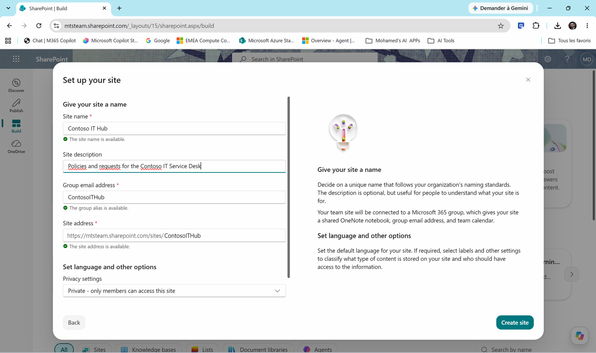

   > A team site is connected to a **Microsoft 365 group**. That group - not the agent - decides who can read the policies. Remember this; it matters in Lab 02.

1. Wait a few seconds while SharePoint creates the site.

   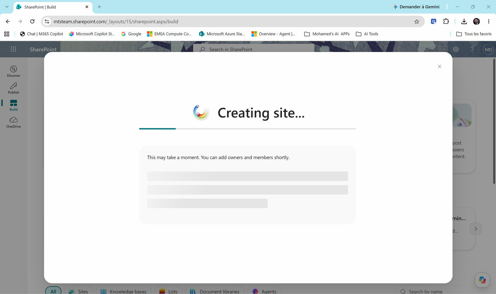

1. When you see **Your site is ready!**, you can add owners and members now (your trainer or a test colleague), or skip it. Select **Go to site**.

   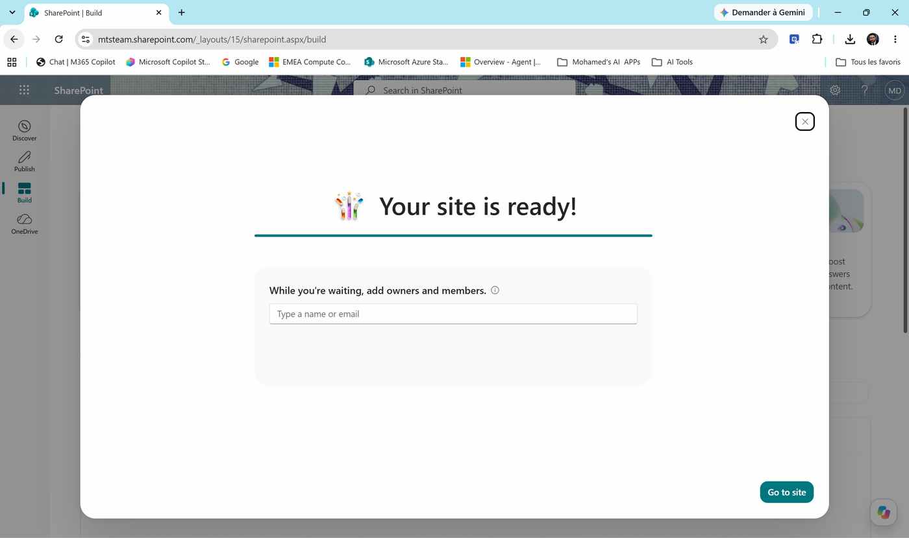

1. The **Contoso IT Hub** home page opens with a **Next steps** panel. Close the panel.

   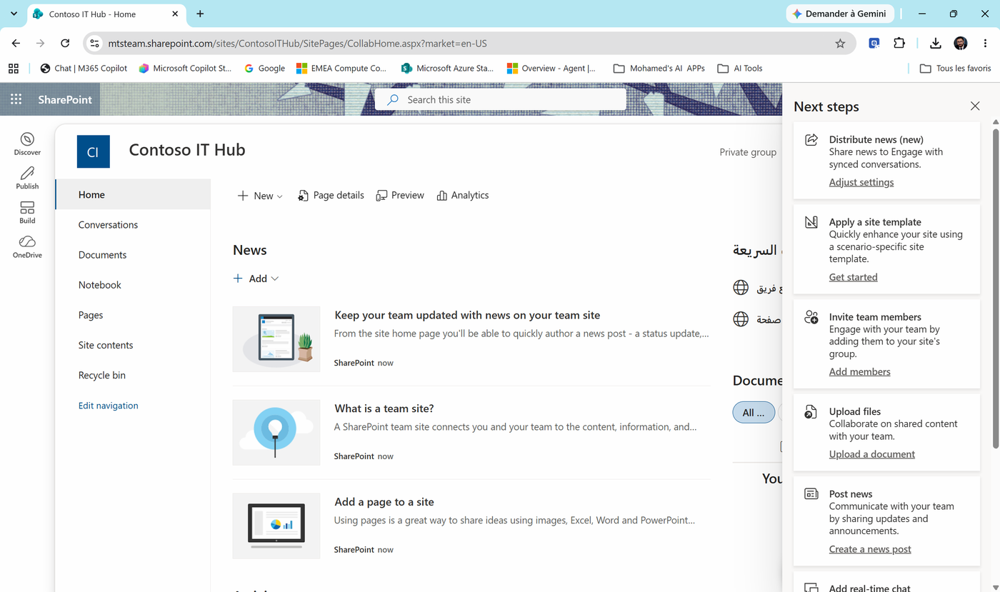

---

## Task 3: Upload the Contoso IT policies

1. Download the four policy files from this repository: open **Allfiles/Labs/00**, select each file, and use the **Download raw file** button (or download the whole repo with **Code > Download ZIP**).

   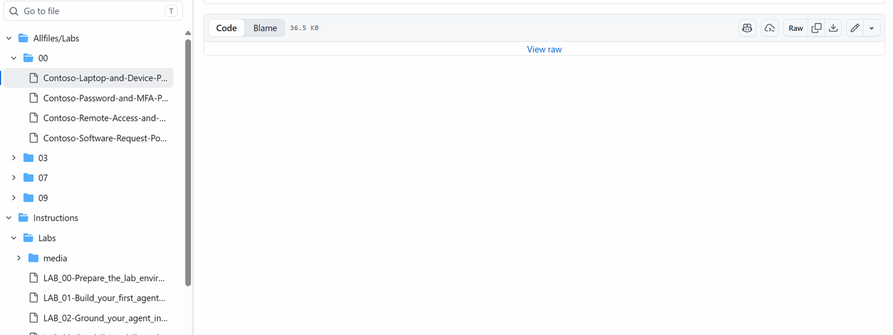

   - `Contoso-Laptop-and-Device-Policy.docx`
   - `Contoso-Password-and-MFA-Policy.docx`
   - `Contoso-Remote-Access-and-VPN-Guide.docx`
   - `Contoso-Software-Request-Policy.docx`

1. On the **Contoso IT Hub** site, select **Documents** in the left navigation.

1. Select **Create or upload** > **Files upload**, select the four files and open them. You should see **Uploaded 4 items to Documents**.

   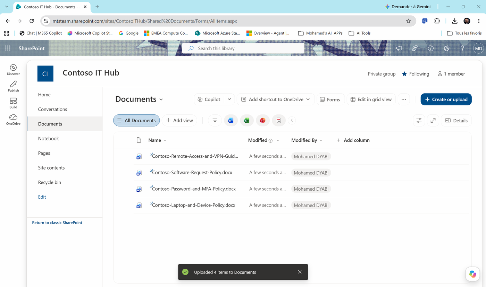

1. Copy the **site URL** - everything up to and including the site name - and paste it into a notepad. You'll need it a lot.

   ```text
   https://<your-tenant>.sharepoint.com/sites/ContosoITHub
   ```

   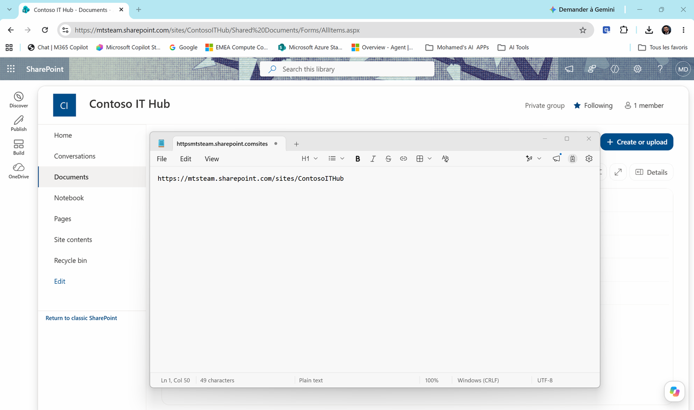

   > Copy the address **without** `/Shared Documents/Forms/AllItems.aspx`. Agents and connectors want the **site** address. In later labs we point them at the **Documents** library of this site.

> **Why do we upload to SharePoint and not straight into the agent?**
> Because SharePoint keeps the **permissions**. When an agent answers from SharePoint, a user only gets answers from files they're allowed to open. Upload a file into an agent, and everyone who uses the agent can read it. Remember this - it matters in Lab 09.

---

## Task 4: Create the IT Requests list

This list is the "inbox" of our Service Desk. In Lab 05 an agent writes into it. In Lab 08 an autonomous agent watches it.

1. Go back to the site **Home** page and select **+ New** > **List**.

   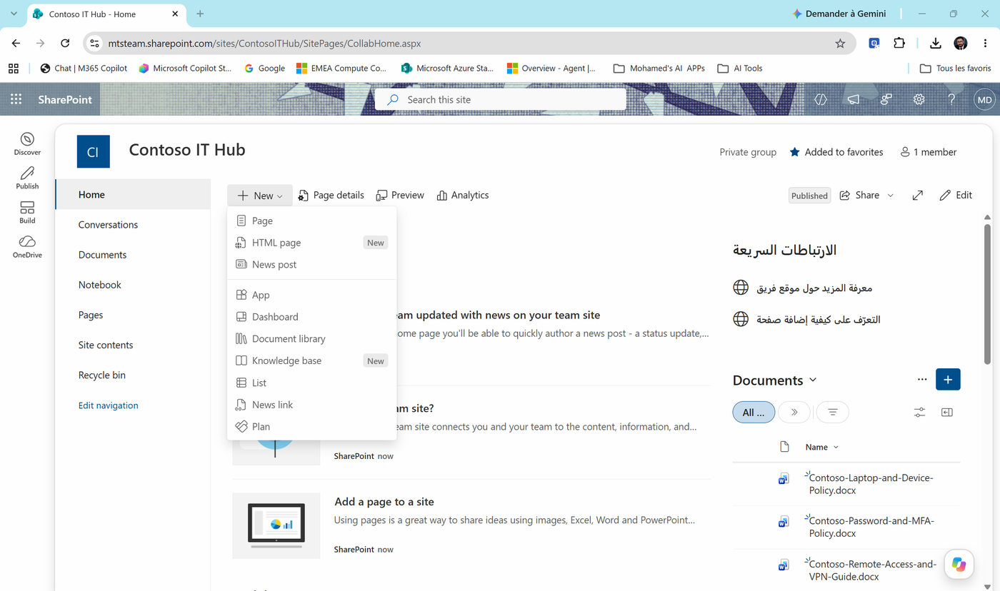

1. In **How would you like to start?**, under **Create from blank**, select **List**.

   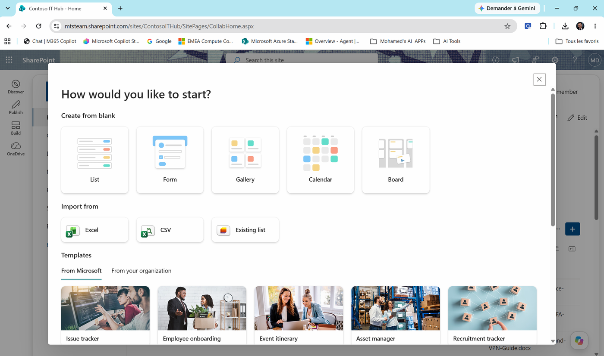

   > Notice **Import from Excel / CSV** and the **Issue tracker** template. Useful in real life - but we build the columns ourselves so the agents' expectations match exactly.

1. Name the list `IT Requests`, keep **Show list in site navigation** checked, and select **Create**.

   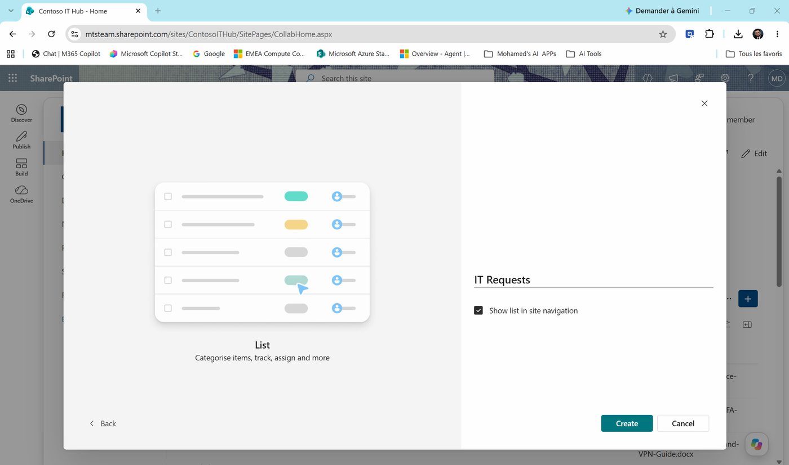

1. Now add the columns. For each row of the table below, select **+ Add column**, choose the **type**, select **Next**, and fill in the settings.

   | Column name | Type | Choices / settings |
   |---|---|---|
   | `Description` | Multiple lines of text | |
   | `Category` | Choice | Hardware, Software, Network, Account & Access, Security |
   | `Priority` | Choice | Low, Normal, High, Critical - **Default value: Normal** |
   | `Status` | Choice | New, Triaged, Waiting for approval, Approved, Rejected, Resolved - **Default value: New** |
   | `AssignedTeam` | Choice | Endpoint, Apps, Network, Identity, SecOps |
   | `RequestedBy` | Person | |
   | `TriageNotes` | Multiple lines of text | |

   > ⚠️ **Type the choice values exactly as shown** - same spelling, same capitals, same `&`. The agents in Labs 05-08 write these exact values. A typo here = a failed tool call later.

1. **How to fill a Choice column.** The panel starts with three placeholders: **Choice 1**, **Choice 2**, **Choice 3**. Select each placeholder and type over it, then use **+ Add Choice** for the extra values. Leave **Can add values manually** unchecked. The **Description** field is optional - listing the values there helps your colleagues.

   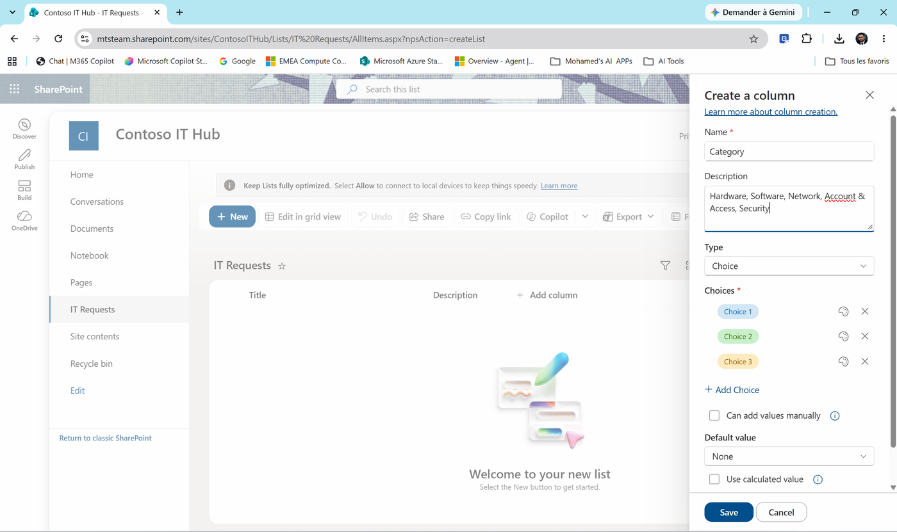

   When you're done, the **Status** column should look like this. Set **Default value** to **New** (scroll down in the panel), then **Save**.

   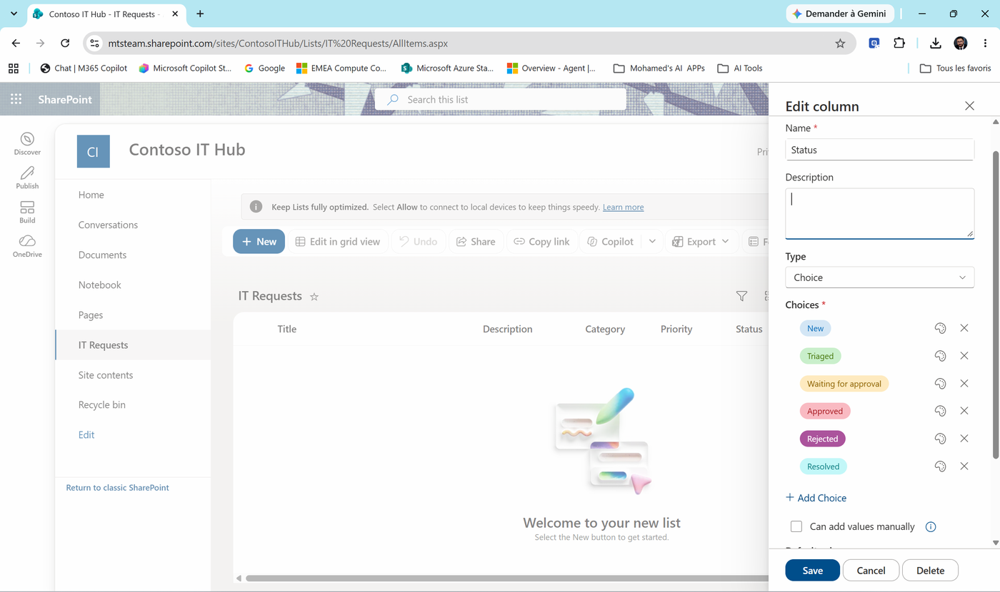

   And the **AssignedTeam** column, with the five teams the agents route to:

   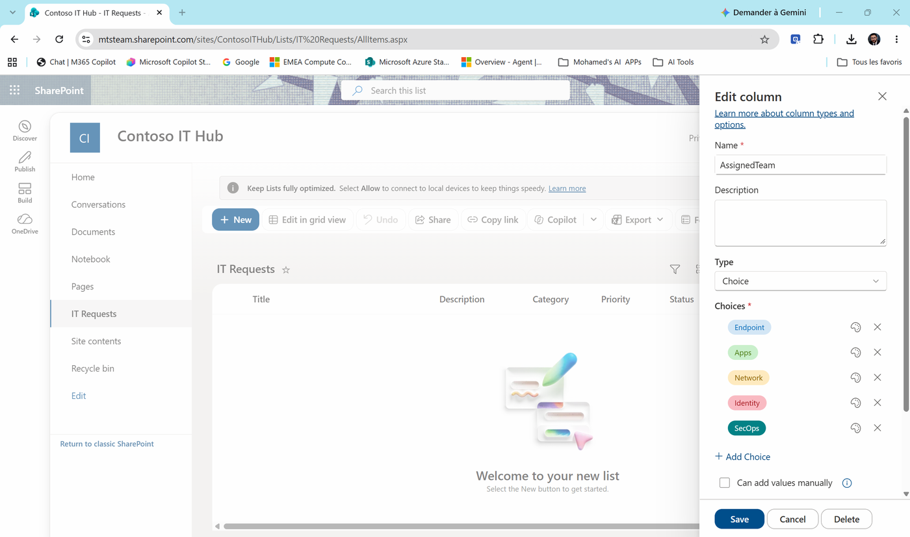

   > **Made a mistake?** Select the column header > **Column settings** > **Edit** to fix the name, the choices or the default value.

1. Check the result. Your list shows **Title, Description, Category, Priority, Status, AssignedTeam, RequestedBy** (scroll right for **TriageNotes**).

   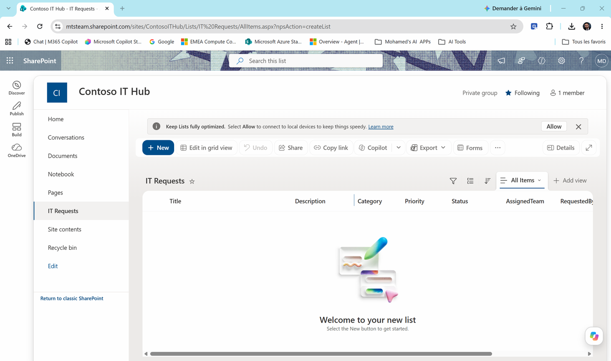

1. Add one test item so the list isn't empty. Select **+ New** and enter:

   | Field | Value |
   |---|---|
   | Title | `Docking station not detected` |
   | Description | `My Dell dock stopped detecting my second screen after the update` |
   | Category | Hardware |
   | Priority | Normal (already filled in - that's the default value you set) |
   | Status | New (default) |

   Select **Save**.

   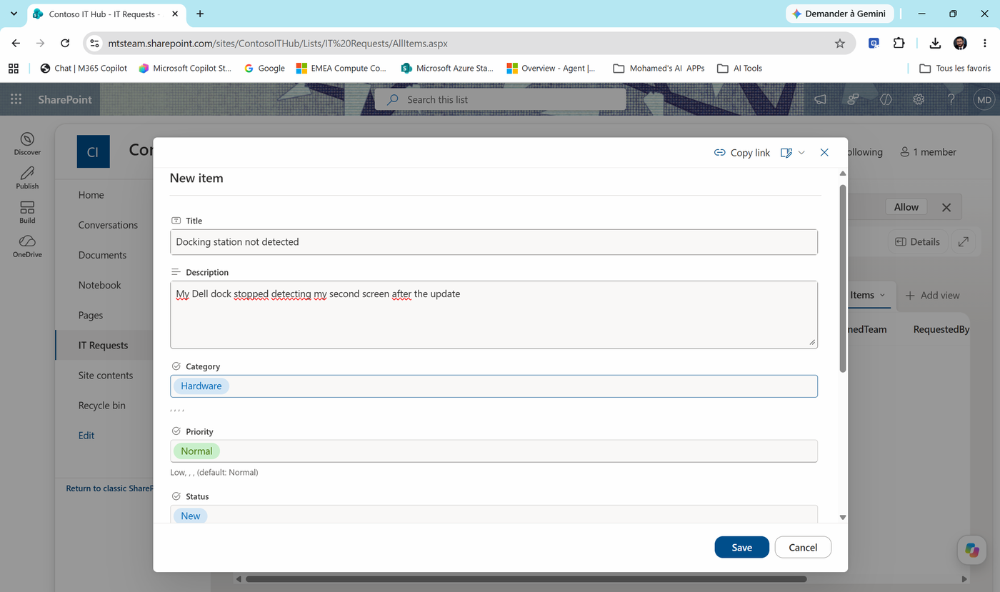

   > Notice that **Priority** and **Status** were filled in for you. That's the **default value** at work. Later, when an agent creates an item and forgets a field, the default keeps the data clean.
   >
   > The grey text under each field is the column **description**. Keep it readable (for example `Hardware, Software, Network, Account & Access, Security`) - it's the hint your colleagues see when they fill in the form.

---

## Task 5: Give the environment Copilot Credits (admin)

> **Who does this?** A Power Platform or global admin - usually the trainer, once, before the course.

Here's a surprise many people hit. You have Microsoft 365 E5 **and** a Microsoft 365 Copilot license. You build an agent from the **Agent** tile, ask it a question in **Preview**... and get this:

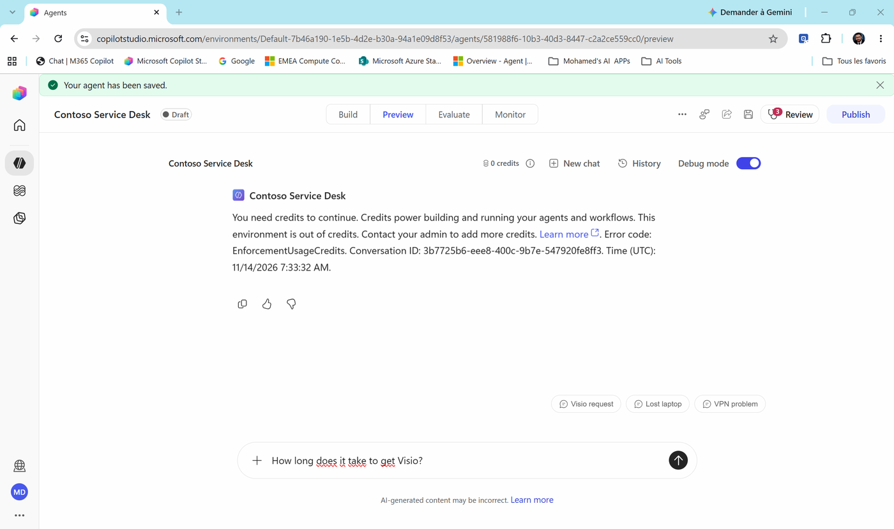

**Why?** Agents on the Microsoft Copilot harness are billed **per use, in Copilot Credits** - and billing starts **as soon as you build and test**, not when you publish. Credits belong to the **environment**, not to your user license. Your Copilot license doesn't add any.

The fastest way for a lab: **pay-as-you-go**, billed to an Azure subscription.

1. Open the [Power Platform admin center](https://admin.powerplatform.microsoft.com) > **Licensing** > **Copilot Studio**. Under **Recommendations**, select **+ New billing plan**.

   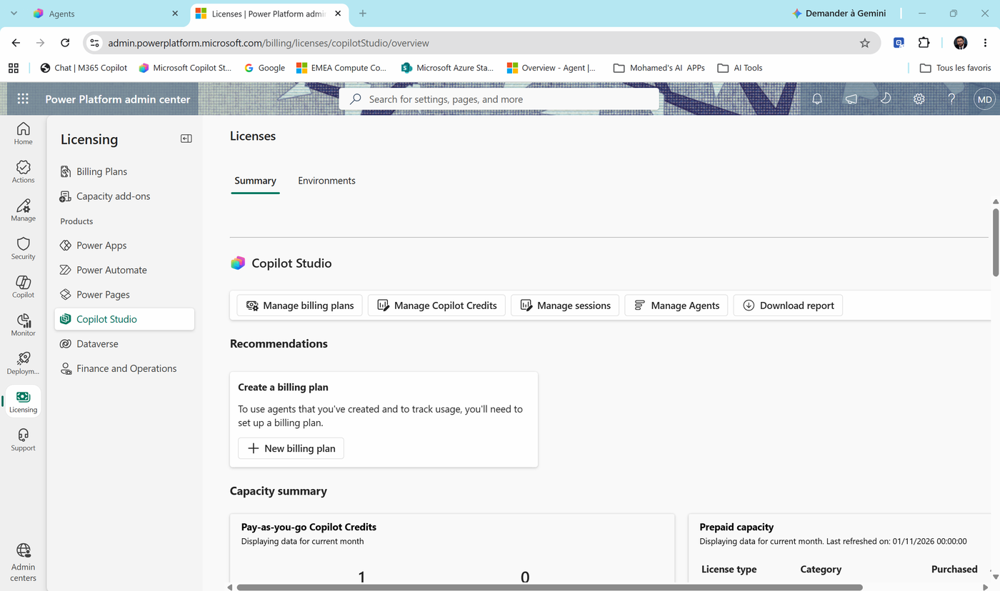

1. Fill in the plan:

   | Field | Value |
   |---|---|
   | Name | `CopilotLabsPAYG` |
   | Azure subscription | The subscription that pays for the labs |
   | Resource group | For example `copilot-credits-rg` |
   | Meter | **Copilot Studio** only |

   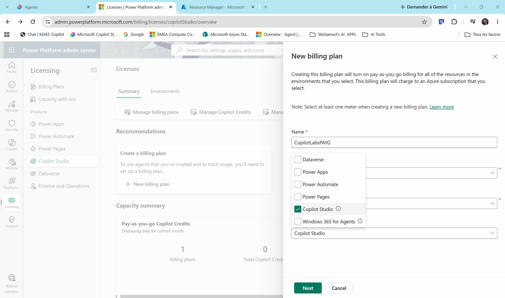

   > Untick the other meters (Windows 365 for Agents, Dataverse...). Select only what this plan should pay for.

1. Select **Next**. In **Select environments**, pick the **Region** where your environment lives. The list is **filtered by region** - pick the wrong one and it's empty:

   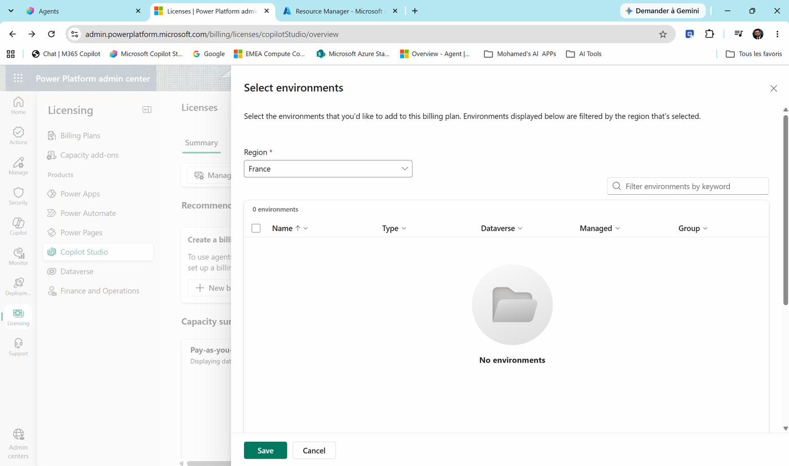

   Not sure? **Manage** > **Environments** > your environment shows its region. Here it's **Europe**:

   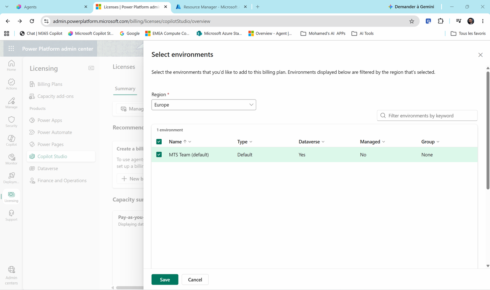

1. Tick your lab environment and select **Save**.

1. Go to **Licensing** > **Billing Plans**. Your plan shows **Enabled**, with **Copilot Studio** as the product.

   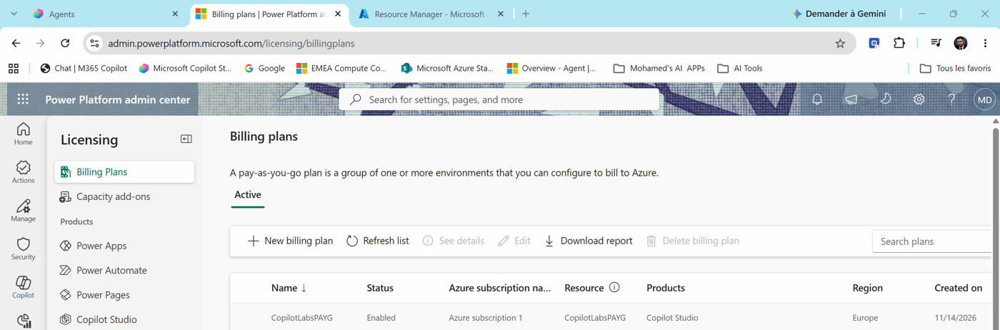

1. Wait 5-10 minutes before testing an agent.

> **Protect your wallet.** Pay-as-you-go has no hard cap. In the Azure portal, open **Cost Management** > **Budgets** and create a budget on the resource group with an e-mail alert. You can unlink the environment from the plan at any time to stop billing.

> **Other options:** prepaid **Copilot Credits capacity** (allocate it to the environment under **Licensing** > **Copilot Studio** > **Manage Copilot Credits**) or a one-year **Copilot Credits prepurchase plan** bought in the Azure portal.

---

## Task 6: Create your own IT Requests list (team only)

Skip this task if you work alone.

1. Open the **Contoso IT Hub** site. On **Home**, select **+ New** > **List**, exactly like in Task 4.

   

1. This time, don't pick a blank list. Under **Import from**, select **Existing list**.

   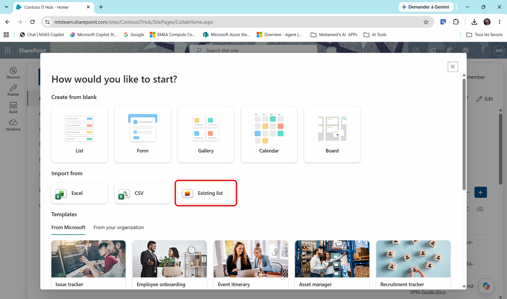

   Why not **List** under *Create from blank*? Because you'd have to rebuild the seven columns and all their choices by hand. **Existing list** copies the **columns, the choices and the default values**, but not the items. One click instead of seven columns, and no typos in the choice values.

1. Pick the **Contoso IT Hub** site, select the **IT Requests** list, and select **Next**.

1. Name it `IT Requests - XX` with **your initials** (for example `IT Requests - MD`). Keep **Show list in site navigation** checked and select **Create**. It's the same dialog you saw in Task 4, with a different name:

   

1. Check the result. Your new list has exactly the same columns as the trainer's **IT Requests** list, and it's empty:

   

1. Add one test item (**+ New**): Title `Docking station not detected`, Category **Hardware**. Check that **Priority** shows **Normal** and **Status** shows **New** without you touching them: the defaults came with the copy.

> 💡 From now on, every time a lab says **IT Requests**, you pick **IT Requests - XX**: in the Lab 05 tools, the Lab 06 workflow and the Lab 08 trigger and tools.

---

## Check your work

- [ ] You can open **New agent** in Microsoft 365 Copilot.
- [ ] You can open Copilot Studio and you wrote down your environment name.
- [ ] The **Contoso IT Hub** site has four policies in its **Documents** library.
- [ ] You saved the site URL (`.../sites/ContosoITHub`) in a notepad.
- [ ] The **IT Requests** list exists with seven custom columns and one item.
- [ ] Team only: your **IT Requests - XX** list exists, with one item.
- [ ] Your lab environment is linked to an **enabled** billing plan with the Copilot Studio meter.

## Key takeaways

- Agents are only as good as the data you give them. Clean, short, well-titled documents give better answers.
- SharePoint keeps permissions. Uploaded files don't.
- Copilot Studio needs an environment with Dataverse. Find it with the **globe** icon in the left rail.
- New Copilot Studio agents (the **Agent** tile) run on the Microsoft Copilot harness by default.
- Exact column names and choice values are a contract between your data and your agents.

**Next:** [Lab 01 - Build your first agent with natural language](LAB_01-Build_your_first_agent_with_Agent_Builder.md)
