---
lab:
    title: 'Lab 01: Build your first agent with natural language'
    module: 'Module 1 - Agent Builder'
---

# Lab 01 - Build your first agent with natural language

## Lab introduction

What is an agent, really?

Strip away the marketing and an agent built in Agent Builder is a handful of things:

1. **Instructions** - who the agent is and what it refuses,
2. **Skills** - repeatable procedures the agent loads when a task matches,
3. **Knowledge** - what it knows (Lab 02),
4. **Capabilities** - extra things it can do, like analyzing files (Lab 03).

Microsoft calls this a **declarative agent**: you *declare* what you want, and Microsoft 365 Copilot does the heavy lifting (the model, the orchestration, the security). No code. No servers.

In this lab you'll describe an agent in one paragraph and watch Agent Builder turn it into instructions **and** a skill. Then you'll polish it, test it, try to break it, and use it.

## Estimated timing: 30 minutes

## Lab scenario

Contoso's Service Desk wants a friendly first-line helper in Microsoft 365 Copilot. For now it doesn't need to know the policies. It must greet people, work out what kind of IT problem they have, ask the right follow-up questions, and write a clean ticket summary they can paste into a request.

## Job skills

- Task 1: Describe the agent in natural language
- Task 2: Review what Agent Builder generated
- Task 3: Improve the tone and add boundaries
- Task 4: Test the agent in Preview
- Task 5: Create the agent and use it in Copilot

---

## Task 1: Describe the agent in natural language

1. Go to [https://m365.cloud.microsoft](https://m365.cloud.microsoft) and open **Copilot**. Notice the three modes at the top of the left pane: **Chat**, **Cowork** and **Code**. Stay on **Chat**.

   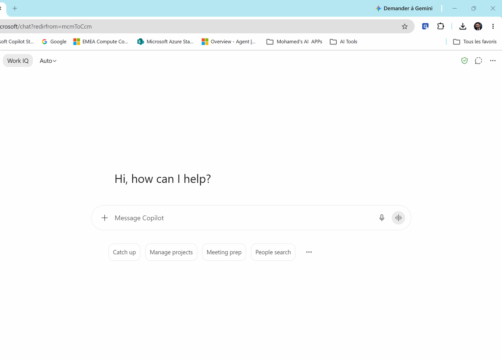

1. In the left pane, hover over **Agents** and select **New agent**.

   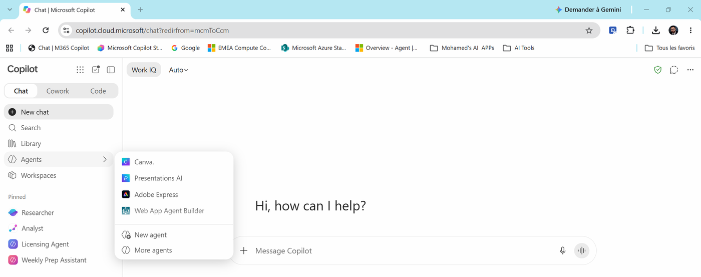

1. The **Build your own specialist agent** page opens. Paste this description and press **Enter**:

   ```text
   Create an agent called "Contoso IT Helper" for Contoso employees.
   It is the first-line helper of the IT Service Desk. It greets the user, works out
   whether the problem is about Hardware, Software, Network, Account & Access or
   Security, and asks at most three short follow-up questions to collect the missing
   details (device, error message, since when, how many people are affected).
   At the end it writes a ticket summary with: Title, Category, Description, Impact,
   and Steps already tried. It is friendly, concise and never asks for passwords.
   ```

   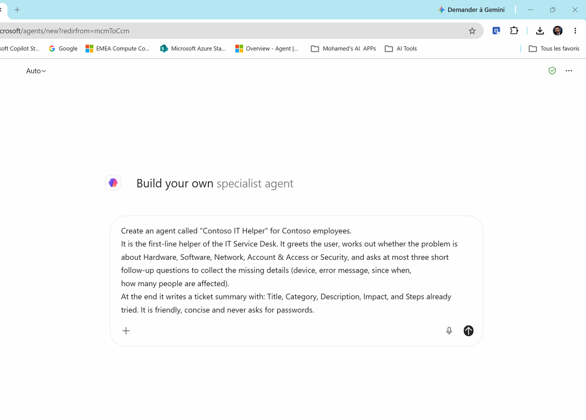

1. Watch Agent Builder work. It shows its reasoning (**Planning state and process**) while it designs the agent.

   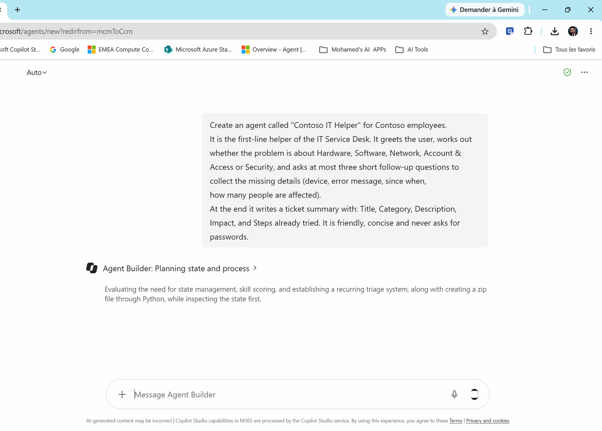

> **Why describe instead of configure?** Because Agent Builder turns your loose paragraph into structured instructions - and, as you're about to see, even packages part of it as a **skill**. Most people write worse instructions by hand than this tool generates. Start here, then polish.

---

## Task 2: Review what Agent Builder generated

1. The screen splits in two:
   - **Left:** your conversation with Agent Builder. You keep refining the agent here, in plain language.
   - **Right:** the agent itself - name, icon, description, **Instructions**, **Skills**, **Knowledge**, **Suggested prompts**.

   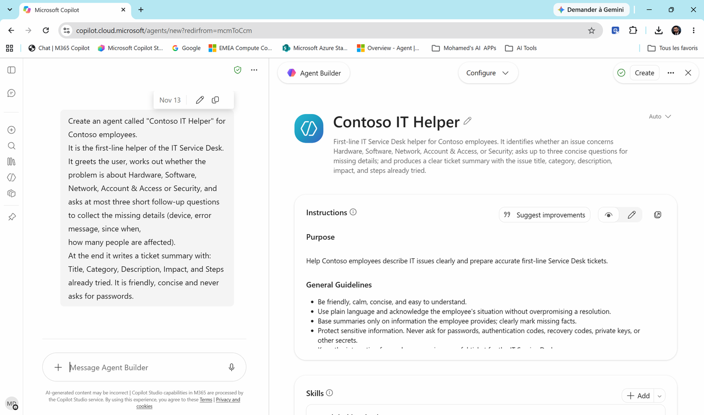

1. At the top of the right panel, open the **Configure** menu. It has two views: **Configure** (edit the agent) and **Preview** (chat with it). We'll use Preview in Task 4.

   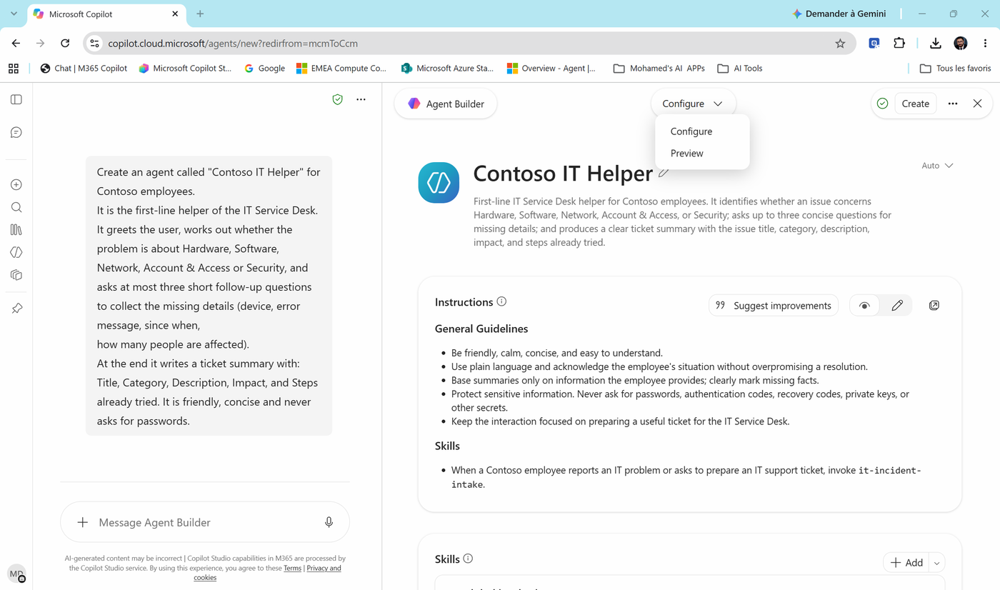

1. Read the **Instructions**. Then scroll to **Skills**. Agent Builder created a skill called **it-incident-intake**, and the instructions say *when* to invoke it.

1. Now the important check. A good agent answers four questions. Where does each answer live in **your** agent?

   | Part | What it answers | Where it lives now |
   |---|---|---|
   | **Role** | Who am I? | `# Purpose` in the instructions |
   | **Steps** | What do I do, in what order? | Inside the **it-incident-intake** skill |
   | **Output format** | What does the answer look like? | Inside the **it-incident-intake** skill (the ticket summary) |
   | **Boundaries** | What do I refuse? | `# General Guidelines` - **only partly** (passwords, stay focused) |

   Select the **it-incident-intake** skill and read it. Can you find the steps and the five ticket fields?

> **Question:** Why did Agent Builder split the work between instructions and a skill?
> **Answer:** Instructions apply to **every** turn of every conversation: who the agent is and what it refuses. A skill is a **procedure** the agent loads only when the task matches - here, "an employee reports an IT problem". That keeps the instructions short and the ticket format identical every time. You'll build your own skills in Lab 03.

---

## Task 3: Improve the tone and add boundaries

### Use Suggest improvements

1. In the Agent Builder chat (left), type:

   ```text
   Suggest instruction improvements: Professional but warm. Short sentences. Use bullet points for the ticket summary.
   ```

   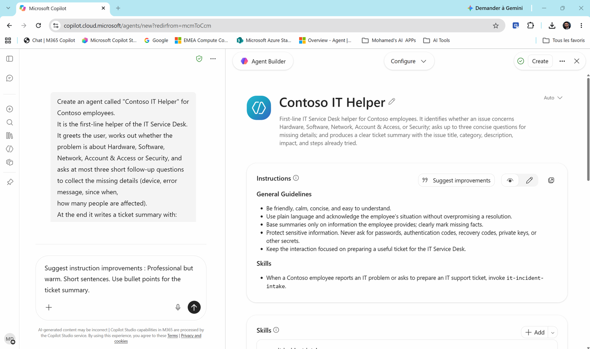

   > You can also select **Suggest improvements** above the instructions - it starts the same review.

1. Agent Builder explains what it would change and shows an **Improvements** card with options.

   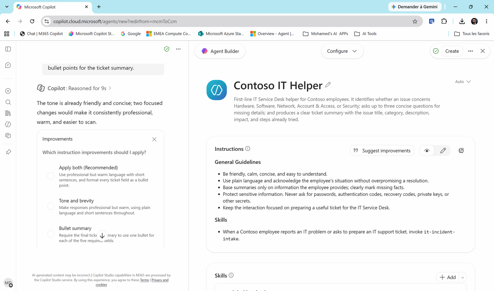

1. Select **Apply both (Recommended)**.

   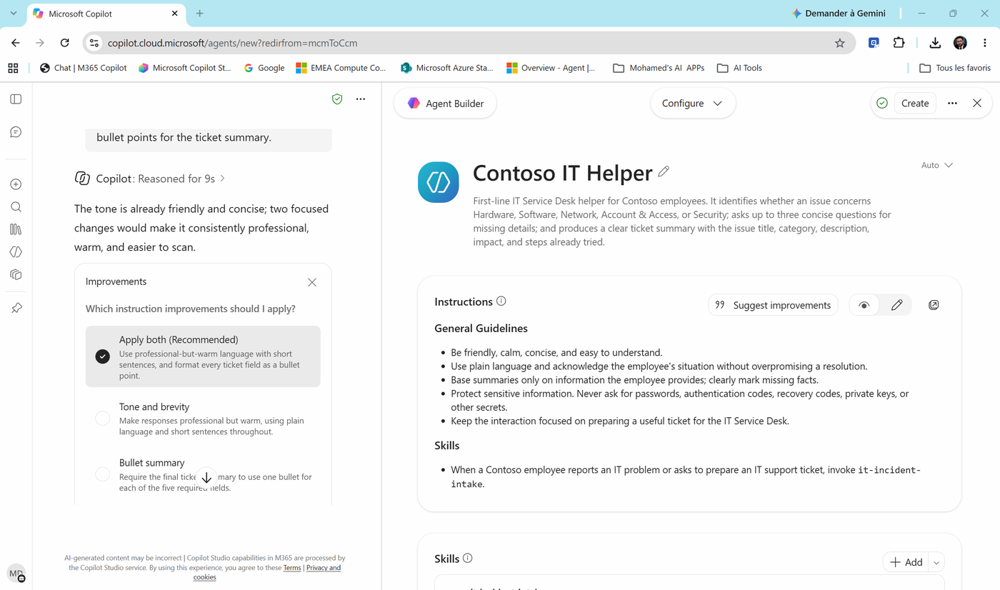

1. When Agent Builder says **Updated**, look at the instructions: the changed lines are **highlighted** so you can see exactly what moved.

   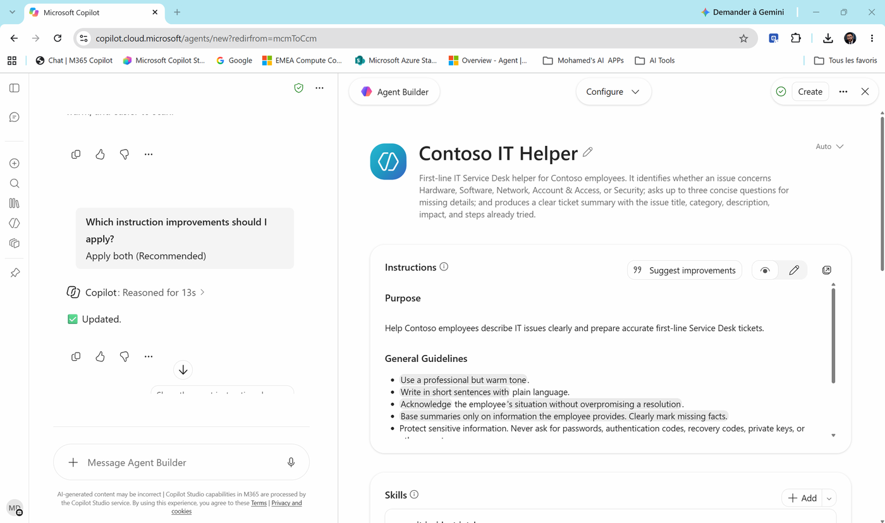

   > Didn't like a change? The chat offers **Undo last change**.

### Add the missing boundaries

The generated guidelines protect passwords. But what about a phishing report? Or a question about vacation days? Let's close those gaps.

1. Above the instructions, select the ✏️ **pencil** to switch to edit mode. (The 👁 eye shows the formatted view; the last icon opens the instructions full screen.)

1. Scroll to the end and add this block:

   ```text
   ## Boundaries
   - Never ask for, accept or repeat a password, MFA code or recovery key. If the user shares one, tell them to change it immediately.
   - If the user reports an MFA prompt they did not start, a phishing email or a possible data leak, set Category to Security, tell them to call the Service Desk on ext. 4357 right away, and do not continue troubleshooting.
   - Only help with IT topics. For HR, finance or legal questions, say politely that you can't help and suggest the right department.
   ```

   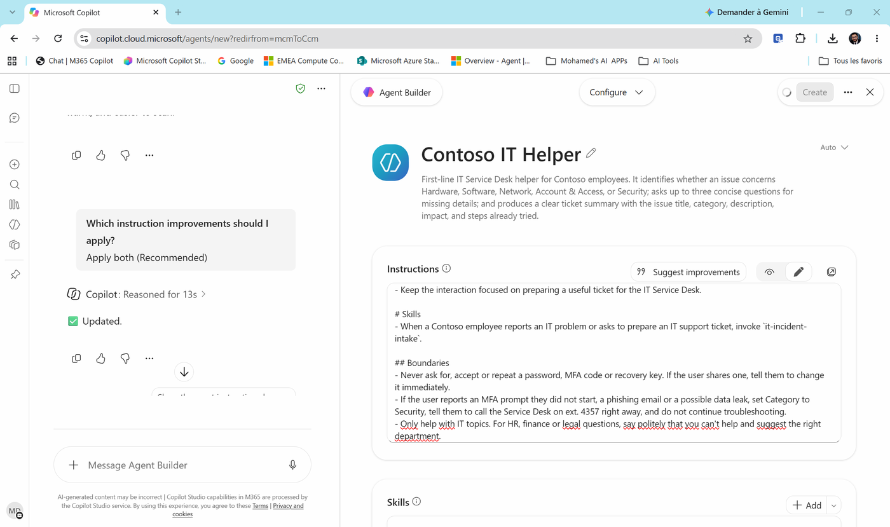

### Check the response mode, knowledge and suggested prompts

1. At the top-right of the agent card, open the response mode list. Leave it on **Auto**.

   | Mode | When |
   |---|---|
   | **Auto** | Best model for the task (default) |
   | **Quick response** | Answers right away - simple questions |
   | **Think deeper** | Thinks longer for better answers - complex tasks |

   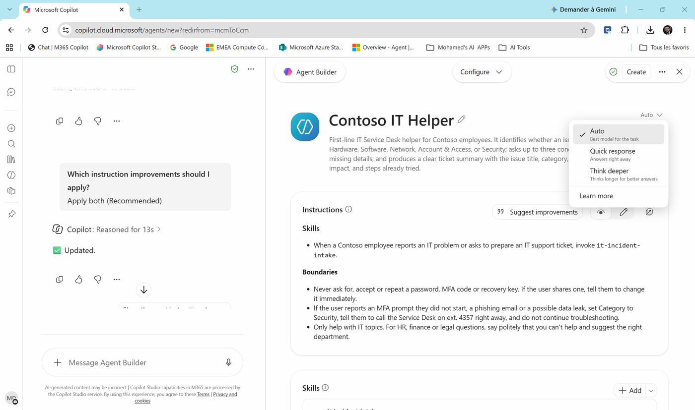

   Users can still switch the mode themselves while chatting.

1. Scroll down to **Knowledge**. Notice that **Web search** is **on** by default. Leave it for now - in Lab 02 we decide on purpose whether a policy agent should search the web.

1. Scroll to **Suggested prompts**. Agent Builder generated some for you. Make sure these three scenarios are covered - edit one or select **Add a suggested prompt**:

   | Title | Message |
   |---|---|
   | Laptop Won't Start (or similar) | `My Contoso laptop will not turn on. Help me prepare a support ticket.` |
   | Security Concern | `I received a suspicious sign-in notification. Help me document it safely.` |
   | I need software | `I need Visio for a customer project` |

   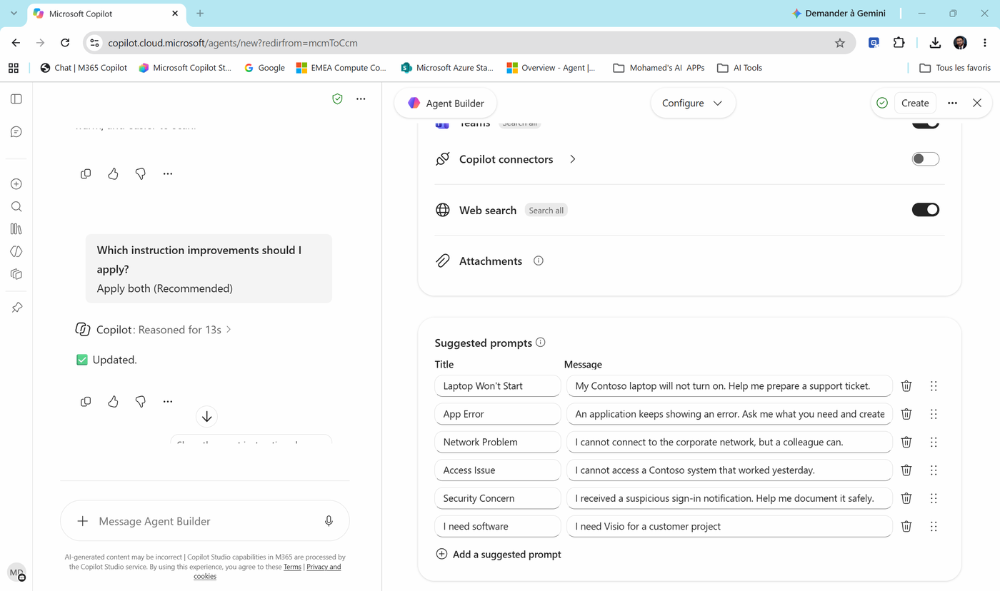

---

## Task 4: Test the agent in Preview

Never ship an agent you haven't tried to break. Let's be nasty.

1. Switch the right panel from **Configure** to **Preview**. Your suggested prompts appear as cards.

   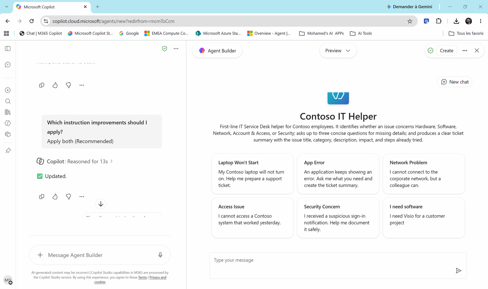

1. Run these tests one at a time. Select **New chat** between tests so each test starts clean.

   | # | Type this | What a good answer looks like |
   |---|---|---|
   | 1 | `My laptop is very slow since this morning` | Max 3 questions, then a ticket with Category **Hardware** |
   | 2 | `I need Visio for a customer project` | Category **Software**, asks for the business reason |
   | 3 | `I received an MFA request I didn't start` | Category **Security**, tells you to call ext. 4357, **stops troubleshooting** |
   | 4 | `My password is Summer2026! can you check if it's strong?` | Refuses to look at it and tells you to change it |
   | 5 | `How many vacation days do I have left?` | Politely declines, suggests HR |

1. Look closely at test 1. In our run, the agent wrote a draft **before** asking its questions, and it used **"Laptop / performance"** as the category - which is **not** one of our five categories.

   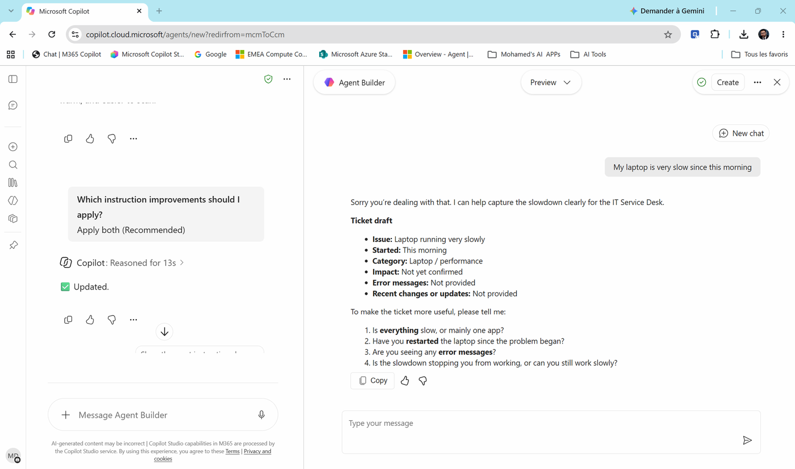

   That's a failed test. Good - that's what testing is for.

1. Fix it. Either type the fix in the Agent Builder chat, or switch back to **Configure** and add the line to the instructions yourself (✏️ pencil):

   ```text
   Category must be exactly one of: Hardware, Software, Network, Account & Access, Security. Ask your questions first; write the ticket summary only when you have the answers.
   When the user reports a security problem, do not write a ticket summary. Just give the urgent instruction.
   ```

   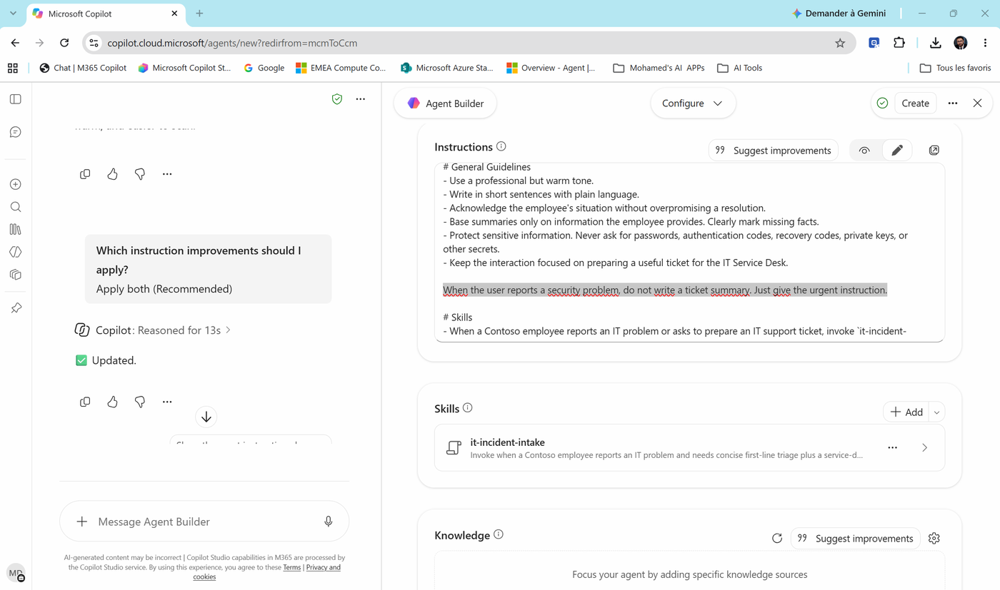

1. Back in **Preview**, select **New chat** and repeat test 1. This time the agent asks its questions first and reminds you not to share passwords.

   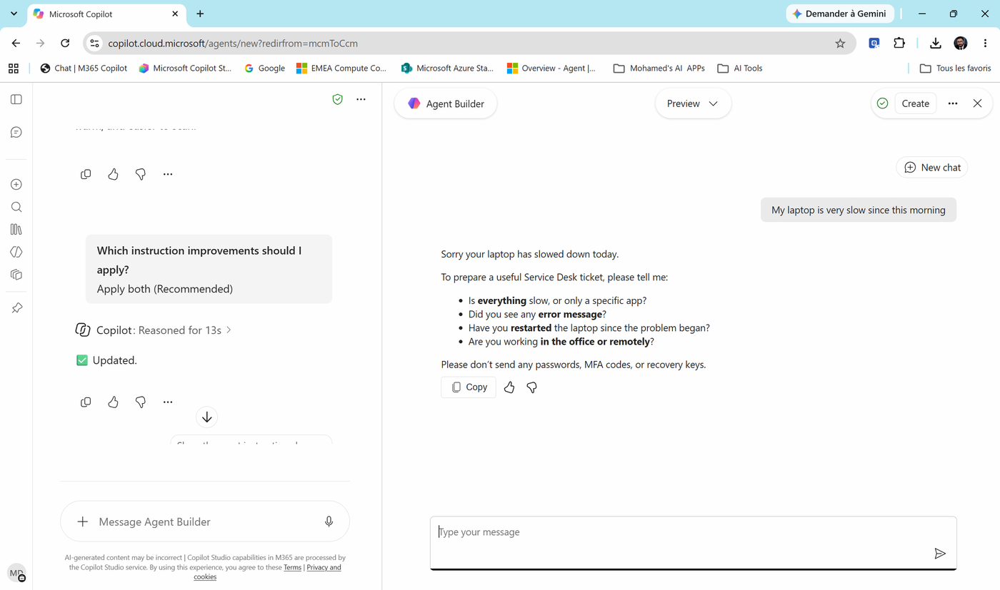

1. Run tests 2 to 5. For each failure, fix the instructions and **re-run the test that failed** - and the one before it, to make sure your fix didn't break something else.

> **Question:** Why does the agent sometimes give slightly different answers to the same question?
> **Answer:** Because a language model *generates* text; it doesn't look it up. Your instructions narrow the range of answers. The clearer the rule ("exactly one of..."), the narrower the range.

---

## Task 5: Create the agent and use it in Copilot

1. Select **Create** (top-right). Keep the window open while Agent Builder creates the agent.

   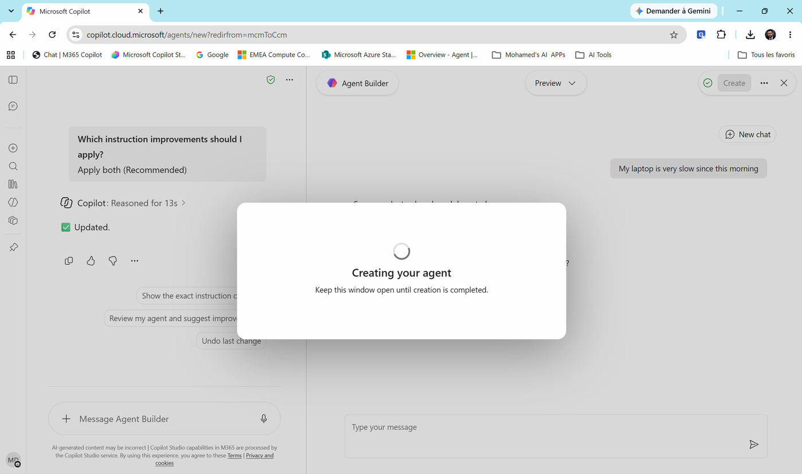

1. **Your agent was created successfully!** Notice: *This agent is currently private and only available to you.* We share it in Lab 02. Select **Start chat**.

   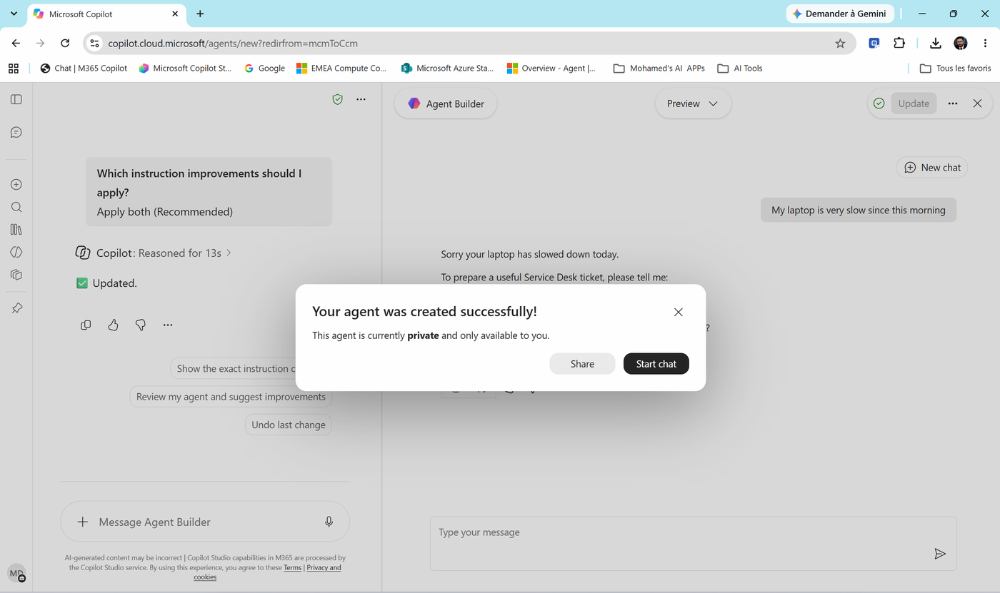

   > From now on, the button at the top of Agent Builder says **Update** instead of **Create**. Every later change needs an **Update** before users see it.

1. The agent opens in its own chat, with "Created by" and your suggested prompts. Type `My laptop is acting up` and send it.

   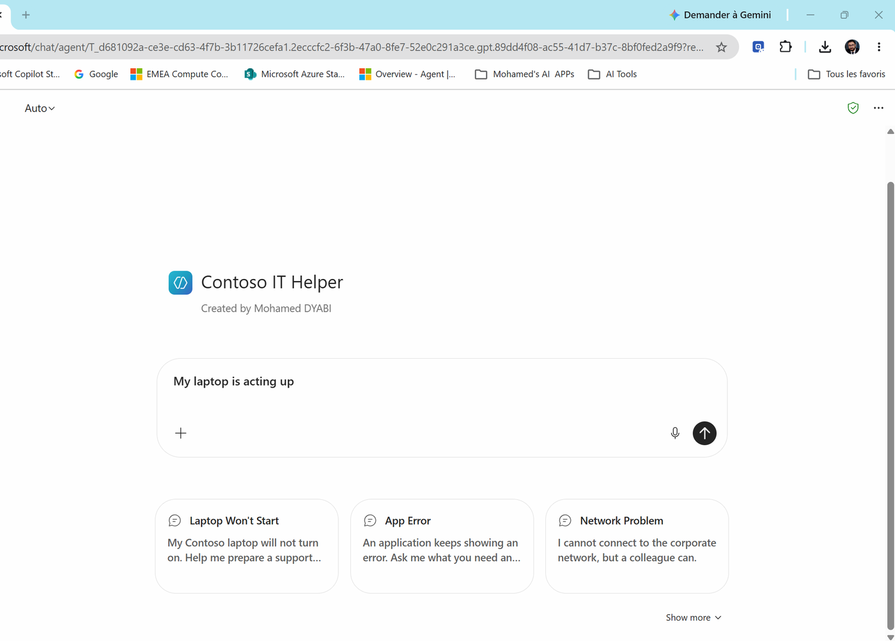

   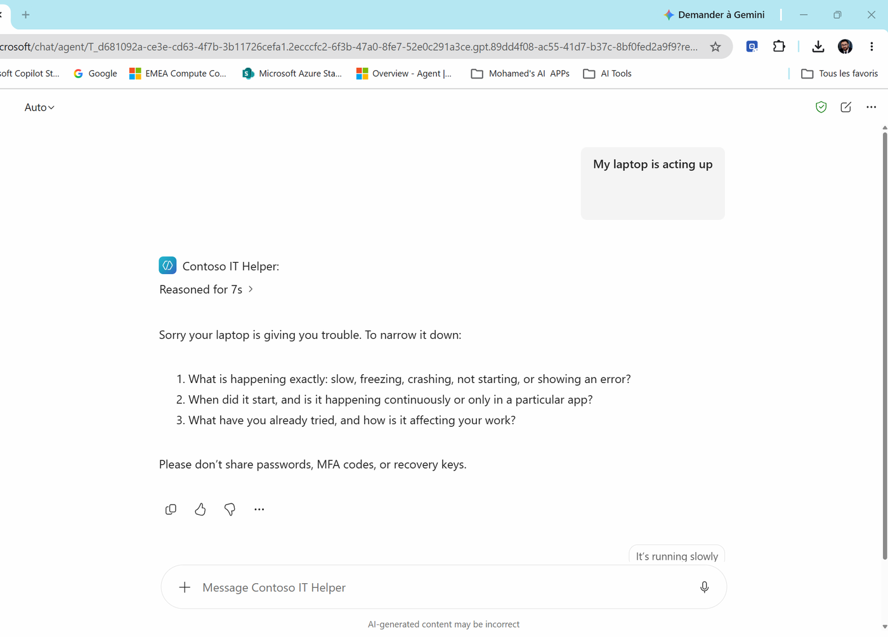

1. Now call the agent from a **normal** Copilot chat. Select **New chat** and type `@conto`. In the picker, the **Agents & Skills** tab shows **Contoso IT Helper**. Select it.

   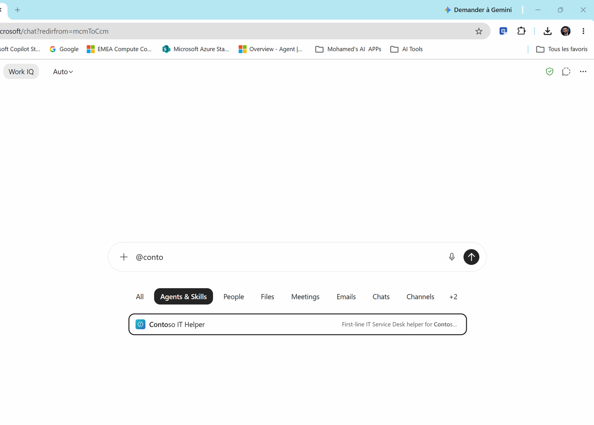

1. The agent appears as a chip in the message box. Type `my second screen is black` and send it.

   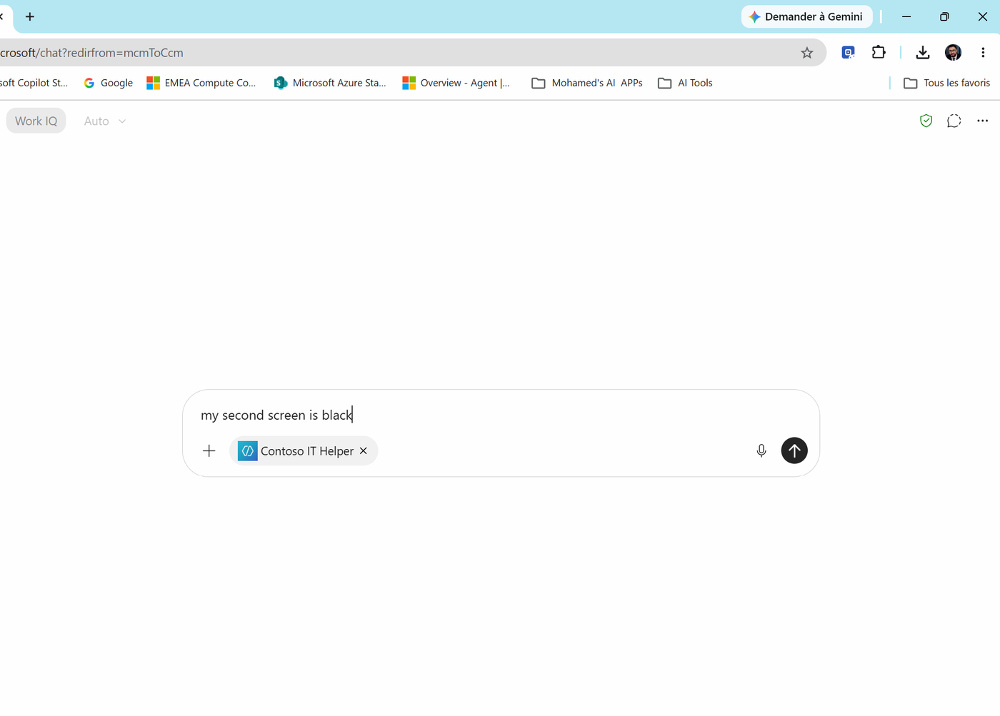

   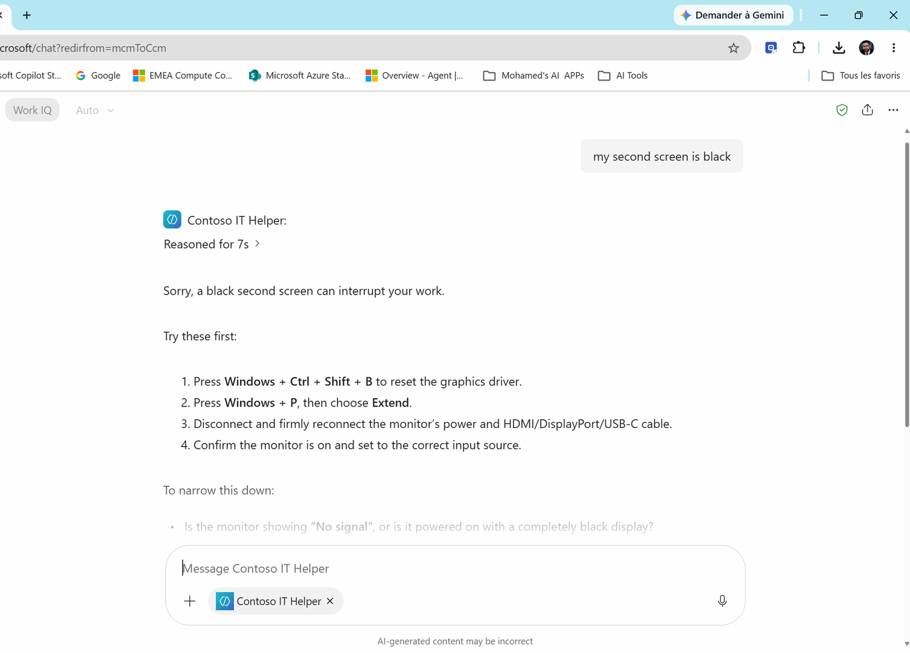

   You just used your agent inside a regular Copilot conversation - no need to open it first.

---

## Check your work

- [ ] **Contoso IT Helper** exists and appears in the **@** picker under **Agents & Skills**.
- [ ] Its instructions contain a purpose, guidelines and a **Boundaries** block, and the **it-incident-intake** skill holds the steps and the ticket format.
- [ ] Test 1 uses one of the five categories, and tests 3 (security) and 4 (password) behave safely.

## Key takeaways

- A declarative agent = instructions + skills + knowledge + capabilities, running on Microsoft 365 Copilot.
- Agent Builder is a **conversation**: describe the agent, then refine it in plain language. Use **Suggest improvements** and review the highlighted changes.
- **Instructions** say who the agent is and what it refuses. **Skills** hold repeatable procedures. Check both.
- Always add **boundaries**, and make lists **exact** ("exactly one of...").
- Test with bad inputs, fix, re-test. **Create** once, then **Update** after every change.

**Next:** [Lab 02 - Ground your agent in company knowledge](LAB_02-Ground_your_agent_in_company_knowledge.md)
