---
lab:
    title: 'Lab 02: Ground your agent in company knowledge'
    module: 'Module 1 - Agent Builder'
---

# Lab 02 - Ground your agent in company knowledge

## Lab introduction

Ask your Lab 01 agent "How long does it take to get Visio?" and it will guess. Politely. Confidently. And without a single source.

Why? Because it has never read the Contoso Software Request Policy. The model knows a lot about the world, but nothing about **your** company.

The fix has a name: **grounding**. You give the agent knowledge sources, and before it answers, Copilot searches those sources and builds the answer from what it finds - with **citations** so the user can check.

In this lab you ground the agent, you decide which sources it may use (and which it may **not**), and you share it.

## Estimated timing: 40 minutes

## Lab scenario

The Service Desk wants the IT Helper to answer policy questions from the official documents only, cite the source, and say "I don't know" instead of guessing. It also wants Microsoft's own support site available for "how do I..." questions about Microsoft 365.

## Job skills

- Task 1: Prove the problem (ask before grounding)
- Task 2: Add the SharePoint policies as knowledge
- Task 3: Add a website and choose what else the agent may search
- Task 4: Teach the agent how to use its knowledge
- Task 5: Update and test grounding and citations
- Task 6: Share the agent

---

## Task 1: Prove the problem

1. Open **Contoso IT Helper** in Copilot and ask:

   ```text
   How long does it take to get Visio, and who approves it?
   ```

   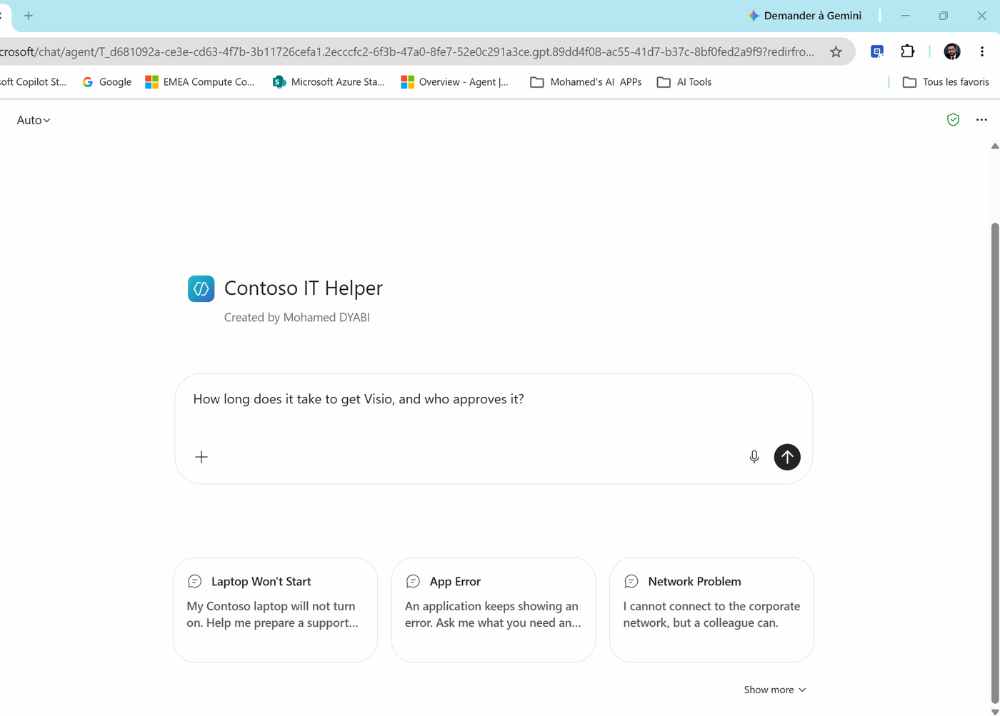

1. Look at the answer. In our run, the agent said it *depends on Contoso's process* and that it *needs to check the internal Visio policy*. No numbers. No citation. It even suggested follow-ups like **Check the Visio approval policy** - which it can't do yet.

   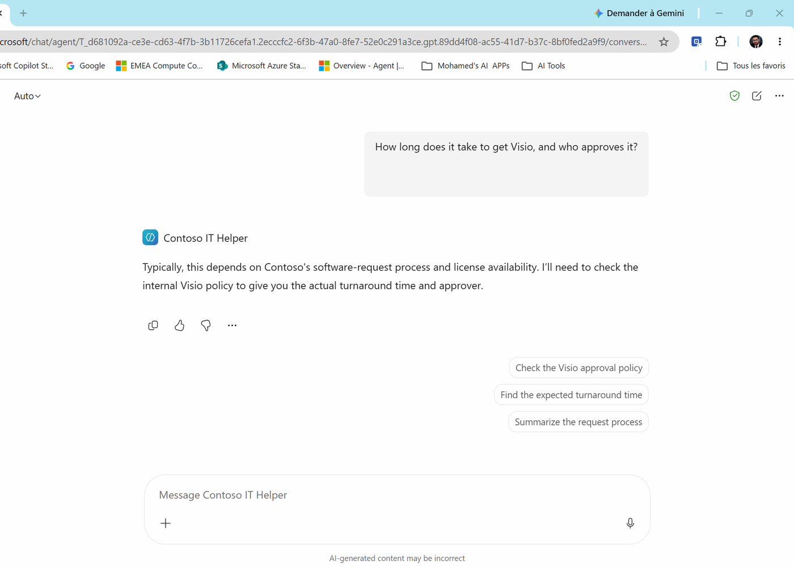

   Write the answer down. That's the problem we fix.

---

## Task 2: Add the SharePoint policies as knowledge

1. In the Copilot left pane, hover over **Agents**, then select **...** next to **Contoso IT Helper** > **Edit**.

   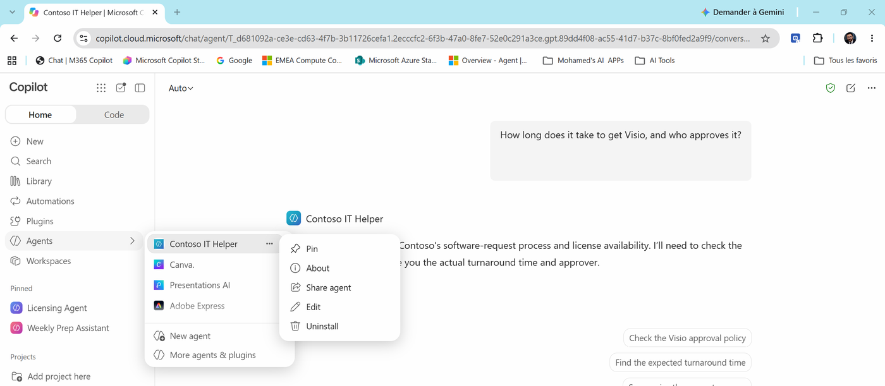

   > The same menu has **Pin**, **About**, **Share agent** and **Uninstall**. We'll use **Share agent** in Task 6.

1. Agent Builder opens with "How would you like to update your agent?". Make sure the right panel shows **Configure**, and scroll down to **Knowledge**.

   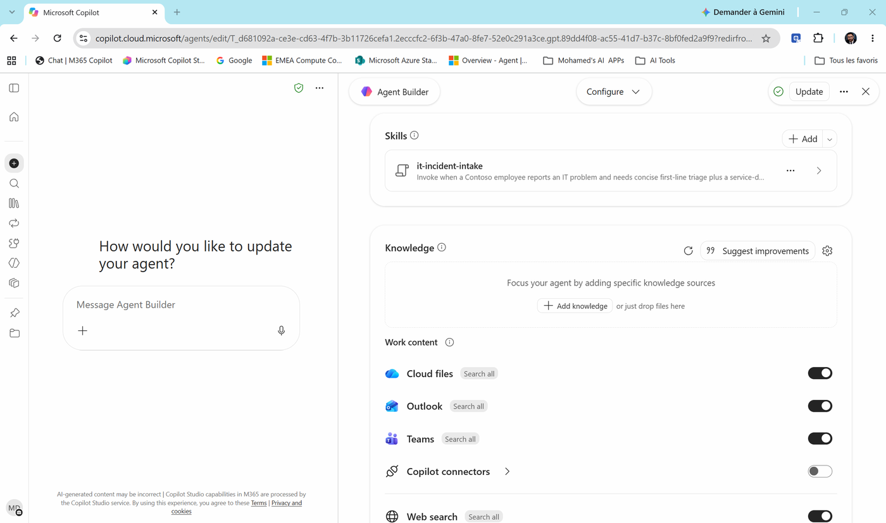

   Notice two blocks:
   - **Focus your agent by adding specific knowledge sources** - specific files, sites or websites you choose.
   - **Work content** - broad sources (**Cloud files**, **Outlook**, **Teams**, **Copilot connectors**, **Web search**). **Search all** means the agent can search *everything* of that type the user can access.

1. Select **+ Add knowledge**. A search box appears: **Paste a link or search for your data**, with tabs **All, Files, Sites, Chats, Meetings**. Your four policies already show up because you uploaded them recently.

   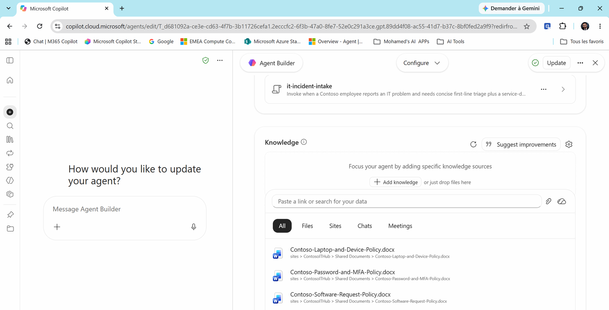

1. Select the ☁️ **cloud** icon at the end of the search box to open the file picker. Browse to **Contoso IT Hub** > **Documents**, select the **four** policy files and select **Select**.

   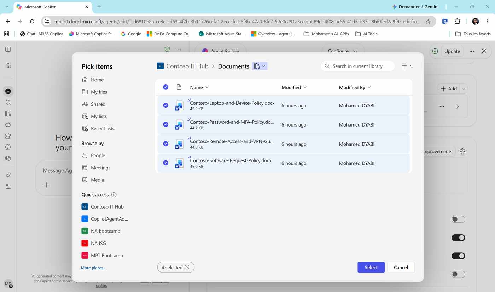

1. The files now appear under **Cloud files** > **SharePoint (4)**.

> **Limits worth knowing:** up to 100 SharePoint files, 1 SharePoint list and 50 OneDrive files per agent. The agent respects SharePoint permissions and sensitivity labels. Newly added files may show **Preparing** for a few minutes - the agent won't use them until they're ready. Keep documents short and focused - one topic per file works best.

---

## Task 3: Add a website and choose what else the agent may search

1. Select **+ Add knowledge** again, paste this URL and select the **+** button:

   ```text
   https://support.microsoft.com/office
   ```

   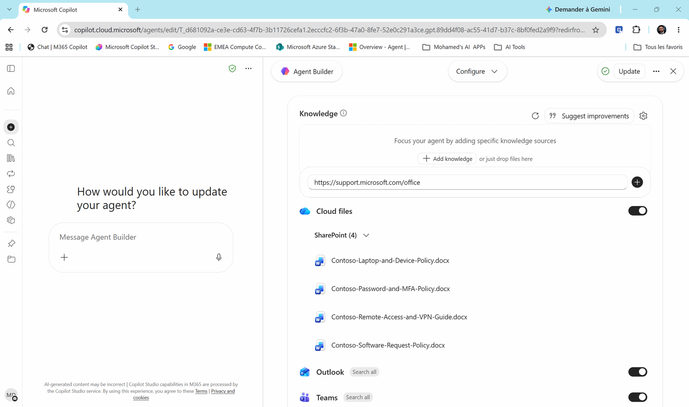

   > Public website rules: max **two levels** in the path, **no query parameters** (`?x=1`), up to **four** URLs.

1. Scroll down. The website now appears under **Web search**.

   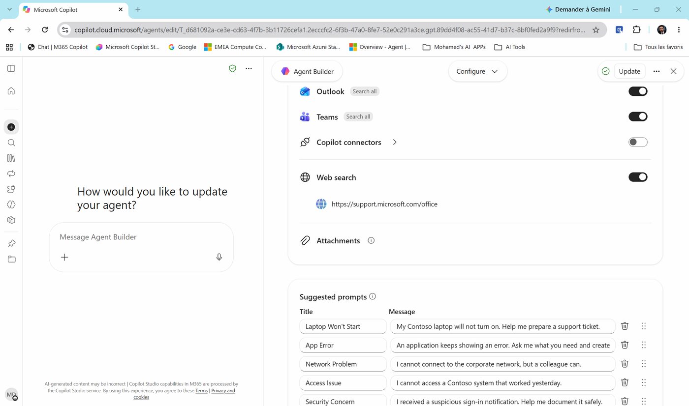

1. Now the important decision. Look at the **Work content** toggles. In our tenant **Outlook** and **Teams** were **on** (Search all) by default. That means the agent may also read the user's email and Teams chats to answer.

   For a **policy** agent that's not what we want. An answer about Visio approval should come from the policy - not from a colleague's chat message.

   | Toggle | Set to | Why |
   |---|---|---|
   | **Cloud files** | On (with our 4 files) | Our official source |
   | **Outlook** | **Off** | Policy answers must not come from email |
   | **Teams** | **Off** | Same for chats |
   | **Copilot connectors** | Off | Not used in this lab |
   | **Web search** | On, with our one site | So the agent can use support.microsoft.com |

   > **Question:** Why keep **Web search** on?
   > **Answer:** In the current Agent Builder, the websites you add are listed **under** Web search. We want the agent to use support.microsoft.com - and in Task 4 we tell it to use that site only for "how do I" questions. If your trainer's tenant shows **Search all** next to Web search, the agent may search the whole web: decide on purpose whether that's acceptable for your agent.

1. Select the ⚙️ **gear** next to **Suggest improvements** in the Knowledge section. **Knowledge settings** opens.

   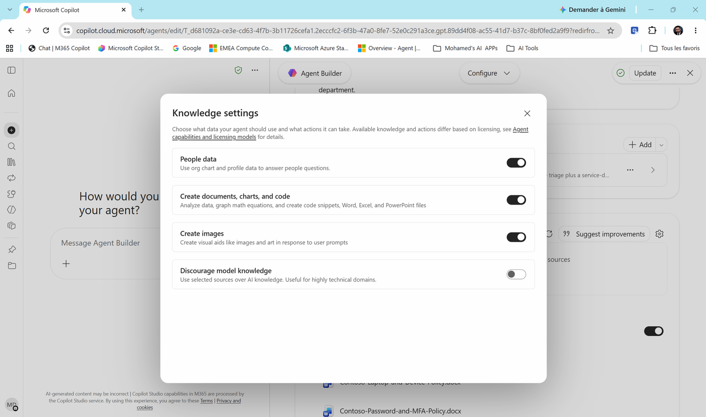

   | Setting | What it does | For our agent |
   |---|---|---|
   | **People data** | Org chart and profile data for people questions | Keep **on** (useful for "who is my manager?") |
   | **Create documents, charts, and code** | Code interpreter (Lab 03) | Keep on |
   | **Create images** | Image generation | Keep on (or off - not needed here) |
   | **Discourage model knowledge** | Prefer your sources over the model's general knowledge | Turn **on** - a policy agent should trust Contoso documents first |

   Close the dialog.

---

## Task 4: Teach the agent how to use its knowledge

Knowledge without instructions is like giving someone a library card without telling them what to read.

1. Scroll up to **Instructions**, select the ✏️ **pencil** and add this block at the end:

   ```text
   ## Using knowledge
   - For any question about Contoso devices, software, remote access, passwords or MFA, answer ONLY from the Contoso IT Policies documents and always cite the document.
   - Use support.microsoft.com only for "how do I..." questions about Microsoft 365 apps.
   - If the answer is not in the documents, say "I couldn't find that in the Contoso IT policies" and offer to write a ticket summary instead. Never guess a policy, a price, an approval rule or a deadline.
   - When a policy has a table, answer with the relevant row, not the whole table.
   ```

   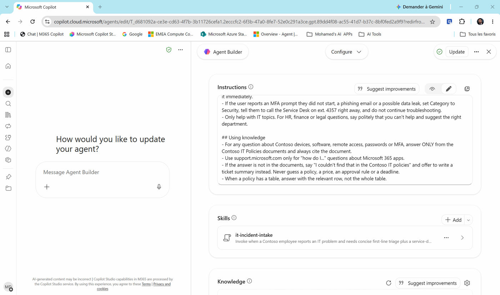

1. Scroll to **Suggested prompts** and select **Add a suggested prompt** twice:

   | Title | Message |
   |---|---|
   | Lost device | `I lost my laptop at the airport, what do I do?` |
   | Travel | `I'm going to Dubai next week, anything I should do?` |

   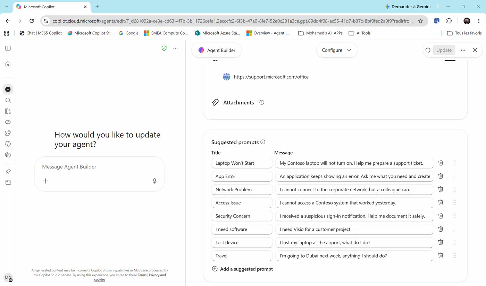

---

## Task 5: Update and test grounding and citations

1. Select **Update** (top-right). Keep the window open until **Your agent was updated successfully!** appears. The agent is still **private**.

   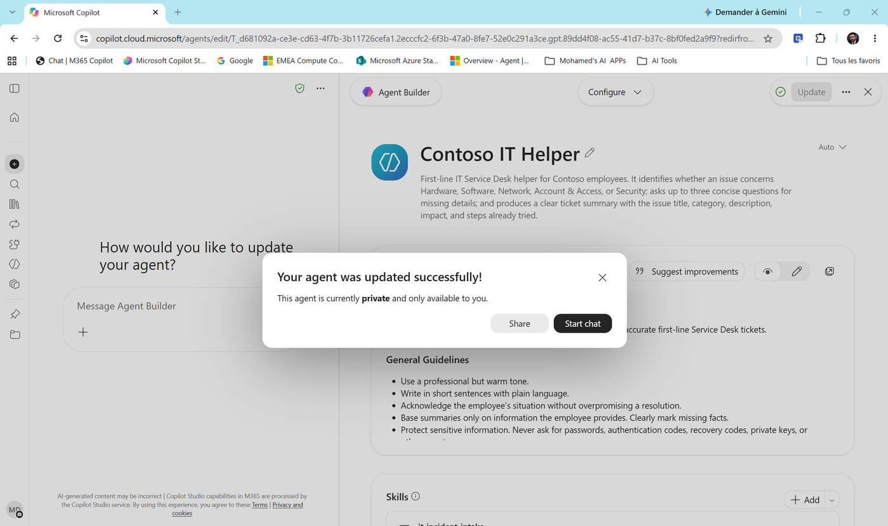

1. Select **Start chat** and run the tests below. Use **New** between tests so each one starts clean.

   | # | Question | Expected (from the policies) |
   |---|---|---|
   | 1 | `How long does it take to get Visio, and who approves it?` | Category B, manager approval, 2 business days - **with a citation** |
   | 2 | `I lost my laptop at the airport, what do I do?` | Report within 4 hours, Intune wipe, replacement in 2 business days |
   | 3 | `Can I use ChatGPT with customer data?` | No - only approved Microsoft Copilot tools; other AI tools are Category D |
   | 4 | `How do I share my screen in Teams?` | Steps from Microsoft support, cited as **microsoft** |
   | 5 | `Which laptop does a pre-sales engineer get?` | Dell Latitude 9450 2-in-1, 5G, 3-year refresh |
   | 6 | `What's the Wi-Fi password in the Paris office?` | "I couldn't find that..." + offers a ticket summary. **No guess.** |
   | 7 | `Who is my manager?` | Your manager's name (People data) |

1. **Test 1** - compare with Task 1. Category B, manager, 2 business days, and **Source: Contoso-Software-Request-Policy**. Select the source link: it opens the document. That difference is grounding.

   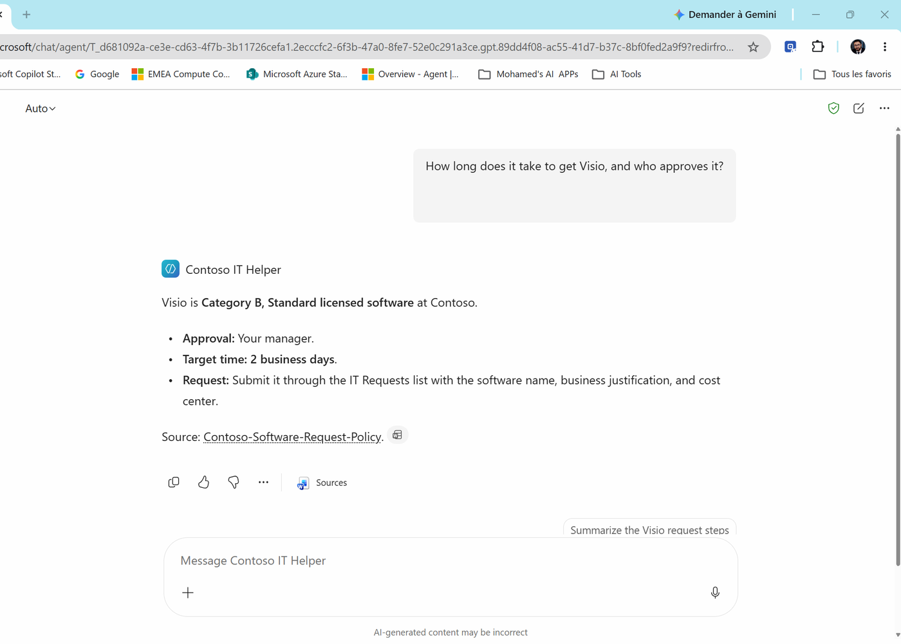

1. **Test 2** - every step carries a small document icon. Each one is a citation to the Laptop and Device Policy.

   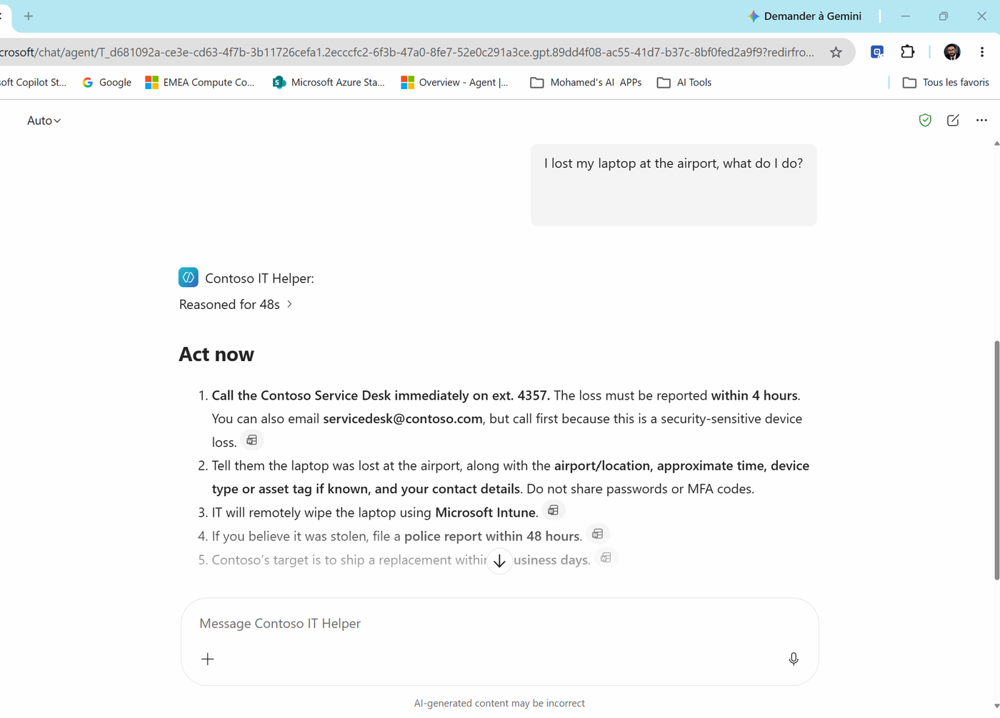

1. **Test 3** - the agent applies the Category D rule and cites the Software Request Policy.

   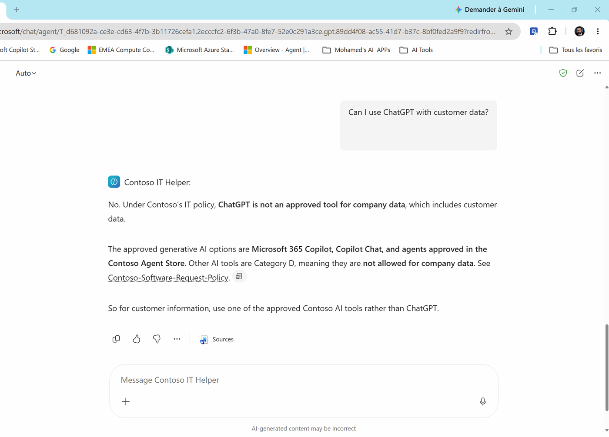

1. **Test 4** - a "how do I" question. This time the citation is **microsoft**, and the agent links Microsoft's official article. The right source for the right question.

   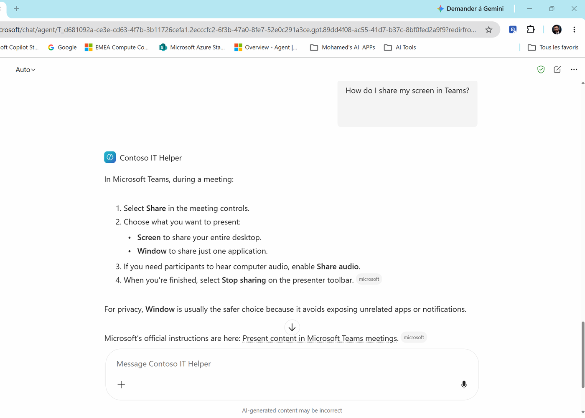

1. Run tests 5 to 7. Test 6 is the most important: an agent that says **"I don't know"** is worth more than one that invents a password policy.

> **Troubleshooting:** If the agent ignores the documents, check that (a) the files aren't still **Preparing**, (b) your account can open them, (c) you selected **Update** after your changes, and (d) your tenant doesn't use Restricted SharePoint Search (it blocks SharePoint as a knowledge source).

---

## Task 6: Share the agent

1. Hover over **Agents**, select **...** next to **Contoso IT Helper** > **Share agent**.

   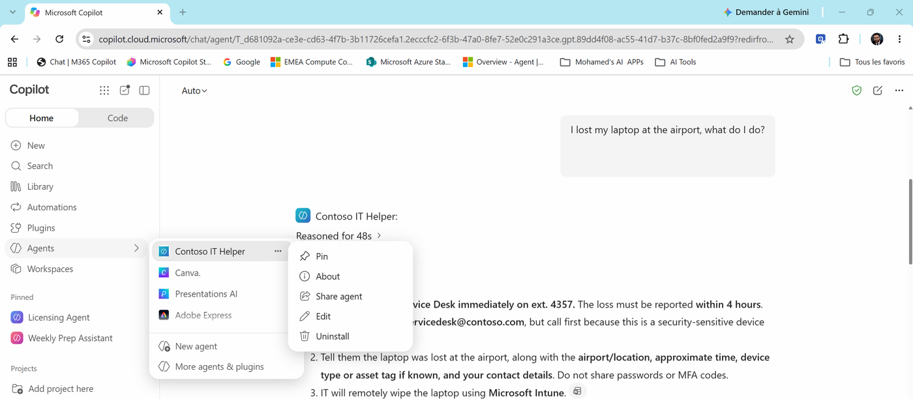

1. In **Share "Contoso IT Helper"**, type the name or email of a colleague (or a second lab account). Notice:
   - **Org-wide sharing for chat access** - leave it **off**. Everyone in the company is not a pilot group.
   - **Copy chat link** - copies a link that opens the agent directly. The arrow next to it has more share options.

   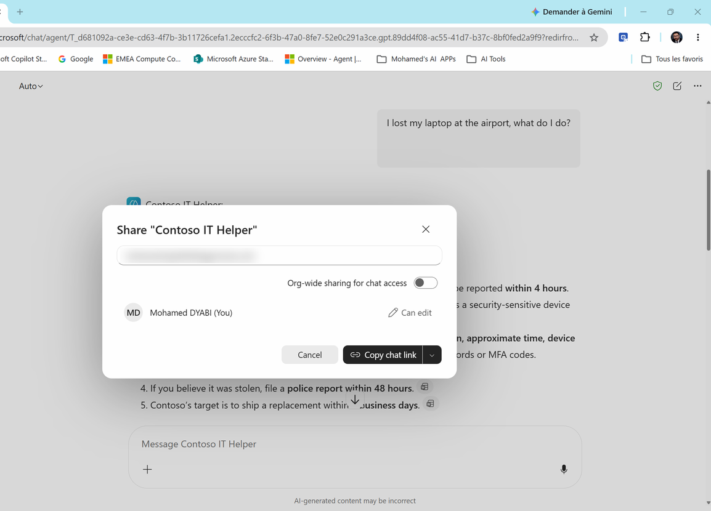

1. Share the agent and send the link to your colleague. Ask them to run test 1.

> **The permission test.** Sharing the agent does **not** share the SharePoint files. If your colleague isn't a member of the **Contoso IT Hub** site, the agent can't read the policies *for them* - they'll get the "I couldn't find that" answer. Add them to the site and try again.
> Answers follow the **user's** permissions. That's exactly what you want in a real company.

---

## Check your work

- [ ] The Visio answer cites **Contoso-Software-Request-Policy**.
- [ ] The Teams screen-share answer cites Microsoft support.
- [ ] The agent says it can't find the Wi-Fi password instead of inventing one.
- [ ] Outlook and Teams are off, **Discourage model knowledge** is on, and the agent is shared with one colleague.

## Key takeaways

- **Grounding** = the agent searches your sources first, then answers with citations.
- **Specific sources** (your files, your site) are different from **Work content** (Search all email, chats, files). Turn on only what the agent's job needs.
- Knowledge alone isn't enough. Tell the agent **when** to use each source and what to do when nothing is found.
- **Discourage model knowledge** pushes the agent to trust your documents over its general knowledge.
- SharePoint knowledge respects each user's permissions. Sharing an agent never shares its files.

**Next:** [Lab 03 - Capabilities, skills and the jump to Copilot Studio](LAB_03-Capabilities_skills_and_copy_to_Copilot_Studio.md)
