---
lab:
    title: 'Lab 03: Capabilities, skills and the jump to Copilot Studio'
    module: 'Module 1 - Agent Builder'
---

# Lab 03 - Capabilities, skills and the jump to Copilot Studio

## Lab introduction

So far our agent can **talk** and **read**. Now we let it **work**.

Agent Builder gives you three ways to add muscle without writing code:

- **Code interpreter** ("Create documents, charts, and code") - the agent writes and runs Python in a sandbox to analyze data, build charts and create Word, Excel and PowerPoint files.
- **Image generator** ("Create images") - the agent creates images from a prompt.
- **Skills** - a packaged, repeatable procedure (a `SKILL.md` file plus optional scripts and resources) that the agent loads every time a matching task comes up.

Then we hit the ceiling. Agent Builder **can't call external systems** - it can't create a SharePoint item, send an email or start an approval. For that we need Copilot Studio. So at the end of this lab we carry the agent across.

## Estimated timing: 40 minutes

## Lab scenario

The Service Desk manager sends a CSV export of Q3 tickets every quarter and asks the same questions: which category is growing, where do we miss the SLA, which site is unhappy? She wants the IT Helper to answer these in seconds, the same way every time. She also wants every incoming request triaged with the same rules - category, priority, team.

## Job skills

- Task 1: Analyze data with code interpreter
- Task 2: Create a skill from a description
- Task 3: Upload a skill package
- Task 4: Hit the ceiling
- Task 5: Copy the agent to Copilot Studio

---

## Task 1: Analyze data with code interpreter

1. Edit **Contoso IT Helper** (Agents > **...** > **Edit**). In the **Knowledge** section, select the ⚙️ **gear**. In **Knowledge settings**, check that **Create documents, charts, and code** is **on**. Close the dialog.

   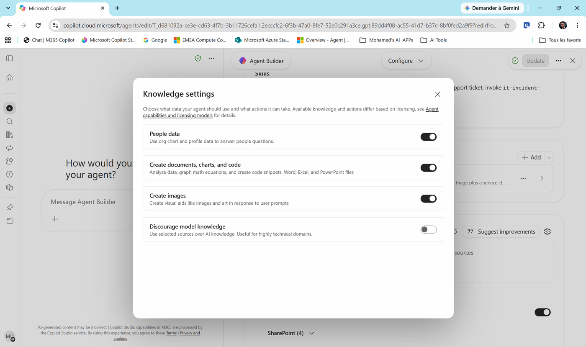

1. Download `Allfiles/Labs/03/Contoso-IT-Tickets-Q3-2026.csv` from this repository. It has 240 tickets with these columns: TicketID, OpenedDate, Site, Category, Priority, ResolutionHours, WithinSLA, SatisfactionScore.

   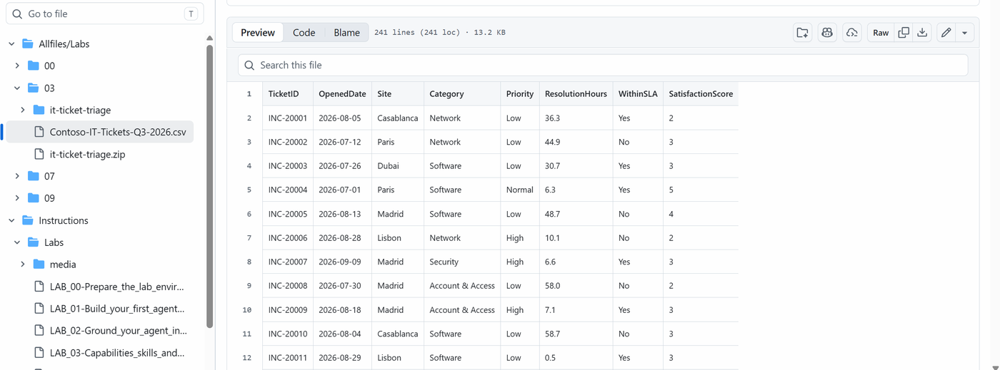

1. Open the **Configure** view menu at the top of Agent Builder. Notice the third option, **Monitor**, next to Configure and Preview - it shows how your agent is used after you share it. For this task, close Agent Builder and open the agent's own chat (**Agents** > **Contoso IT Helper**), so the generated files open full size.

   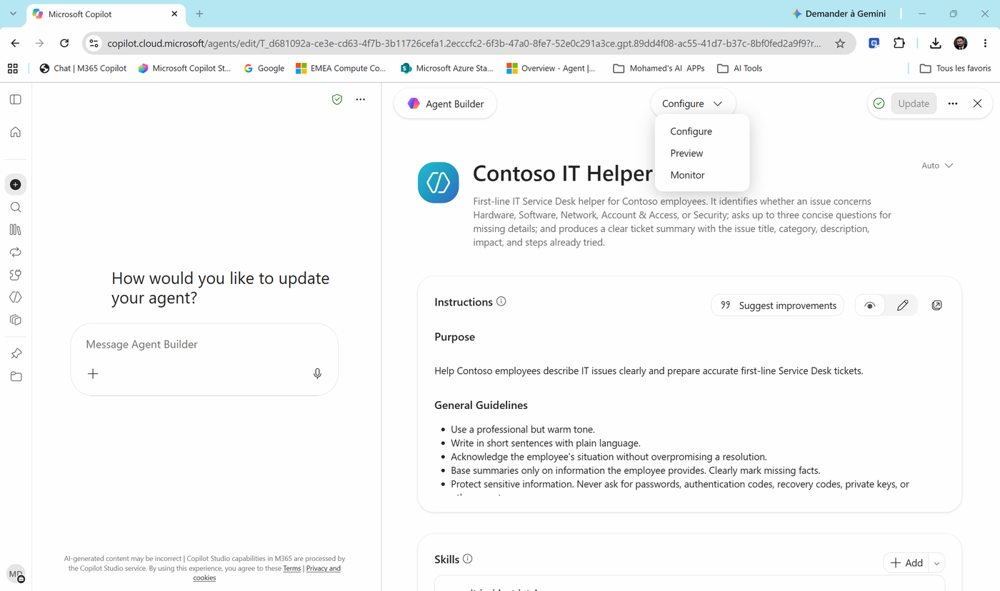

1. Select **+** in the message box and attach the CSV.

   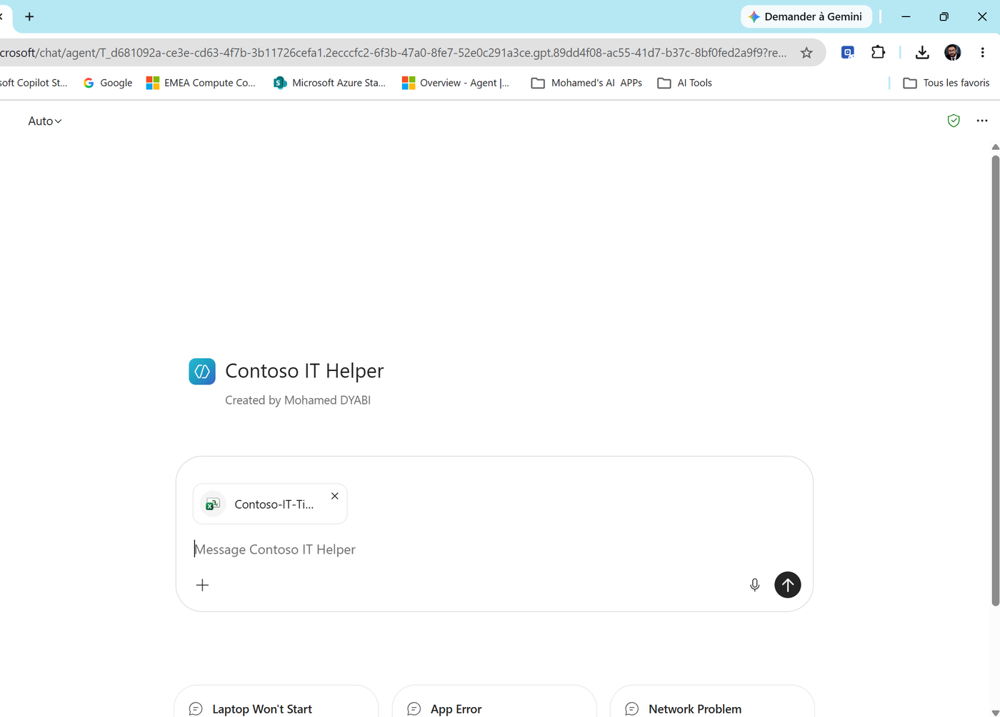

1. Type this prompt and send it:

   ```text
   Using this ticket export, give me:
   1. the number of tickets per category, as a bar chart,
   2. the SLA compliance rate (WithinSLA = Yes) per priority,
   3. the site with the lowest average SatisfactionScore.
   Keep the commentary to five bullet points.
   ```

   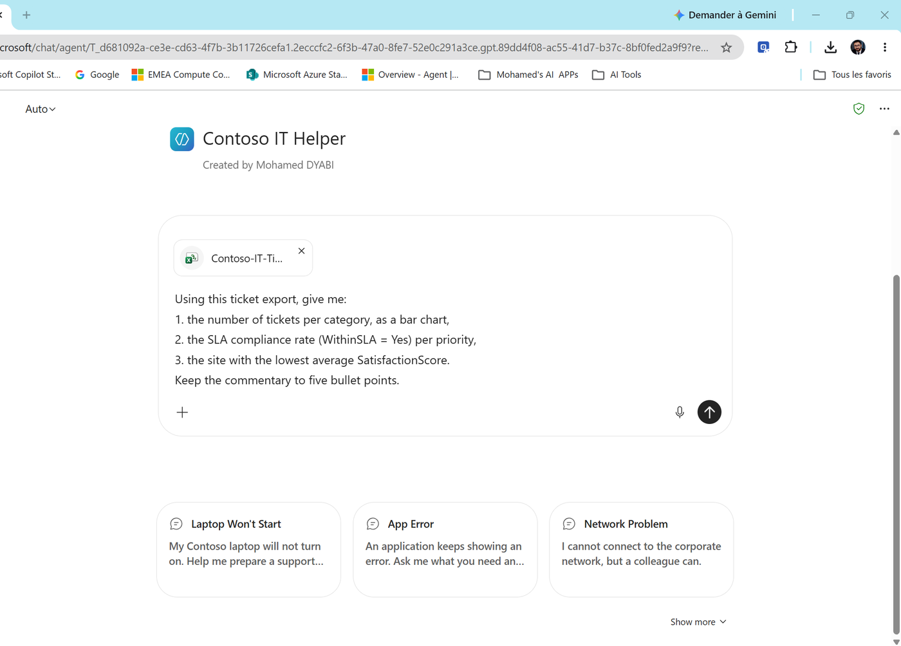

1. Watch the status: **Contoso IT Helper: Coding and executing**. Select the arrow to see the Python code it writes and runs.

   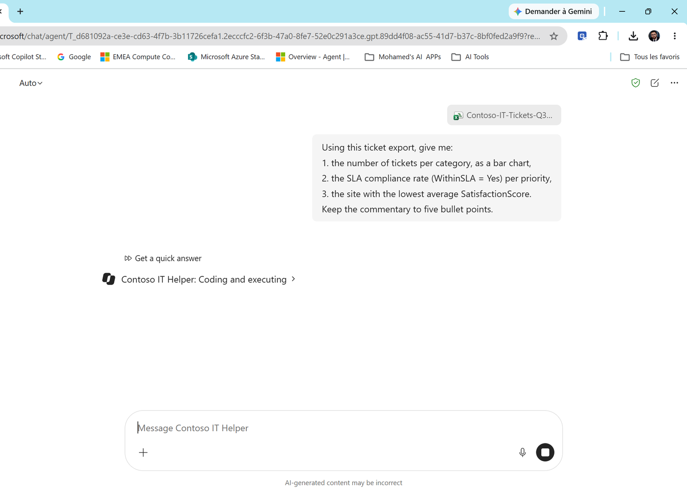

1. Review the result:
   - a **bar chart** of tickets per category (Software 73, Hardware 61, Network 41, Account & Access 40, Security 25),

     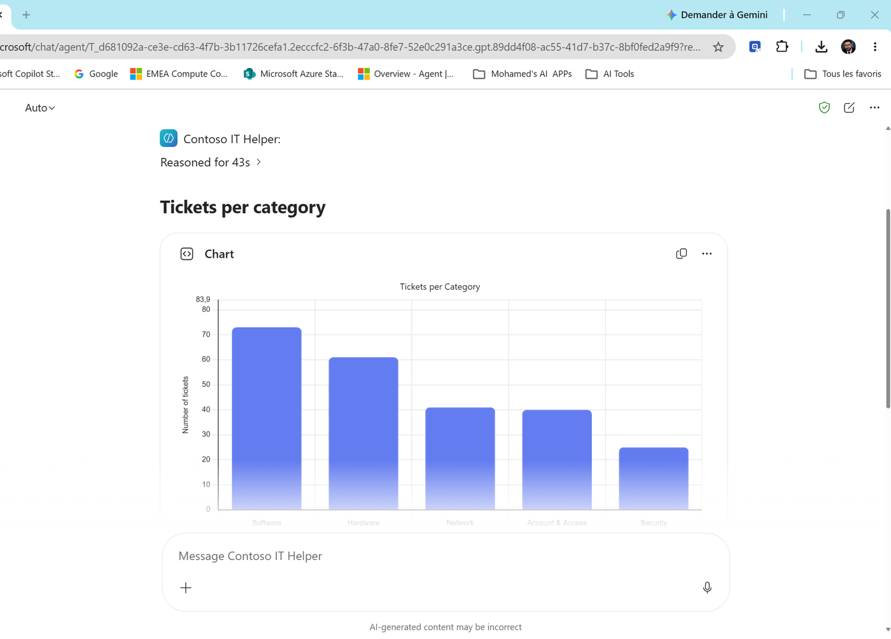

   - an **SLA compliance table** per priority, and five bullets citing the CSV as the data source.

     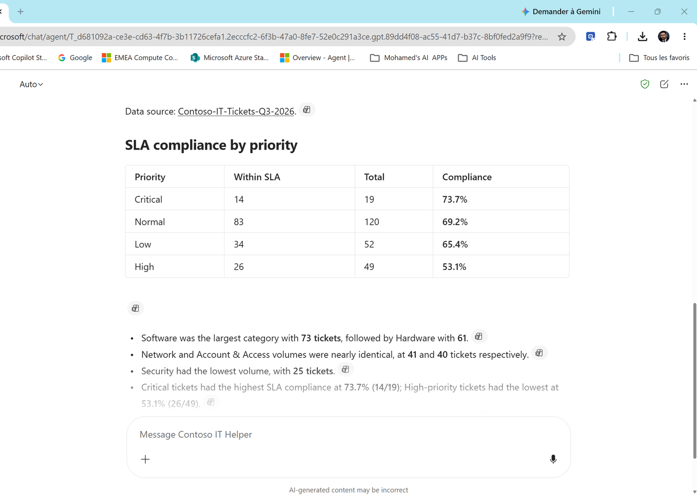

   - the site with the lowest satisfaction: **Madrid, 3.38 out of 5**.

1. Now ask for a file:

   ```text
   Create an Excel file with one sheet per category and a summary sheet
   ```

   The workbook opens next to the chat: a **Summary** sheet with the three tables and a chart, plus one sheet per category.

   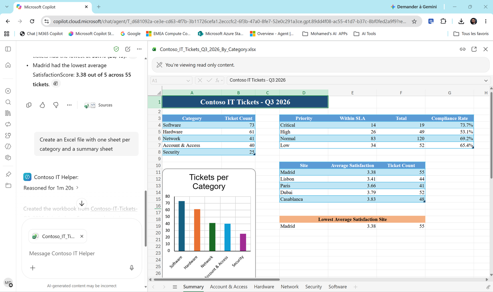

> **Question:** Why use code interpreter instead of just asking the model to "count"?
> **Answer:** Language models are bad at arithmetic over 240 rows. Code is exact. When numbers matter, make the agent **compute**, not **guess**.

---

## Task 2: Create a skill from a description

Every quarter the manager asks for the same report. Typing the same five-line prompt each time is the definition of a skill.

1. Edit the agent again. In the **Agent Builder chat** (left pane), paste:

   ```text
   Add a reusable skill called "quarterly-sla-report".
   When the user uploads a Contoso ticket export (CSV with TicketID, OpenedDate, Site,
   Category, Priority, ResolutionHours, WithinSLA, SatisfactionScore), always:
   1. compute tickets per category and per site,
   2. compute SLA compliance per priority and flag any priority below 85%,
   3. find the 3 slowest categories by median ResolutionHours,
   4. produce a one-page Word report with a title, a 5-bullet executive summary,
      the tables and one bar chart.
   Package it with clear instructions and the analysis script so the result looks the same every time.
   ```

1. Scroll to **Skills**. You should see **quarterly-sla-report**. In our run, Agent Builder **also** created a second skill, **ticket-export-analysis**, for the ad-hoc analysis you did in Task 1 - and added lines to the instructions saying when to invoke each one.

   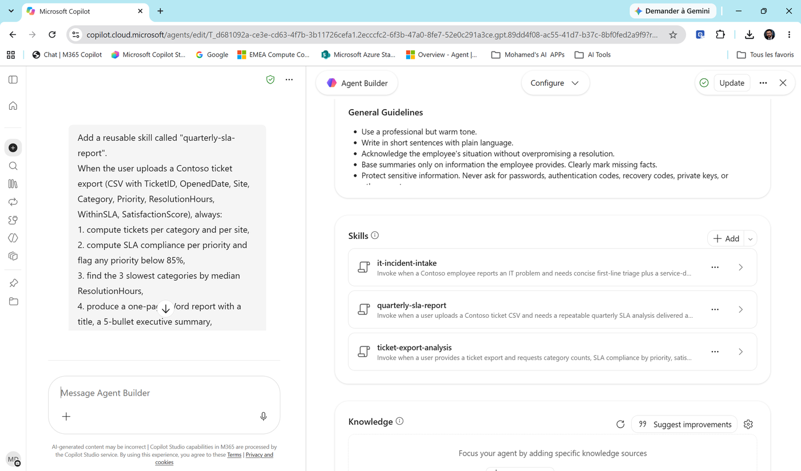

   > Agent Builder may create extra skills on its own. That's fine - but **read** each one (select the **>** arrow) and delete what you don't want. You own the agent, not the generator. A skill limit applies: **eight skills** per agent.

1. Select **Update**.

1. Open the agent chat, attach the CSV again and type only:

   ```text
   Quarterly report please
   ```

   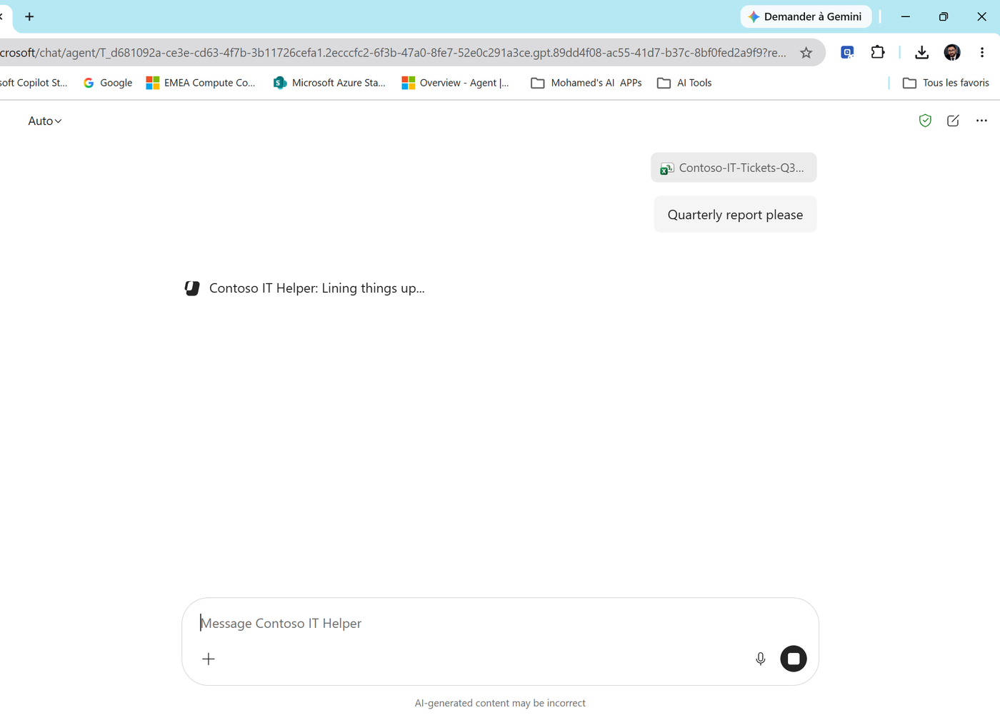

1. The agent builds **Contoso-Q3-2026-Quarterly-SLA-Report.docx**: title, 5-bullet executive summary, tickets by category and by site, SLA compliance by priority with a **Flag** column.

   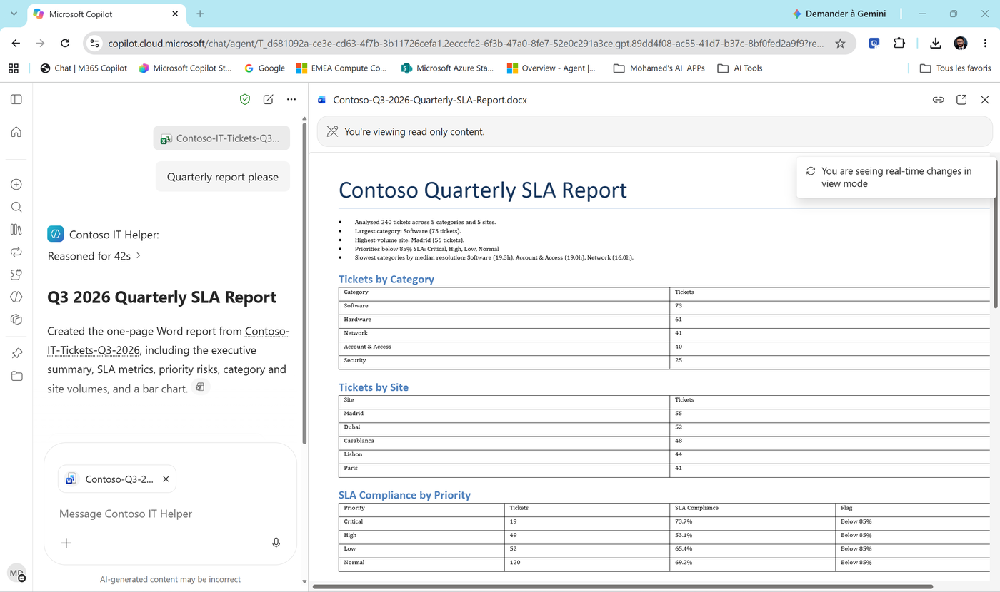

1. Run it a second time in a **new** chat. Same structure? That's the point of a skill.

> **Look at the Flag column.** With our sample data, every priority is below the 85% target, so every row says "Below 85%". Correct - but is that useful? Discuss: should the skill also show *how far* below target each priority is? Edit the skill (Agent Builder chat: *"In quarterly-sla-report, add the gap to 85% for each priority"*) and run it again.

---

## Task 3: Upload a skill package

Skills are **portable**. The same package works in Agent Builder, in Copilot Studio (Lab 07), and in other tools that support the open Agent Skills format. Let's prove it.

1. Open `Allfiles/Labs/03/it-ticket-triage/SKILL.md` in any text editor and read it. Notice the structure:
   - a **YAML front matter** with `name` and `description` (the description tells the agent *when* to use the skill),
   - the **rules** (category signals, priority rules, team mapping),
   - a strict **output format** (Category / Priority / AssignedTeam / Reason).

1. In Agent Builder, scroll to **Skills** and select **+ Add**. The **Upload skill** dialog accepts **a `SKILL.md` file or a `.zip` package that includes a `SKILL.md`**. Upload `it-ticket-triage/SKILL.md` (or `it-ticket-triage.zip`) and select **Upload**.

   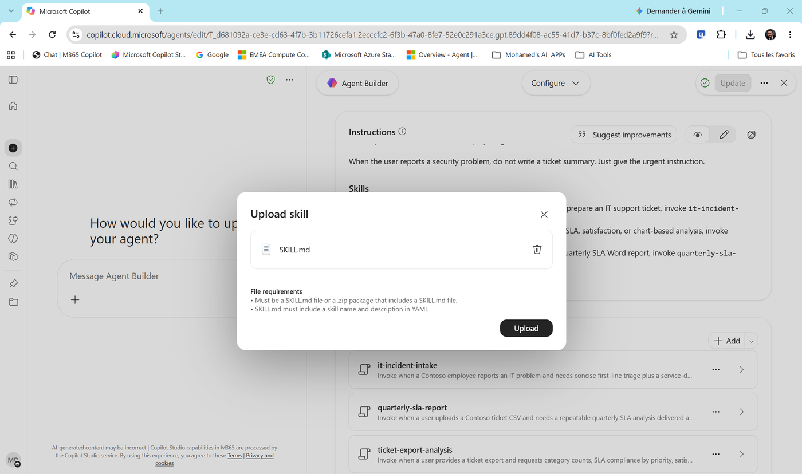

   > Use the **.zip** when the skill has extra files (scripts, templates). A lone `SKILL.md` is enough for an instructions-only skill like this one.

1. Keep the window open while the skill uploads.

   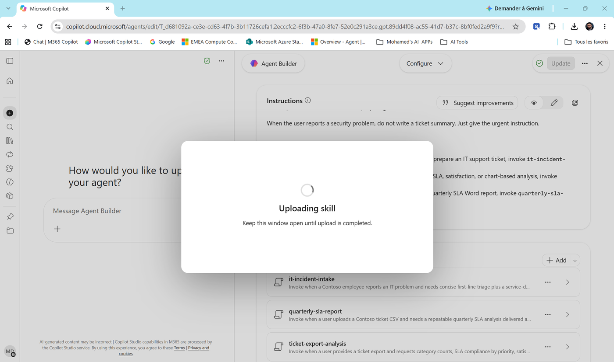

1. Switch to **Preview**, select **New chat**, and test:

   | Message | Expected |
   |---|---|
   | `Triage this: "I clicked a link in an email and now my browser opens strange pages"` | Security issue - the urgent instruction (call ext. 4357), no ticket |
   | `Triage this: "Need Power BI Pro for the sales dashboard, no rush"` | Software, Low, Apps |
   | `Triage this: "Left my laptop in a taxi in Madrid 20 minutes ago"` | Urgent - report within 4 hours, Intune wipe |

1. **Test 1** - notice that the **Boundaries** you wrote in Lab 01 win over the skill: for a security problem the agent gives the urgent instruction and stops, instead of producing a triage block.

   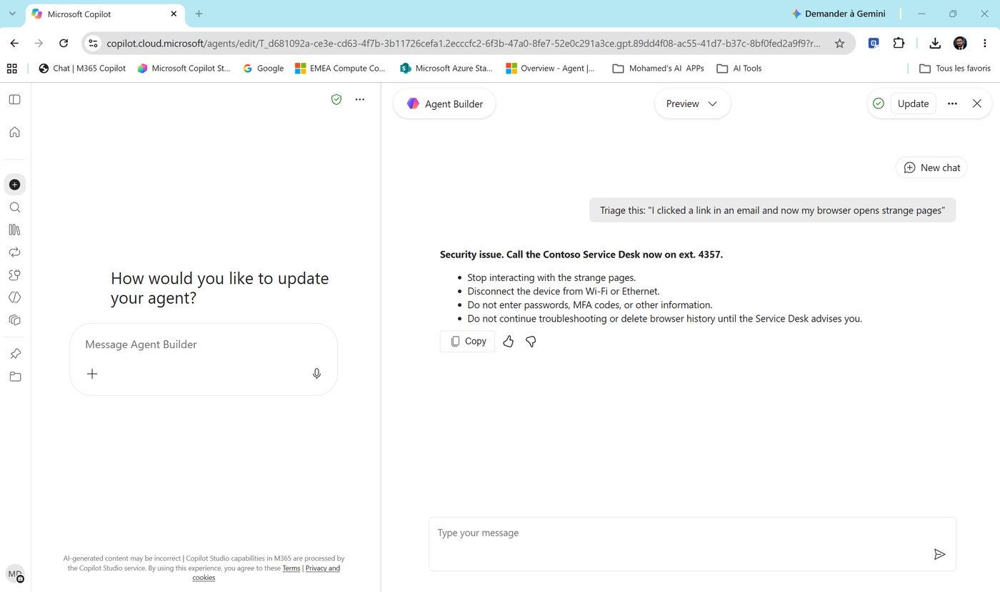

1. **Test 2** - the exact output format from the skill.

   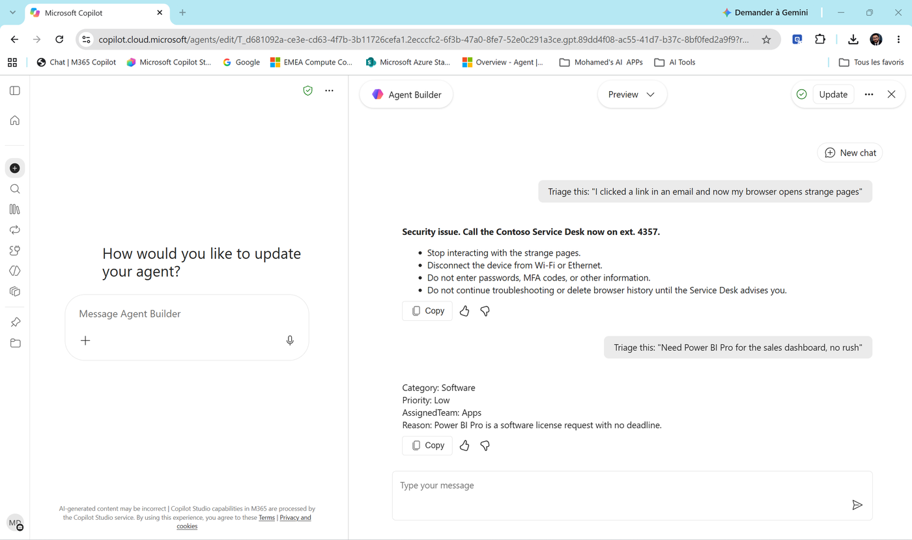

1. **Test 3** - the agent treats the lost laptop as urgent and cites the Laptop and Device Policy.

   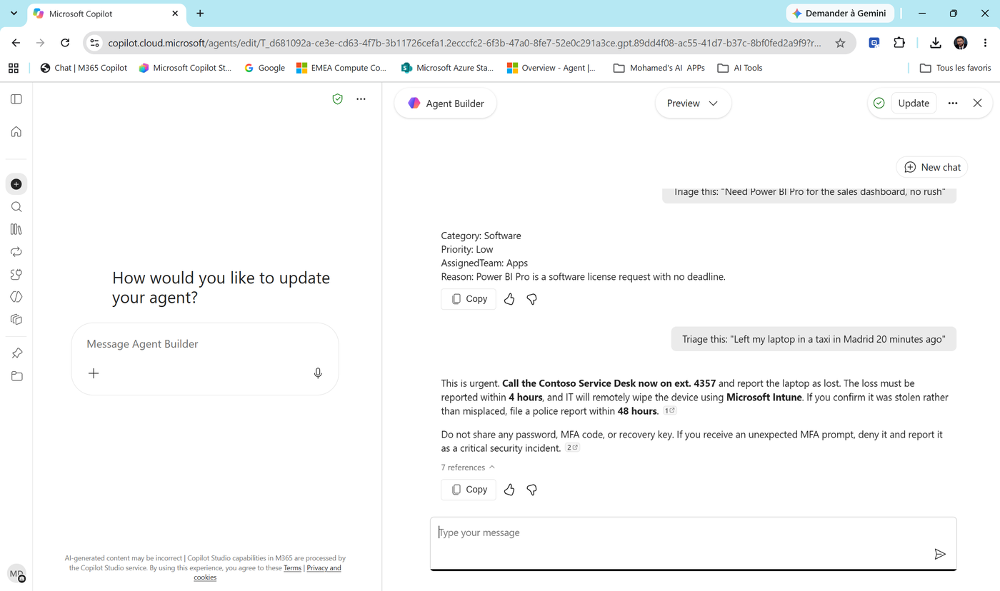

1. Select **Update** to save the agent.

---

## Task 4: Hit the ceiling

1. In the same Preview chat, type:

   ```text
   Please create the ticket in the IT Requests list for me
   ```

1. Read the answer: *"I couldn't create the item because no tool is available to write to the IT Requests list."* The agent writes the ticket content for you to copy - and still tells you to call the Service Desk now.

   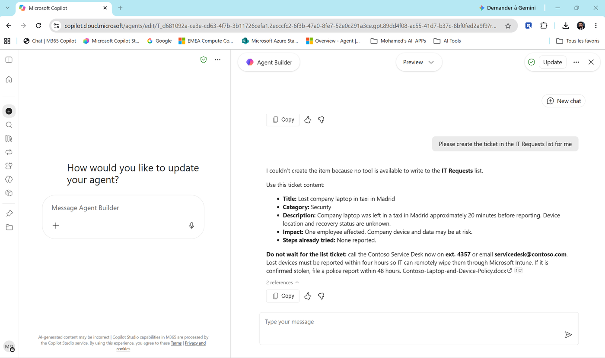

   That's the ceiling. Agent Builder doesn't author actions that call external services.

> **🔍 Spot the mistake.** Look at the ticket in the screenshot: **Category: Security**. Our triage skill says a lost or stolen device is **Hardware, High** - Security is for phishing, suspicious sign-ins and data leaks. Two instructions pulled in different directions (the lost-device urgency vs. the triage rules).
> **Fix it:** in the Agent Builder chat, type *"A lost or stolen device is always Category Hardware, Priority High. Security is only for phishing, suspicious sign-ins, malware or data leaks."* Select **Update**, then re-run test 3 and this test.
> This is exactly why we test: two good rules can still conflict.

---

## Task 5: Copy the agent to Copilot Studio

Time to move up.

1. In Agent Builder, open **...** (top-right, next to **Update**). Look at the options:

   | Option | What it does |
   |---|---|
   | **Share** | Share with colleagues (Lab 02) |
   | **Agent details** | Name, icon, description |
   | **Submit to org catalog** | Ask the admin to publish the agent for the whole organization |
   | **Download .zip file** | Export the agent package |
   | **Copy to Copilot Studio** | Our next step |

   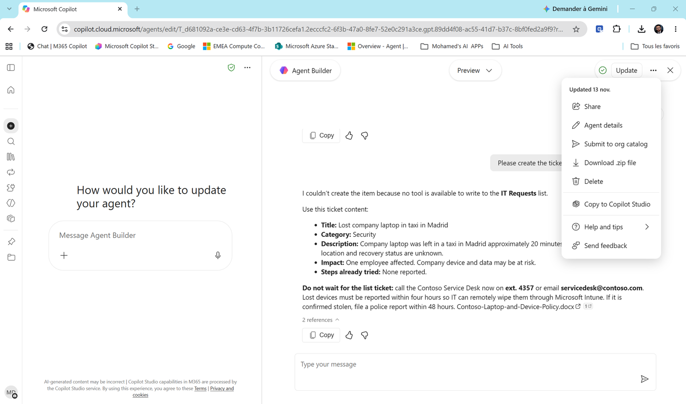

1. Select **Copy to Copilot Studio**. Read the dialog **Copy to full version of Copilot Studio?**:
   - **Comes over:** name, icon, description, instructions, suggested prompts, enterprise knowledge, SharePoint and website sources.
   - **Not included:** uploaded files, Teams and Outlook knowledge sources, sharing settings, image generation, and actions.

   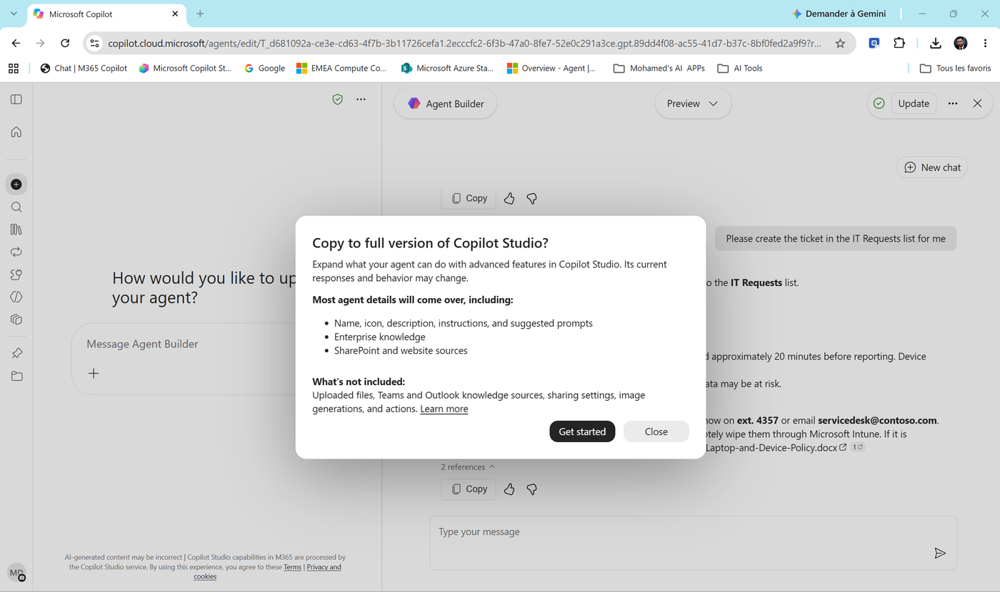

   > **Notice what's not listed:** skills. Plan to re-add your skills in Copilot Studio (we do it in Lab 07).

1. Select **Get started**. In **Choose an environment**, pick the environment you wrote down in Lab 00 (here **MTS Team (default)**) and select **Continue**.

   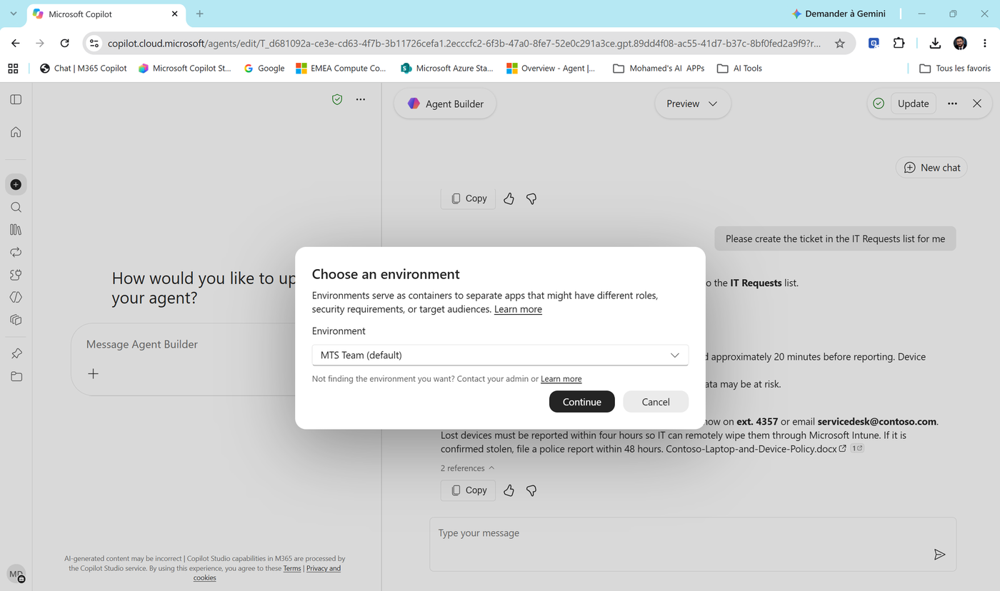

   > The list shows every environment you can build in - your personal developer environment may appear too. Pick the one with Dataverse that your trainer chose for the course.

1. Copilot Studio opens in a new tab on **Start building your agent**, with **Contoso IT Helper (copy)**: details, description, instructions and suggested prompts are already filled in. Notice the message *Knowledge is being prepared*. Select **Create**.

   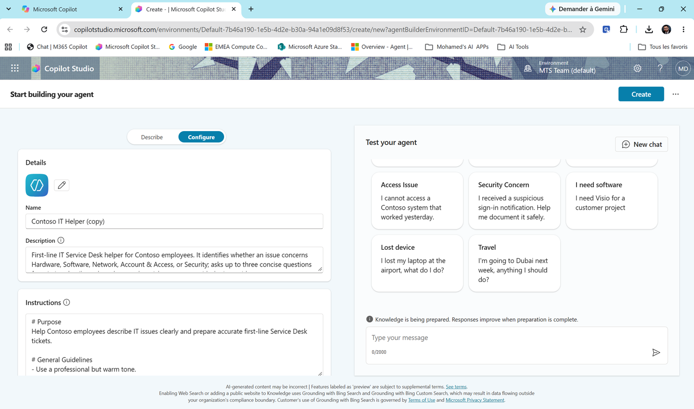

1. The agent opens on its **Overview** page with status **Setting up...**. Wait until setup finishes before testing.

   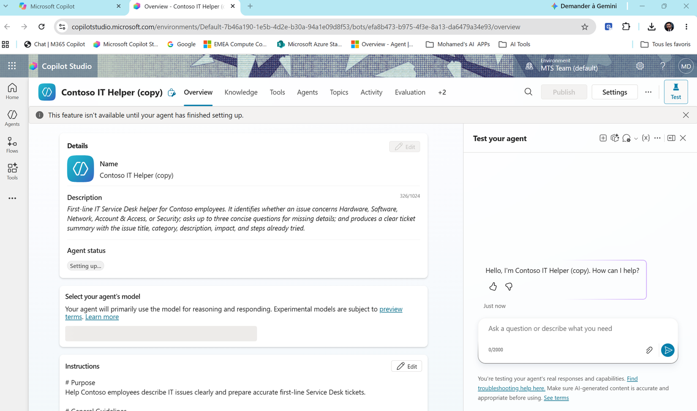

1. Look at the tabs across the top: **Overview, Knowledge, Tools, Agents, Topics, Activity, Evaluation...** This is the **classic Copilot Studio designer** - the **standard harness**, with topics. In Lab 04 you create a new agent from the **Agent** tile on the Home page, which runs on the **GitHub Copilot harness** with a single **Build** tab. Compare the two experiences.

> **Important:** a copy is a **snapshot**, not a sync. Changes you make to the Agent Builder version later won't reach the Copilot Studio version, and the other way round. Your original agent keeps working in Microsoft 365 Copilot.

We keep this copy as a reference. In Lab 04 we build the "real" Service Desk agent in Copilot Studio from scratch, so you understand every piece.

---

## Check your work

- [ ] The agent produced a bar chart and an Excel workbook from the CSV.
- [ ] **quarterly-sla-report** produced a Word report, and **it-ticket-triage** returns Category / Priority / AssignedTeam / Reason.
- [ ] A lost device is triaged as Hardware, not Security.
- [ ] **Contoso IT Helper (copy)** exists in Copilot Studio.

## Key takeaways

- **Code interpreter** makes the agent compute instead of guess - and create real Excel and Word files.
- A **skill** = a repeatable procedure the agent loads only when the task matches its description. Agent Builder may generate skills for you: review them.
- Skills upload as a `SKILL.md` or a `.zip` - and travel between tools.
- Instructions and skills can conflict. Test, spot it, fix it.
- Agent Builder stops at **actions**. **Copy to Copilot Studio** brings the agent to the classic (standard harness) designer; uploaded files, Outlook/Teams knowledge, images and skills need to be re-done.

**Next:** [Lab 04 - Your first Copilot Studio agent](LAB_04-Your_first_Copilot_Studio_agent.md)
