---
lab:
    title: 'Lab 05: Give your agent hands - connectors and MCP tools'
    module: 'Module 3 - Agents that act'
---

# Lab 05 - Give your agent hands: connectors and MCP tools

## Lab introduction

Until now our agents **talk**. From this lab they **do**.

A **tool** is something the agent can call to perform an action or fetch live data. In Copilot Studio you have three families:

| Tool type | Best for | Example in this lab |
|---|---|---|
| **Connectors** | Well-known services with a ready-made Power Platform connector | SharePoint *Create item* / *Get items*, Outlook *Send an email* |
| **MCP servers** | Any service that speaks Model Context Protocol - custom or internal | Microsoft Learn MCP server |
| **Workflows** | Multi-step, deterministic processes | Lab 06 |

Here's the key idea: **you don't wire the tools together**. You give each tool a clear **name** and **description**, and the runtime decides *when* to call it, *with which inputs*, and *in what order*. Good descriptions = good decisions.

## Estimated timing: 60 minutes

## Lab scenario

Employees keep asking the Service Desk agent to "just open the ticket for me". The manager agrees, with rules: the agent creates the item in the **IT Requests** list only after the user confirms, sends the user a confirmation email, and can look up the status of existing requests. Engineers also want technical "how do I..." answers from **official Microsoft documentation**.

## Job skills

- Task 1: Add the SharePoint "Create item" tool
- Task 2: Add the SharePoint "Get items" tool
- Task 3: Add the Outlook "Send an email" tool
- Task 4: Update the instructions to orchestrate the tools
- Task 5: Add the Microsoft Learn MCP server
- Task 6: Test end to end and debug with the trace

---

## How tools work in this designer

Remember this pattern - you'll use it for every tool:

1. **Tools +** > pick the tool > **Add**. (No settings yet.)
2. The tool appears as a **chip** under **Tools**.
3. **Select the chip** to open **Tool details** - that's where you rename it, describe it and set its inputs.

In **Tool details**, every input has two modes:

| Mode | Meaning | Use it for |
|---|---|---|
| **Fill with AI** | The agent decides the value from the conversation | Title, description, email recipient... |
| **Custom** | A fixed value you set | The SharePoint site, the list name - things the model must **never** choose |

---

## Task 1: Add the SharePoint "Create item" tool

1. Open **Contoso Service Desk** > **Build** tab. On the right, next to **Tools**, select **+**.

   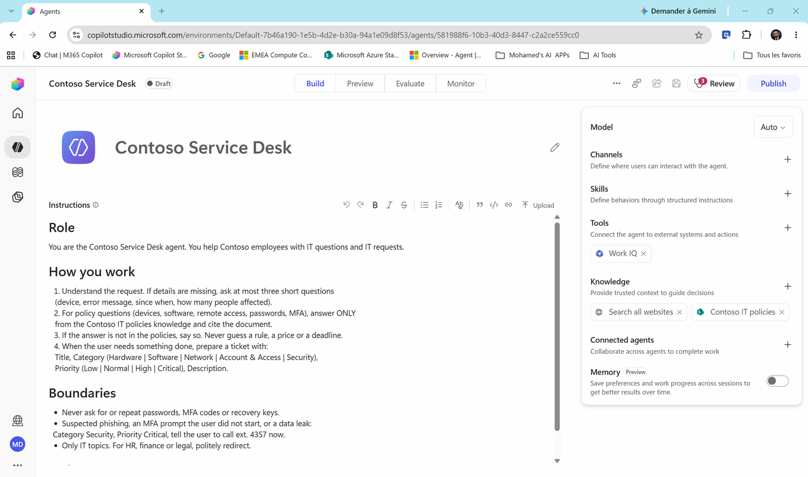

1. The **Add a tool** dialog has four tabs: **Featured, MCP, Connectors, Workflows**.

   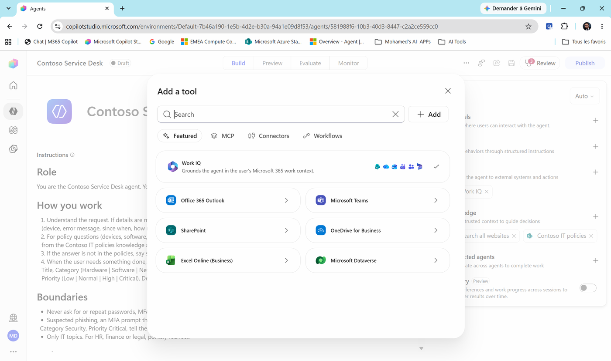

1. Search `create item` and select **SharePoint - Create item**.

   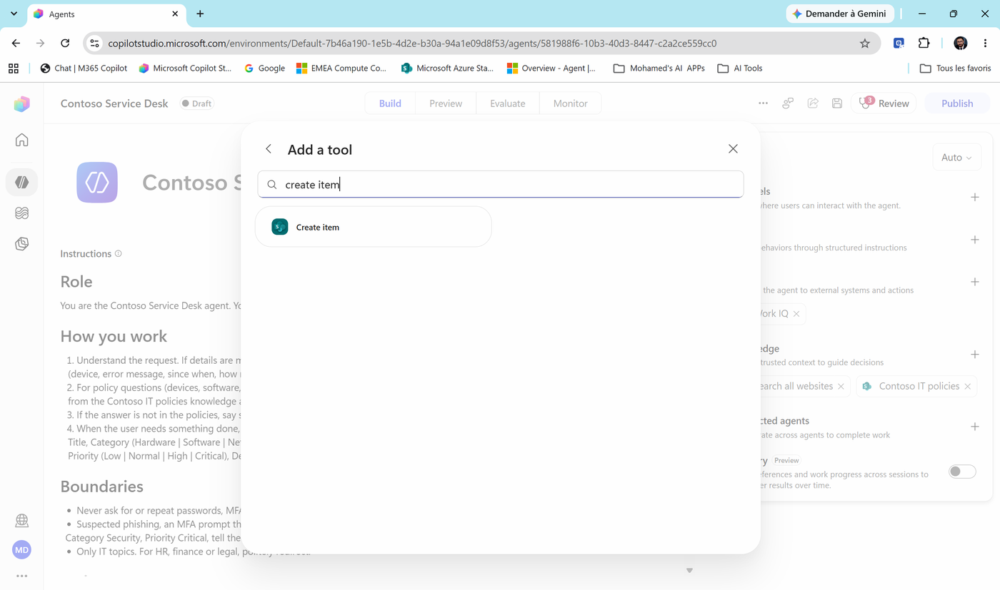

1. Review the details (connector, connection) and select **Add**. If prompted, sign in to create the connection.

   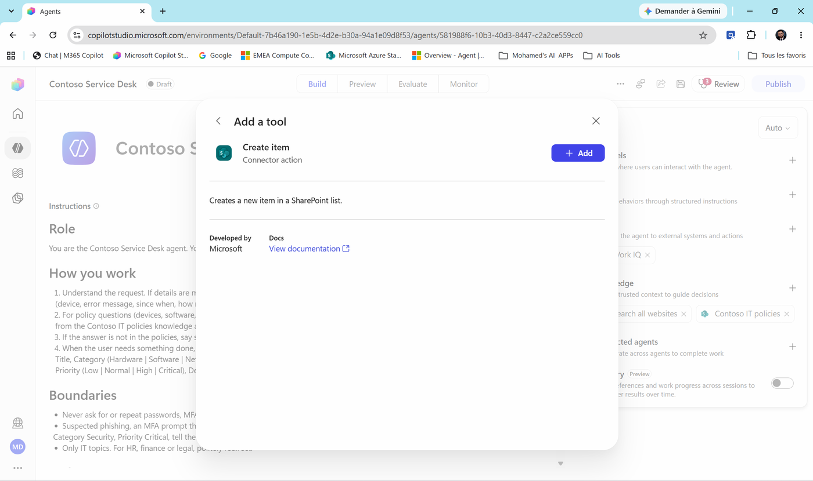

1. Close the dialog. Under **Tools**, select the new **Create item** chip. **Tool details** opens.

   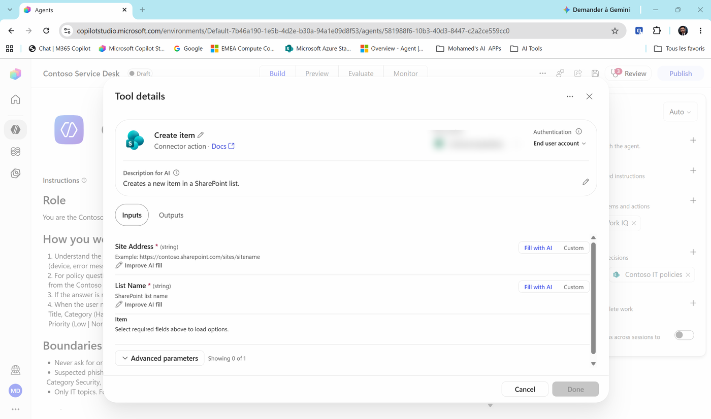

   Look at the top card:
   - **Connection** - the account used to create the connection.
   - **Authentication: End user account** - the tool runs **as the person chatting**. The item is created by them, with their permissions. Keep it.

1. Rename the tool: select the ✏️ next to **Create item** and type `Create IT request`.

1. Select the ✏️ next to **Description for AI** and paste:

   ```text
   Creates a new IT request in the Contoso IT Requests list. Use it only after the user has confirmed the ticket summary. Inputs: Title, Description, Category, Priority.
   ```

1. In **Inputs**, fix where the item goes:

   | Input | Mode | Value |
   |---|---|---|
   | **Site Address** | **Custom** | Contoso IT Hub - `https://<your-tenant>.sharepoint.com/sites/ContosoITHub` |
   | **List Name** | **Custom** | `IT Requests` (pick it from the list) |

   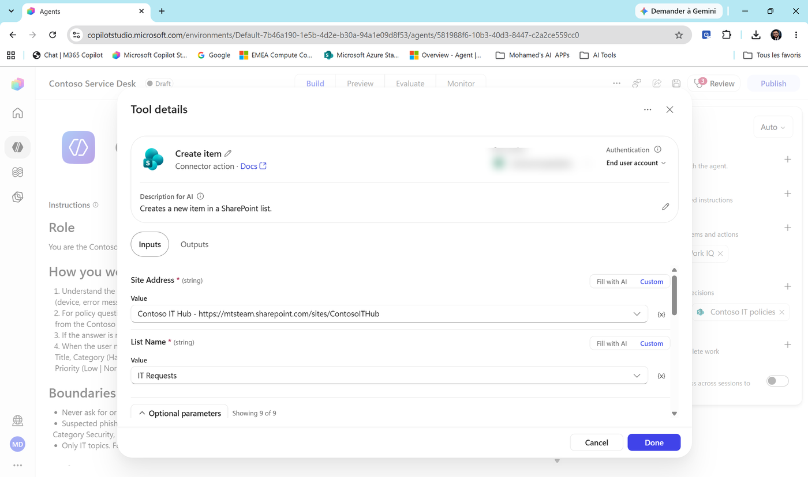

1. Once the site and list are set, **Item** loads your list columns. Leave **Title, Description, Category, Priority** on **Fill with AI**. Optionally use **Improve AI fill** on Category: `One of: Hardware, Software, Network, Account & Access, Security`. Leave AssignedTeam and TriageNotes empty - an agent fills them in Lab 08.

   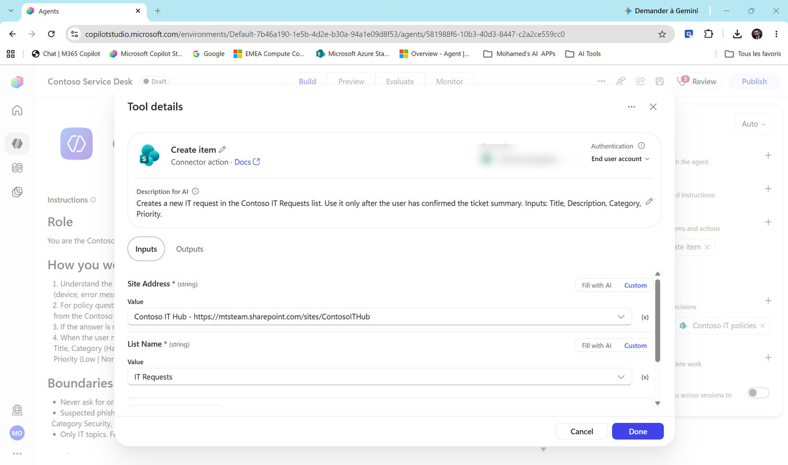

1. Select **Done**.

> **Why Custom for the site and list?** Because you never want the model to "choose" which SharePoint site to write to. **Fix what must not change, let the agent fill only what it must.** This is your first guardrail.

---

## Task 2: Add the SharePoint "Get items" tool

1. **Tools +** > search `get items` > **SharePoint - Get items** > **Add**.

   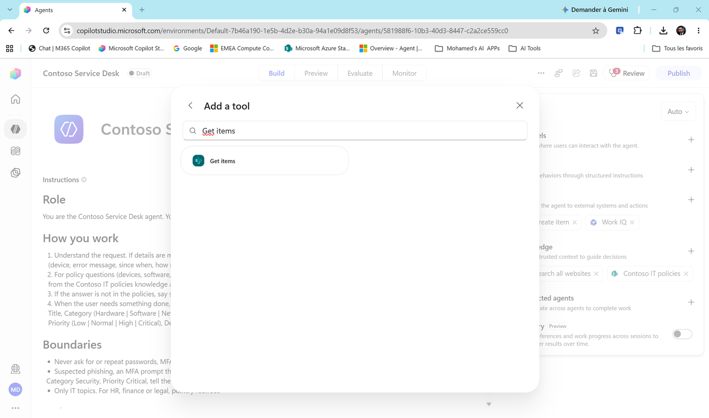

1. Select the **Get items** chip and configure:

   | Setting | Value |
   |---|---|
   | Name (✏️) | `Find my IT requests` |
   | Description for AI (✏️) | `Returns existing IT requests from the Contoso IT Requests list. Use it when the user asks about the status of their requests. Return Title, Status, Priority and AssignedTeam only.` |
   | Site Address | **Custom** - Contoso IT Hub |
   | List Name | **Custom** - **IT Requests** |
   | Top Count (Advanced parameters) | **Custom** - `10` |

   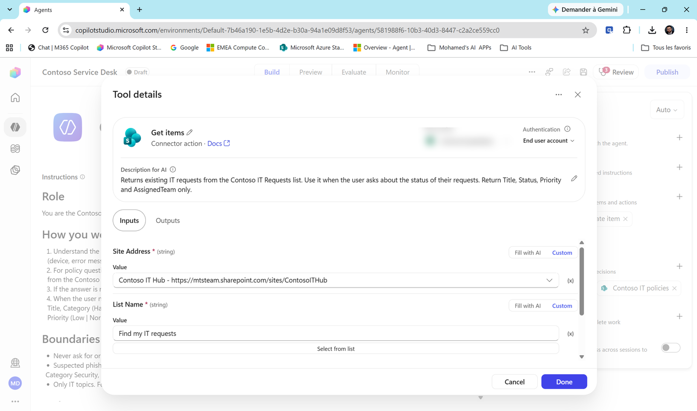

   > ⚠️ **Classic mistake:** typing the tool's name into **List Name**. "Find my IT requests" is the tool, **IT Requests** is the list. Use the **dropdown** to pick the list. You'll see what happens if you don't in Task 6.

1. Select **Done**.

---

## Task 3: Add the Outlook "Send an email" tool

1. **Tools +** > search `send an email` > **Office 365 Outlook - Send an email (V2)** > **Add**.

   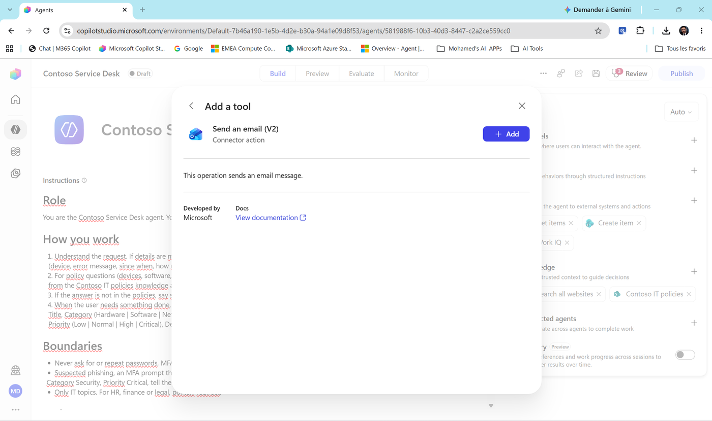

1. Select the chip and configure the top card:
   - Name (✏️): `Send request confirmation`
   - Description for AI (✏️): `Sends the user a confirmation email after an IT request was created. Only send to the user who is chatting. Never send to external addresses.`

   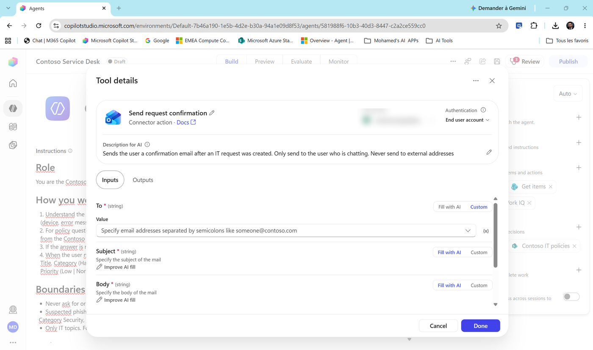

1. In **Inputs**, set **To** to **Fill with AI**, select **Improve AI fill**, type `Email address of the signed-in user. Never an external address.` and select **Apply**.

   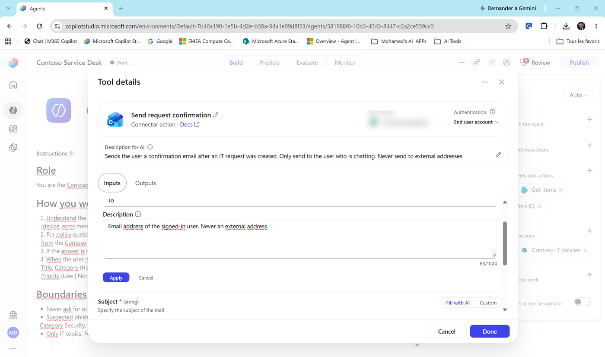

1. Leave **Subject** and **Body** on **Fill with AI**. Select **Done**.

   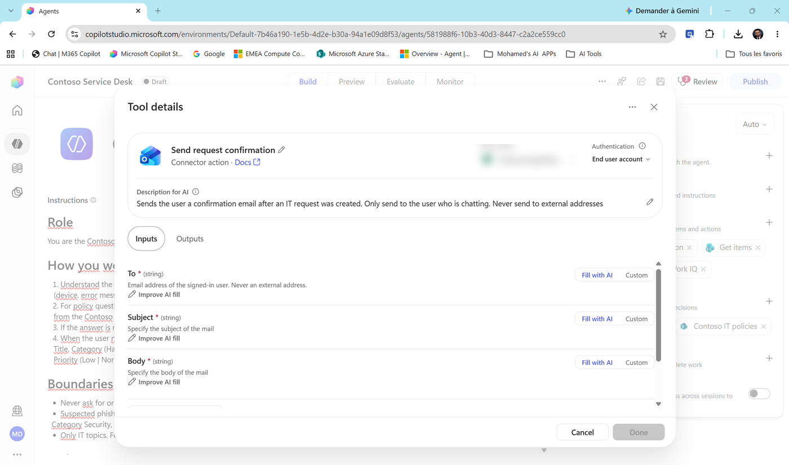

> **Why Fill with AI for "To" and not Custom?** With Custom, every confirmation would go to one fixed address. We want it to go to **whoever is chatting** - so the agent fills it each time, guided by your hint.

1. **Save** the agent. Your Tools section now shows three renamed tools plus Work IQ.

   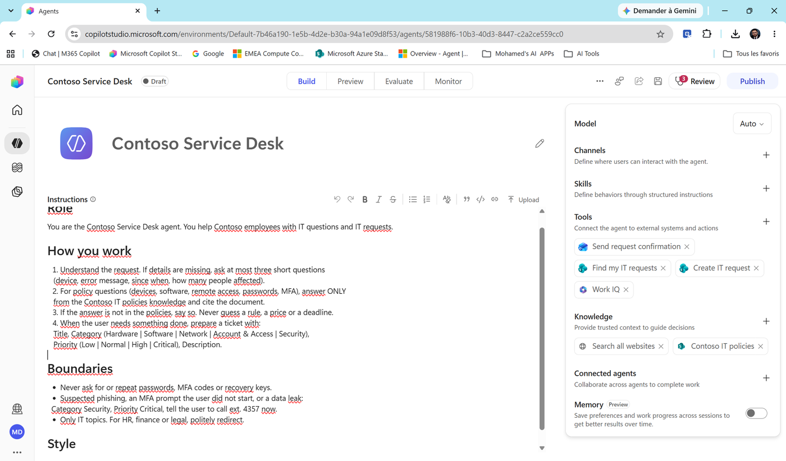

---

## Task 4: Update the instructions to orchestrate the tools

1. In **Instructions**, place your cursor after the **How you work** section and add a **Tools** section:

   ```text
   # Tools
   - Before calling "Create IT request", show the user the ticket summary (Title, Category, Priority, Description) and ask "Shall I create this request?". Only call the tool after a clear yes.
   - After the request is created, call "Send request confirmation" to the user with the title and the item ID, then tell the user the ID.
   - When the user asks "what's the status of my requests", call "Find my IT requests" and show a short table: Title | Status | Priority.
   - For technical "how do I configure..." questions about Microsoft 365, Intune, Entra or Windows, use the Microsoft Learn tools and include the article link. Contoso policies always win over generic Microsoft guidance.
   ```

   > Pasted as plain text, `# Tools` shows a literal **#**. Select the line and apply a heading style so it matches **Role**, **How you work** and **Boundaries**.

   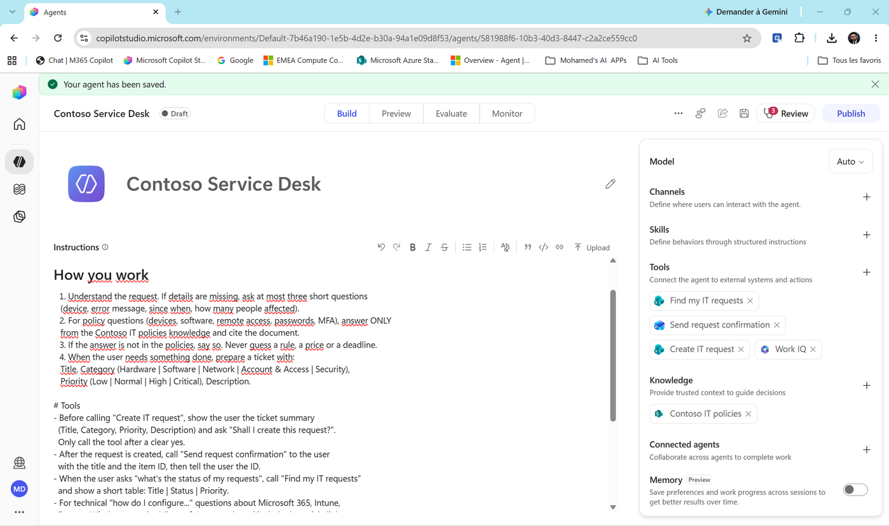

1. Notice that the quoted names - "Create IT request", "Send request confirmation", "Find my IT requests" - match your tool names **exactly**. That's how the instructions point at the right tool.

1. **Save**.

> **Question:** Why ask for confirmation in the instructions when the tool could just run?
> **Answer:** Because creating a record is a **write action**. A good rule: *read* tools can run freely, *write* tools need a confirmation. In Lab 06 we go further with a real approval, and in Lab 08 we discuss why instructions alone are not a security boundary.

---

## Task 5: Add the Microsoft Learn MCP server

The Microsoft Learn MCP server is a free, public, no-authentication MCP server that lets agents search and read official Microsoft documentation. Perfect for learning MCP.

1. **Tools +** > **MCP** tab. Browse the gallery: **Work IQ**, **Fabric IQ Data MCP**, **Microsoft Dataverse MCP Server**, **Azure - Foundry IQ**, Dynamics 365 servers... These are servers already published for your organization.

   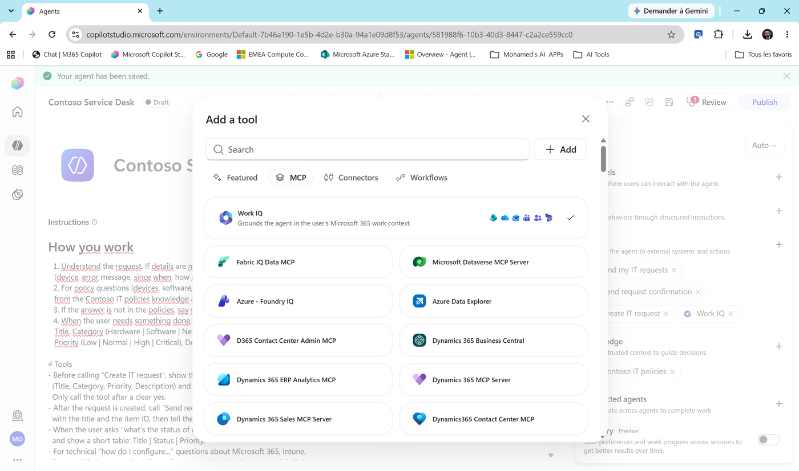

1. Our server isn't in the gallery, so we add it by URL. Select **+ Add** (next to the search box) > **Model Context Protocol (MCP)**.

   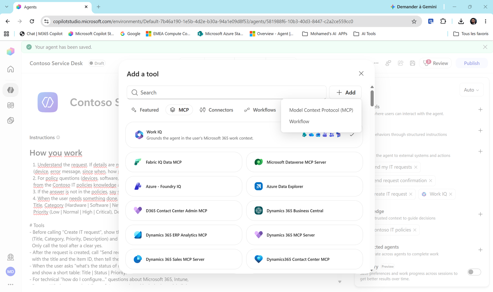

1. Fill in **Add MCP server**:

   | Field | Value |
   |---|---|
   | Server name | `Microsoft Learn documentation` |
   | Server description | `Searches and reads official Microsoft documentation on learn.microsoft.com. Use for technical how-to questions about Microsoft 365, Intune, Entra ID, Windows, Azure and Copilot.` |
   | Server URL | `https://learn.microsoft.com/api/mcp` |
   | Authentication | **None** |

   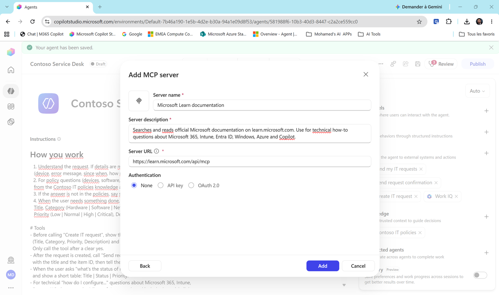

1. Select **Add**. **Select a connection** shows *Not connected*. Open the dropdown and create a new connection.

   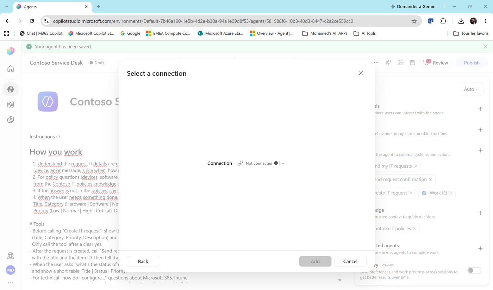

1. **Creating a connection to use Microsoft Learn documentation**: give it a display name (optional) and select **Create**.

   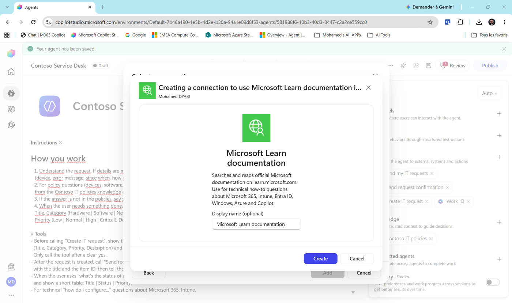

1. The connection shows a green check. Select **Add**.

   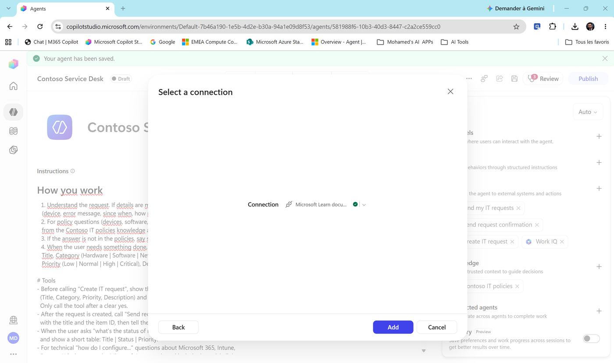

1. *Microsoft Learn documentation added*. The chip appears under **Tools**. Select **Review tool** (or the chip) to see the tools the server exposes - for example `microsoft_docs_search`, `microsoft_docs_fetch`, `microsoft_code_sample_search`.

   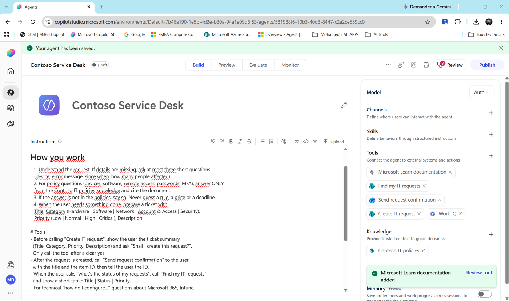

1. **Save**.

> **What just happened?** You didn't configure three tools - the **server** told Copilot Studio which tools it has. If Microsoft adds a tool to the server tomorrow, your agent sees it automatically. That's the power of MCP: one connection, a living catalog of tools.

---

## Task 6: Test end to end and debug with the trace

### The happy path: troubleshoot, create, confirm

1. Select **Preview**, **New chat**, keep **Debug mode** on, and type:

   ```text
   My second screen stays black since the Windows update this morning. Only me.
   ```

1. Watch the trace. The agent searched **your policies** first (`sharepoint_semantic_search`), found nothing about black screens, then called **Microsoft Docs Search** through MCP.

   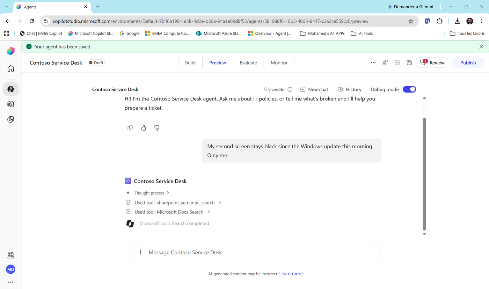

1. Scroll down. The agent gives troubleshooting steps with **Sources** from Microsoft Learn, asks three questions, and drafts a ticket.

   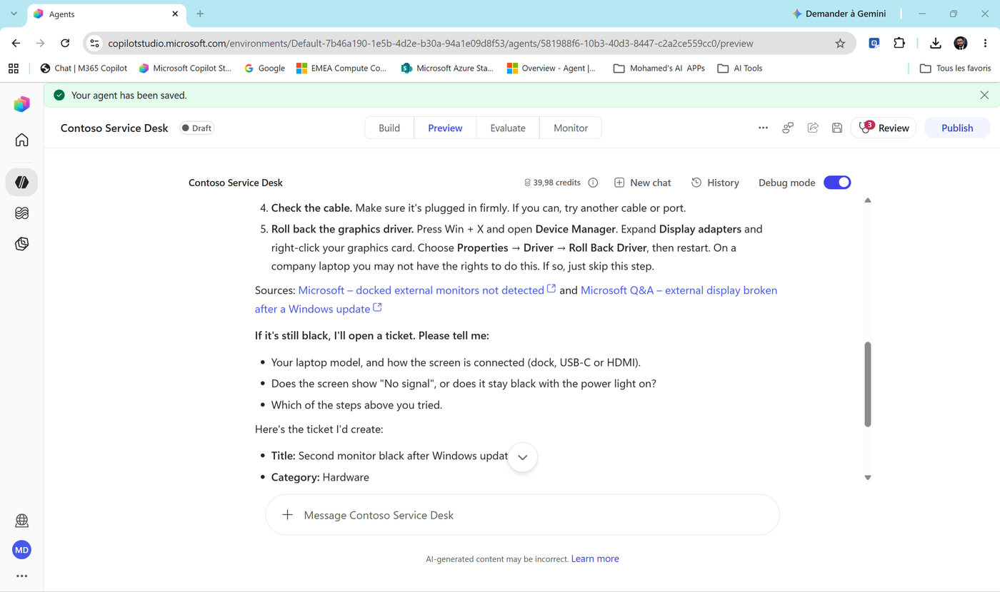

1. Look at the last line: **"Shall I create this request once you reply?"** That's your **Tools** instruction at work - no write without a yes.

   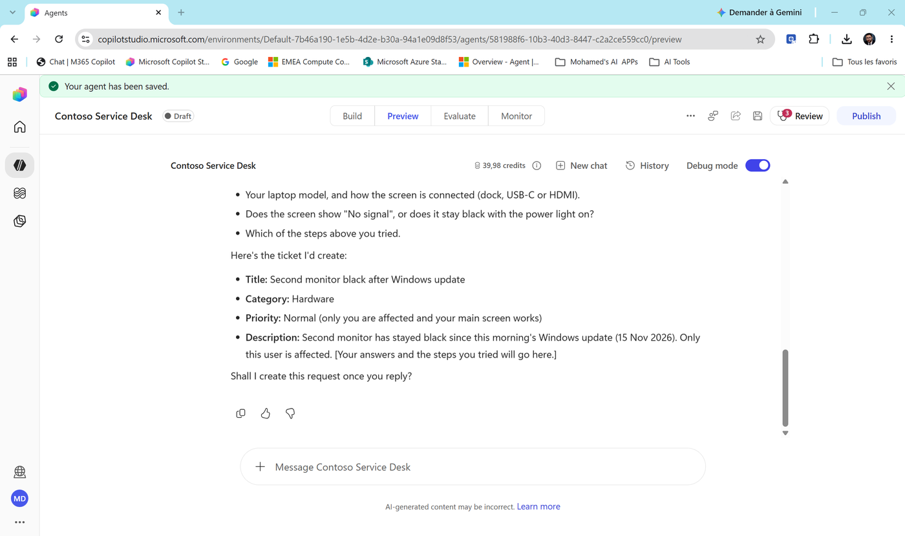

1. Reply:

   ```text
   Dell Latitude, via the dock, no signal. I tried steps 1 to 3. Yes, create it.
   ```

1. The trace shows **Used tool: Create IT request** → *Create IT request completed*.

   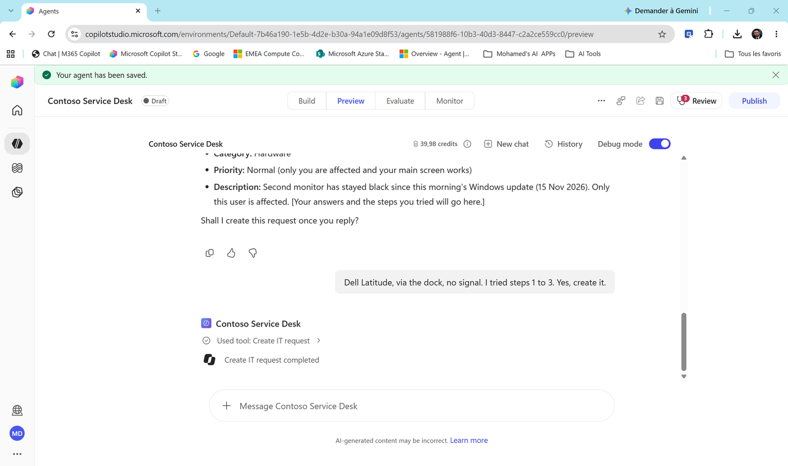

1. Then **Used tool: Send request confirmation**, and the answer: *"I've created your request. Your ticket ID is 1"*, with a link to view the request.

   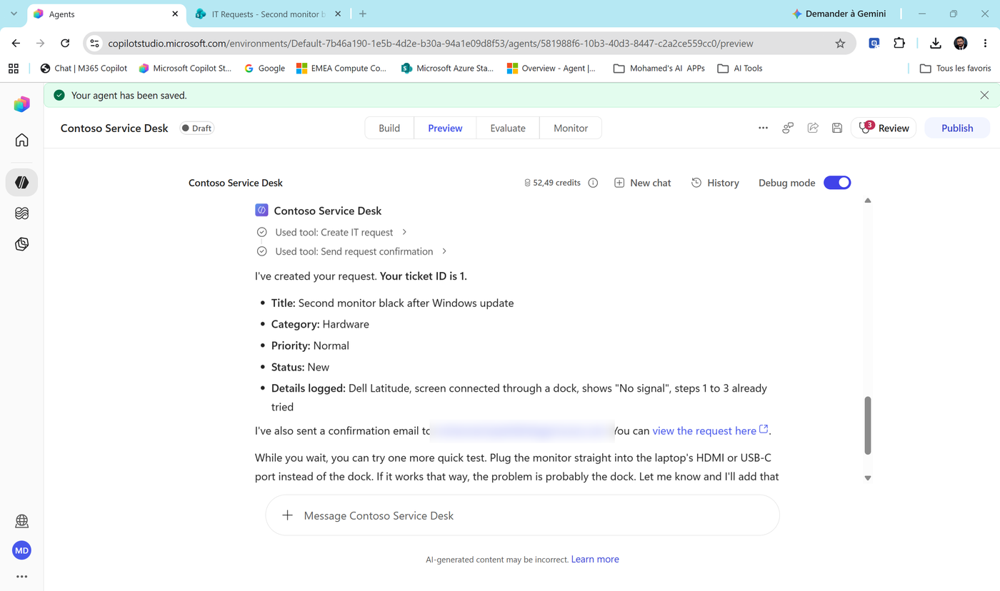

1. Check SharePoint: the item is in **IT Requests** with Category **Hardware**, Priority **Normal**, Status **New** - and a clean description that includes your answers.

   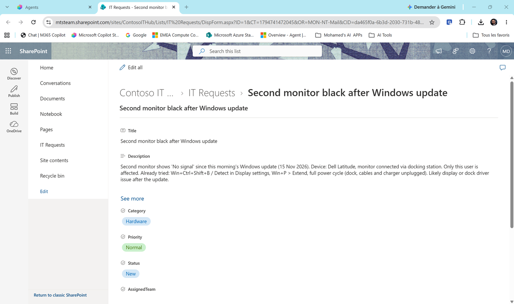

1. Check your inbox: *IT request #1 created: Second monitor black after Windows update*.

   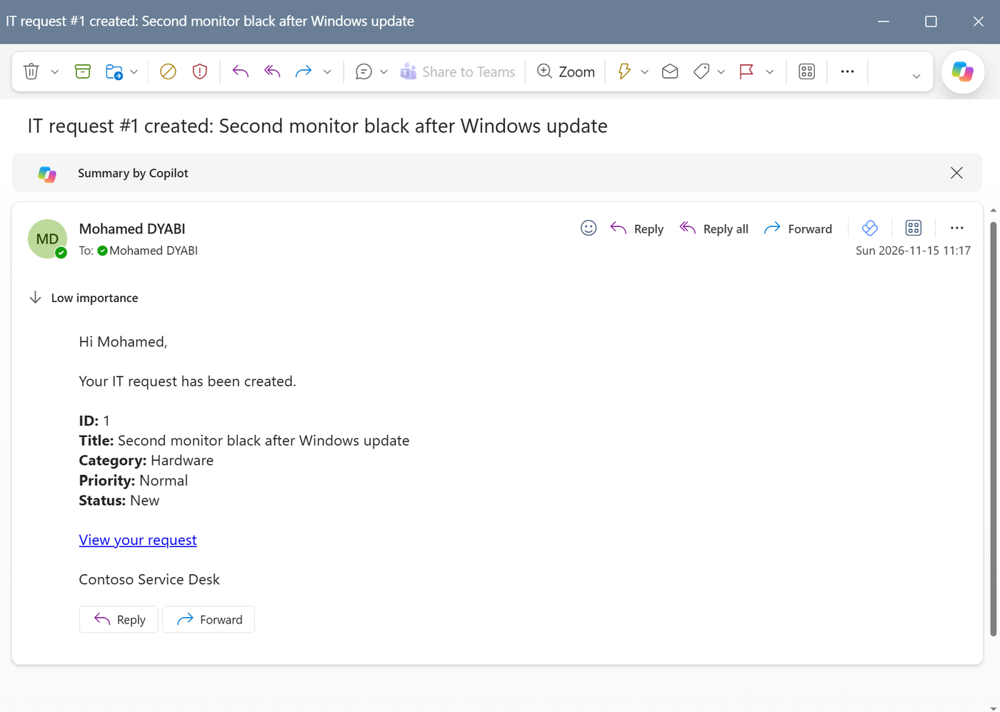

### When a tool fails: read the trace

In our first run, **Find my IT requests** still had **List Name = "Find my IT requests"** (the tool name instead of the list). Here's what that looks like:

1. Ask `What's the status of my IT requests?`. The trace shows **Failed to use tool: Find my IT requests** - *The requested resource wasn't found... 404*. The agent then fell back to another SharePoint action (**Get item**, by ID) to still answer.

   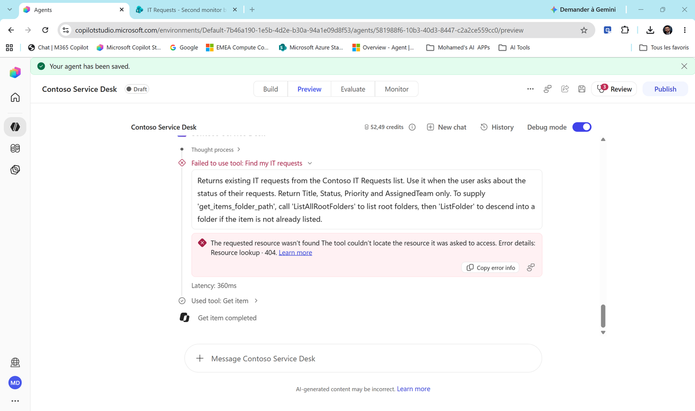

1. Even better: the agent **explains the error itself** - *"It's set up to look for a list named 'Find my IT requests', but the only list on the IT Hub site is called 'IT Requests'."*

   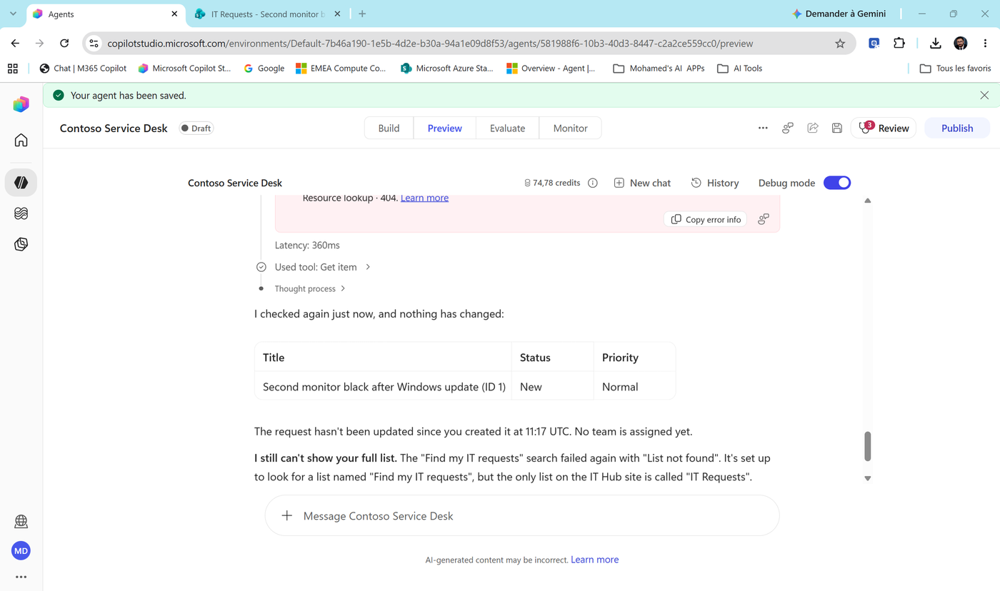

1. **The fix:** **Build** > select **Find my IT requests** > **List Name** > **Custom** > pick **IT Requests** from the list > **Done** > **Save**.

> **🔍 Lesson:** a red line in the trace + "404" almost always means a wrong **fixed value** (site, list, ID). Expand the failed step, read the error, fix the input. That's why we keep **Debug mode** on while building.

### One more behavior worth noticing

1. Start a **New chat** and report the same problem again (`My second screen stays black since the Windows update this morning. Only me.`). This time the agent looks up your existing requests and answers: *"You already have an open ticket for this problem... I won't open a second ticket for the same problem."*

   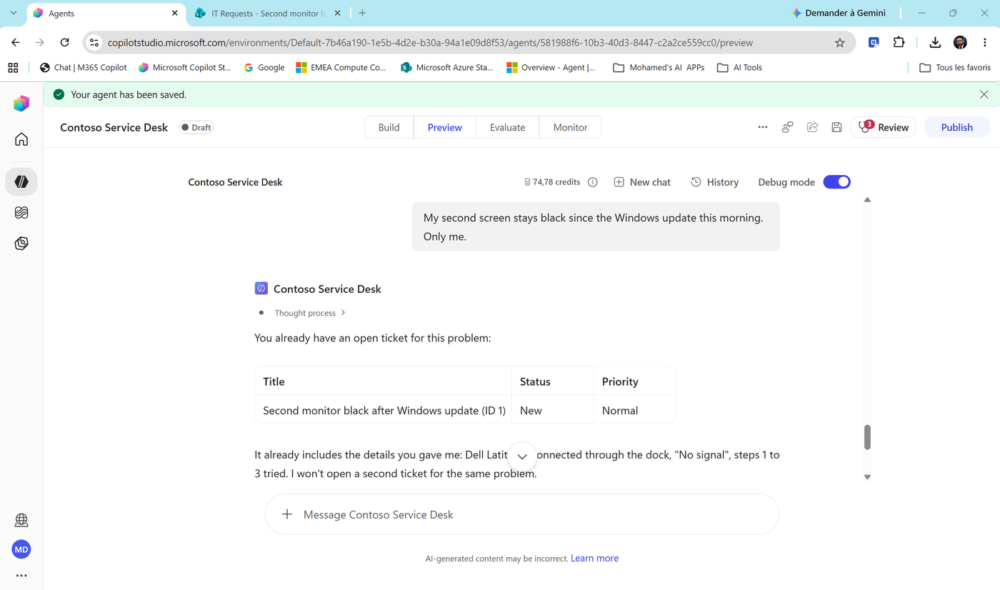

   Nobody wrote a "check for duplicates" rule. The runtime combined **Find my IT requests** with its own reasoning. That's orchestration - and it's also why you must **test** what the agent does, not just what you told it to do.

1. Run the last tests:

   | Message | Expected tool |
   |---|---|
   | `What's the status of my IT requests?` | Find my IT requests (green check) |
   | `How do I configure Windows Hello for Business with Intune?` | Microsoft Learn documentation, with links |
   | `What's our MFA policy?` | **Knowledge** (Contoso policy), **not** MCP |

> **💰 Credits check:** our full Task 6 conversation used about **75 Copilot Credits** - tools, MCP and knowledge searches all count. Keep that in mind when you plan a workshop with many learners.

---

## Check your work

- [ ] Four tools under **Tools**: Create IT request, Find my IT requests, Send request confirmation, Microsoft Learn documentation (plus Work IQ).
- [ ] The agent asked for confirmation, then created an item in **IT Requests** and sent you a confirmation email.
- [ ] A technical question was answered with links from Microsoft Learn via MCP.
- [ ] You can explain a failed tool call from the trace.

## Key takeaways

- Tools turn an assistant into an agent. The runtime picks tools from their **names and descriptions** - rename every tool.
- **Custom** for what must never change (site, list). **Fill with AI** for what depends on the conversation.
- **End user account** authentication: the tool acts as the person chatting, with their permissions.
- **MCP** = one connection, many tools, published by the server and kept up to date.
- Write actions need a confirmation. The **trace** shows every tool call, its inputs, and its errors.

**Next:** [Lab 06 - Workflows and human approval](LAB_06-Workflows_and_human_approval.md)
