---
lab:
    title: 'Lab 07: Skills, memory and connected agents'
    module: 'Module 4 - Advanced agents'
---

# Lab 07 - Skills, memory and connected agents

## Lab introduction

Our Service Desk agent is getting big. It has instructions for policies, for tickets, for software and for tools. Soon it will be one giant prompt that nobody dares to touch.

How do real teams handle this? The same way they handle big code: **split it into pieces**.

| Piece | What it gives you | Analogy |
|---|---|---|
| **Skill** | A focused procedure the agent loads only when needed | A checklist in a drawer |
| **Memory** | The agent remembers each user's preferences between conversations | A colleague who remembers you prefer French |
| **Connected agent** | A whole specialist agent your agent can delegate to | Transferring a call to the licensing expert |

## Estimated timing: 60 minutes

## Lab scenario

The Service Desk manager has three requests:

1. "Triage must follow **exactly** our rules, the same rules you used in Lab 03."
2. "Users hate repeating that they're in Dubai or that they want answers in French."
3. "The licensing team built their own agent. Don't copy their knowledge. **Ask their agent**."

## Job skills

- Task 1: Add the triage skill to the Service Desk agent
- Task 2: Create a skill from blank
- Task 3: Turn on memory
- Task 4: Build and publish the License Advisor agent
- Task 5: Connect the License Advisor to the Service Desk agent
- Task 6: Test the whole team

---

## Task 1: Add the triage skill

Remember the `it-ticket-triage` skill from Lab 03? You reuse the **exact same package** here. A skill written once in Agent Builder runs unchanged in Copilot Studio. That's portability.

1. Open **Contoso Service Desk** > **Build** tab. On the right, next to **Skills**, select **+**.

   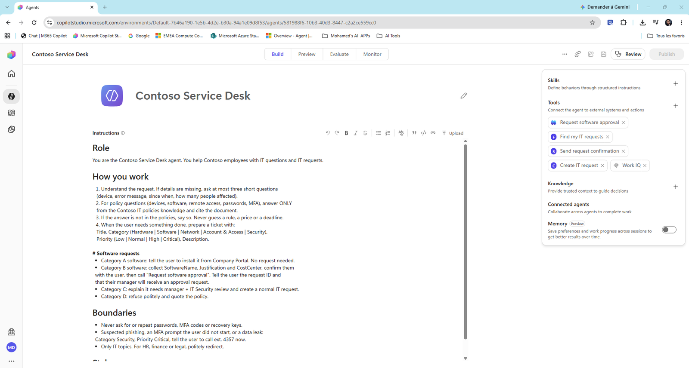

1. The menu shows three options:

   | Option | What it does |
   |---|---|
   | **Upload a skill** | Upload a `SKILL.md` or a `.zip` package that contains one |
   | **Create from blank** | Write the skill in the designer (Task 2) |
   | **Browse skills (preview)** | Pick a ready-made skill from a gallery |

   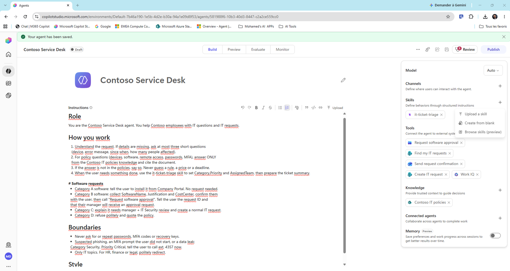

1. Select **Upload a skill** and drop `Allfiles/Labs/03/it-ticket-triage.zip`.

   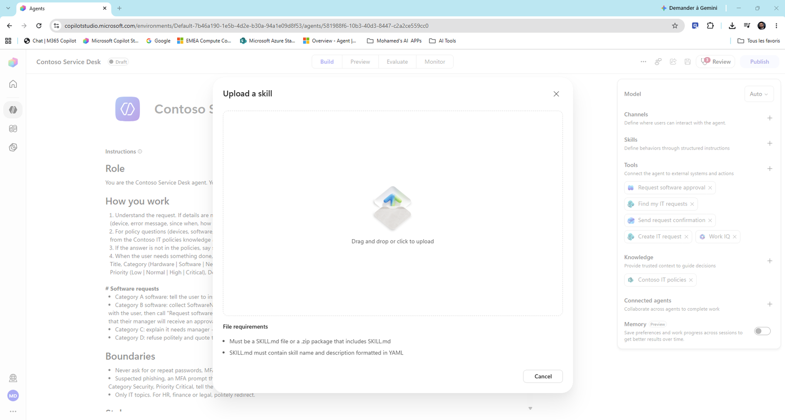

   Look at the file requirements: the `SKILL.md` must contain the skill **name** and **description** in YAML. That's the front matter at the top of the file.

1. The skill appears as a chip under **Skills**. Select it to open its details: **Name**, **Description** and **Instructions**, read from the `SKILL.md`.

   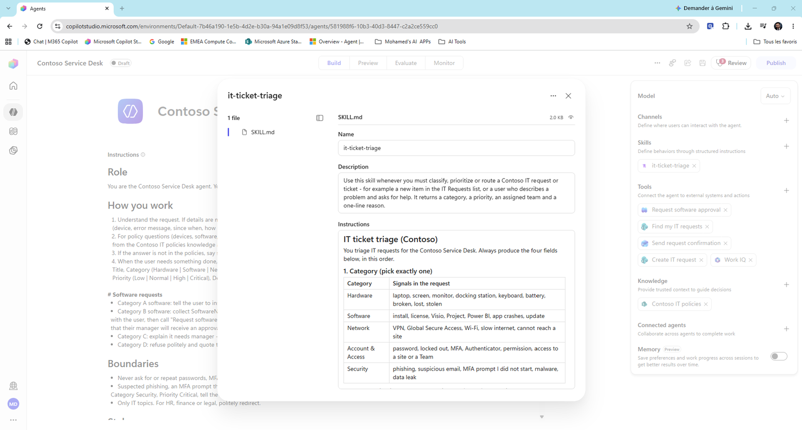

   Read the **Description** as if you were the model. It says *when* to use the skill ("whenever you must classify, prioritize or route a Contoso IT request"), not only *what* it does. That's how the agent decides to load it.

### Remove the duplicate rules from the instructions

The triage rules now live in the skill. If they also live in the instructions, sooner or later the two will disagree. So you replace them with a pointer.

1. In **Instructions** > **How you work**, find step **4**. It wraps over three lines and ends with *"Priority (Low | Normal | High | Critical), Description."*

1. Select the text of step 4: click right after the **4.** and **Shift**-click after **Description.**

   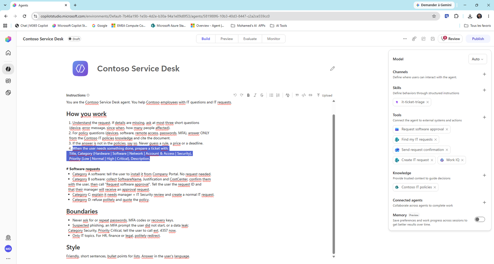

1. Type the new text. **Don't type "4."** because the editor keeps the list number:

   ```text
   When the user needs something done, use the it-ticket-triage skill to set Category, Priority and AssignedTeam, then prepare the ticket summary.
   ```

   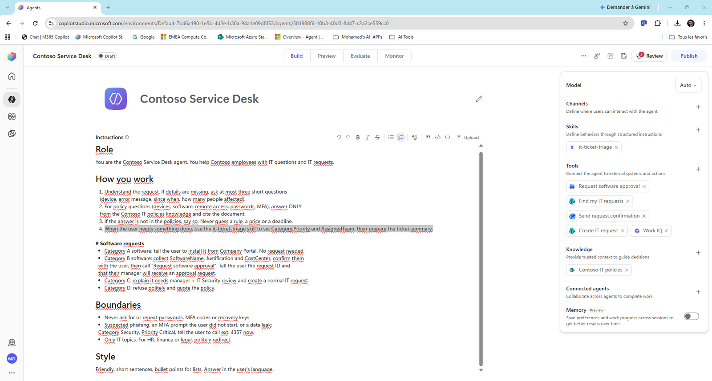

1. Select **Save**.

---

## Task 2: Create a skill from blank

Uploading is great when the skill already exists. Now you write one yourself.

1. **Skills** > **+** > **Create from blank**.

1. Fill in the form:

   - **Name**: `ticket-closure-message`
   - **Description**:

     ```text
     Use this skill when a ticket is resolved and the user needs a closure message. Returns a polite message of exactly two lines.
     ```

   - **Instructions**:

     ```text
     # Ticket closure message
     Write exactly two lines:
     1. Thank the user by first name and confirm what was fixed, in one sentence.
     2. Tell them to reply within 5 days if the problem comes back, otherwise the ticket closes.
     Tone: polite, short, no emojis. Answer in the user's language.
     ```

   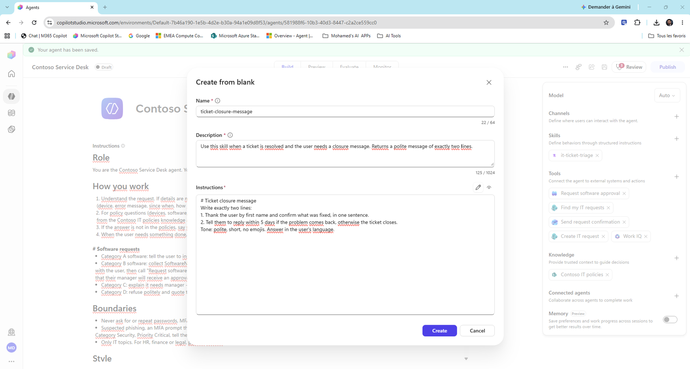

1. Select **Create**, then **Save** the agent. You now have two skills.

   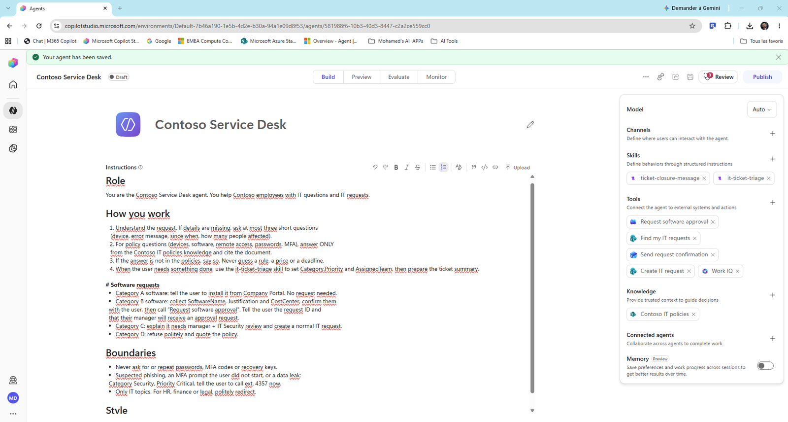

1. On **Preview**, select **New chat** and turn on **Debug mode**. Type:

   ```text
   My VPN works again, you can close my ticket.
   ```

   🔍 **What happened?** The agent called **Find my IT requests**, found **no VPN ticket** and closed nothing. It didn't use the skill.

   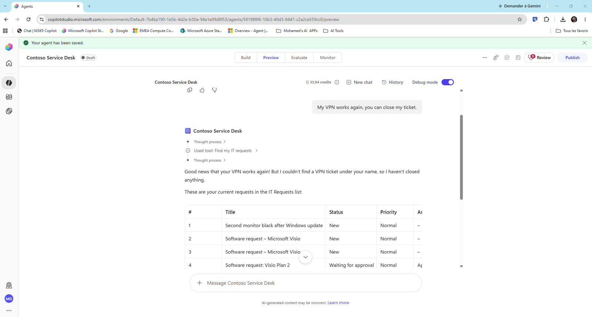

   Is that a failure? No. Writing "your ticket is closed" for a ticket that doesn't exist would be a made-up answer. The agent checked the facts first. That's **grounded** behavior.

1. Select **New chat** and use a ticket that exists (check your IT Requests list for its number):

   ```text
   Ticket 1 is fixed, my second monitor works again. Write the closure message.
   ```

   The trace shows **Used skill: ticket-closure-message**, and the answer follows the skill: a thank-you with what was fixed, then the 5-day rule.

   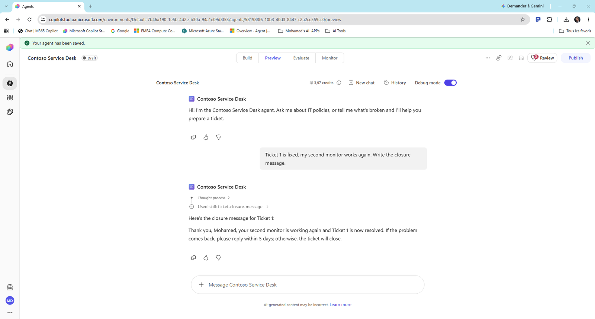

> **Skill or tool?** The skill only **writes** the message. Ticket 1 is still *New* in SharePoint. A skill changes *how the agent works*. Changing *data* needs a **tool** (like *Update item* in Lab 06).

> **Built-in skills.** The Microsoft Copilot harness already ships skills for reading Word, PDF, Excel, PowerPoint, CSV, HTML and Markdown files. You'll see one in Task 4: **Used skill: analyzing-docx**.

---

## Task 3: Turn on memory

1. On **Build**, at the bottom of the right panel, turn **Memory (Preview)** on. Select **Save**.

   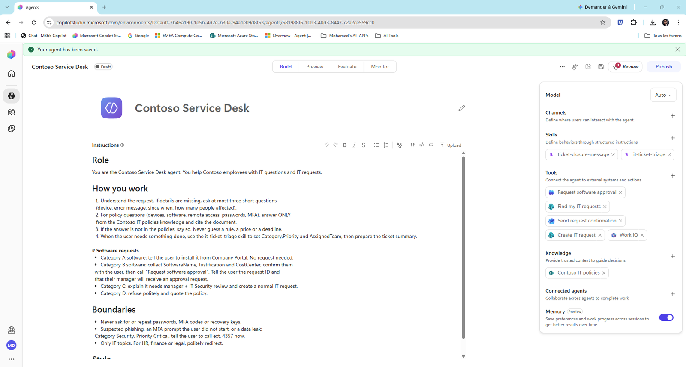

   > ⚠️ If you leave the page with unsaved changes, you get *Leave without saving?* Select **Save and continue**.
   >
   > 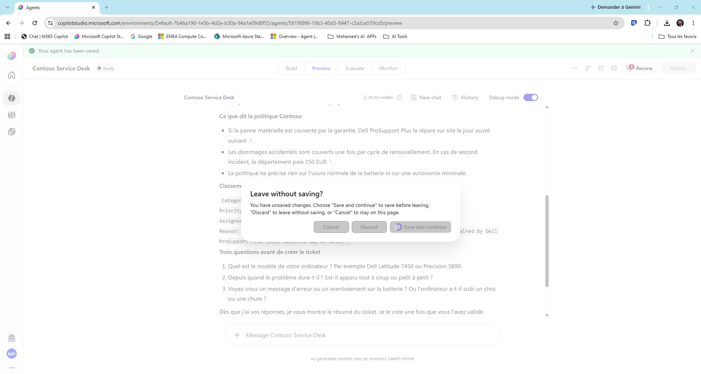

1. On **Preview**, select **New chat**. The agent now tells the user it remembers, and offers **Manage memories**.

   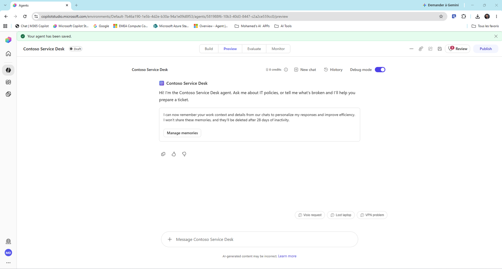

1. Type:

   ```text
   For your info: I work from the Dubai office and I prefer answers in French.
   ```

   The trace shows **Used tool: Saved to memory** twice, once per fact. The agent confirms, already in French.

   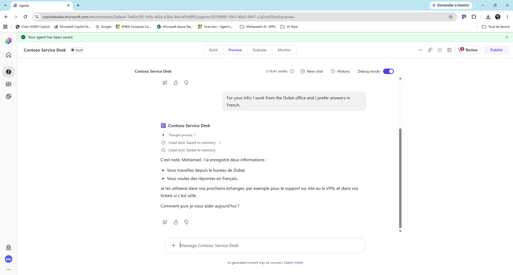

1. Select **New chat**. This is a new conversation, not just a new message. Type in **English**:

   ```text
   My laptop battery dies after one hour.
   ```

1. Read the trace: **Used tool: Searched your memory**, next to the triage skill and the policy search.

   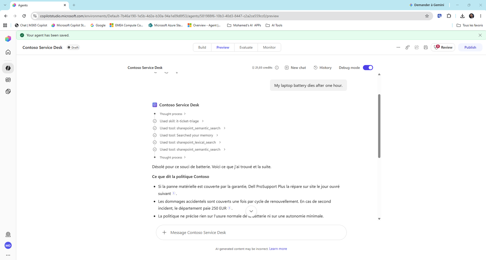

   The answer is **in French**, even though you wrote in English. And the triage skill did its job: Hardware / Normal / Endpoint.

   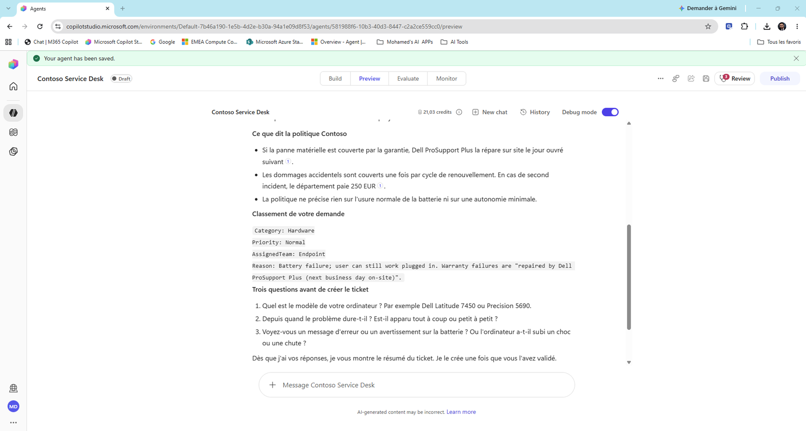

> **What you should know about memory (preview):**
> - Each user has a **separate, private** memory. You, the maker, can't read it.
> - Memories are deleted after **28 days** without a conversation (the notice says so).
> - Users see and delete their memories with **Manage memories**.
> - Turning memory off stops the agent from *using* memories. It doesn't delete them.
>
> **Question:** Would you turn on memory for an HR agent that handles sick leave?
> **Answer:** Think twice. Memory is great for preferences, but risky for sensitive data. Decide per agent.

---

## Task 4: Build and publish the License Advisor agent

1. Go to **Agents** > **New agent**. Name it `Contoso License Advisor`.

1. **Instructions**:

   ```text
   You are the Contoso License Advisor. You answer questions about which Microsoft licenses
   Contoso owns, who is eligible, the approval needed and the monthly charge to the cost center.
   Answer only from the Contoso License Catalog. Always state the monthly charge and the approval rule.
   If a license is not in the catalog, say so and suggest contacting the Licensing team (licensing@contoso.com).
   ```

1. **Knowledge** > **+** > upload `Allfiles/Labs/07/Contoso-License-Catalog.docx`. Name it `Contoso License Catalog` and select **Add to agent**.

   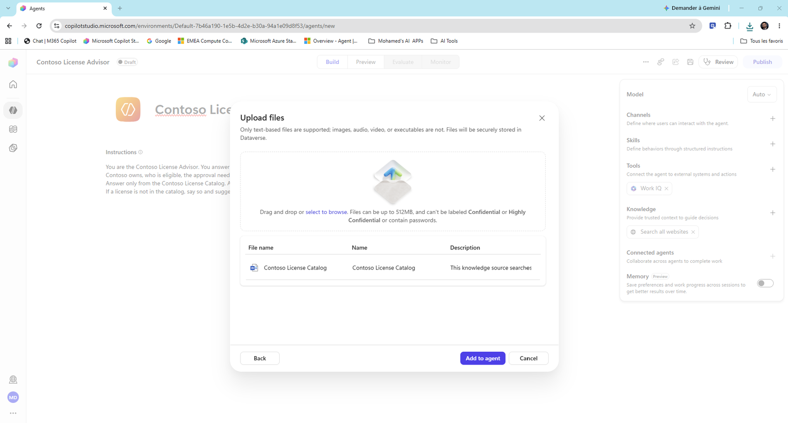

1. On **Preview**, type `How much does a Copilot license cost my cost center?`

   Expected: **EUR 28 per month**, manager approval. Look at the trace: **Searched knowledge**, then **Used skill: analyzing-docx**. That's a built-in skill reading the Word file.

   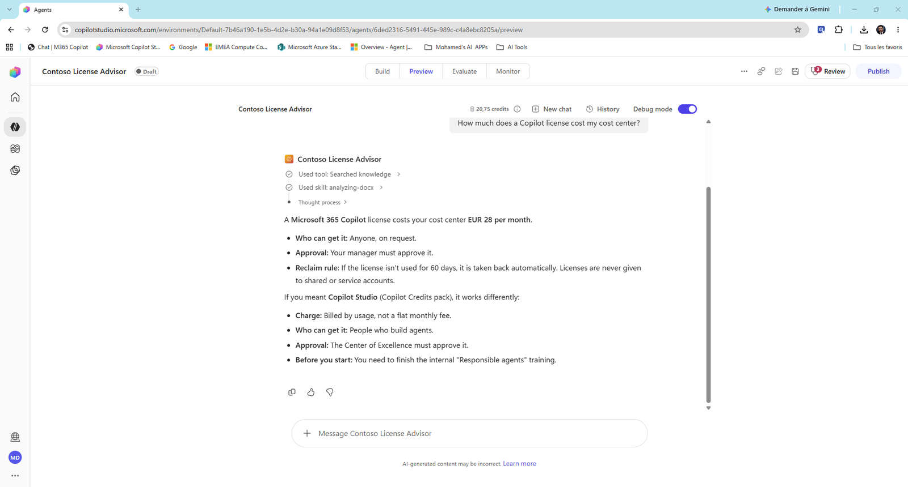

1. Open **...** > **Settings** > **AI + behavior**. Check that **Allow other agents to connect** is **on**. It's on by default, but this is the switch that makes the agent usable by others.

   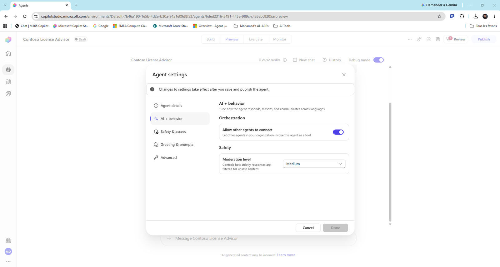

1. Select **Publish**. The dialog offers channels. You don't need one: another agent calls it, not a person.

   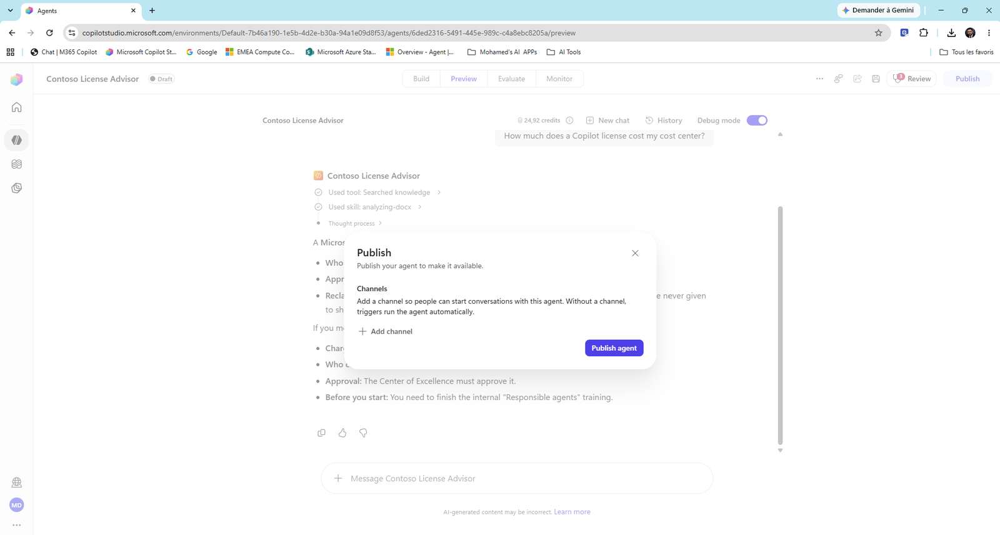

1. Select **Publish agent**. When you see *Your agent is published*, select **Done**.

   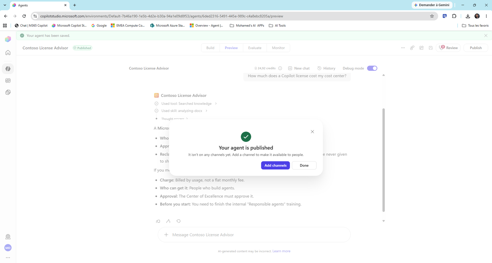

   > A connected agent must be **published**. The parent always uses the latest *published* version, not your draft.

---

## Task 5: Connect the License Advisor

1. Open **Contoso Service Desk** > **Build**. Next to **Connected agents**, select **+**.

1. The list shows the agents you can connect. Older agents built in the classic designer show *Classic agent connections are not supported*. Only agents built in the new experience (and published) can be connected here.

   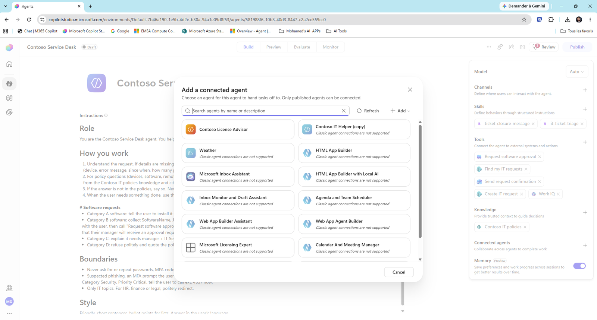

1. Select **Contoso License Advisor**. Write the **Description**. The parent reads it to decide **when to delegate**, the same way it reads tool descriptions:

   ```text
   Specialist for Microsoft license questions at Contoso: which licenses exist, eligibility, approval rules and the monthly charge to a cost center. Delegate any question about license cost, eligibility or license reclaim.
   ```

   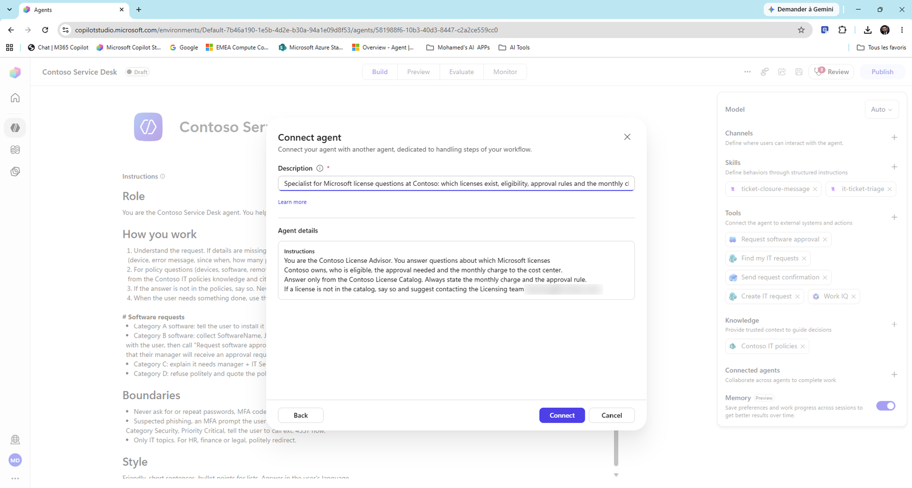

   Below the description you can read the child agent's own instructions. The parent doesn't use them, but they help you write a good description.

1. Select **Connect**, then **Save**.

> **Connected agents can come from anywhere.** With **+ Add** in the same dialog, you can also connect agents built in **Microsoft Foundry**, with the **Microsoft 365 Agents SDK**, or any remote agent that speaks **A2A** (Agent2Agent protocol). That's how you build a multi-agent system across teams and platforms.

> **Security note:** when the parent calls the child, **data access** still follows each tool's connection. If the child's tools use *author* authentication, users could see data through the parent that they couldn't see directly. Prefer **user authentication** for connected agents' tools.

---

## Task 6: Test the whole team

On **Preview** of **Contoso Service Desk** (Debug mode on), send these four messages:

| # | Message | Expected route |
|---|---|---|
| 1 | `How much would Power BI Pro cost my cost center per month?` | **License Advisor** → EUR 13 |
| 2 | `I need Visio. Cost center IT-4410, it's for DC diagrams. How much will my cost center pay?` | **License Advisor** (EUR 14) + confirmation before the **Request software approval** workflow |
| 3 | `Triage: the whole Lisbon office has no Wi-Fi` | **Skill** it-ticket-triage → Network / Critical / Network |
| 4 | `Is my password policy 14 characters?` | Own **knowledge** only, no delegation |

### Test 1: delegation

While the agent works, the trace shows **Using tool: Contoso License Advisor**. To the parent, a connected agent looks just like a tool.

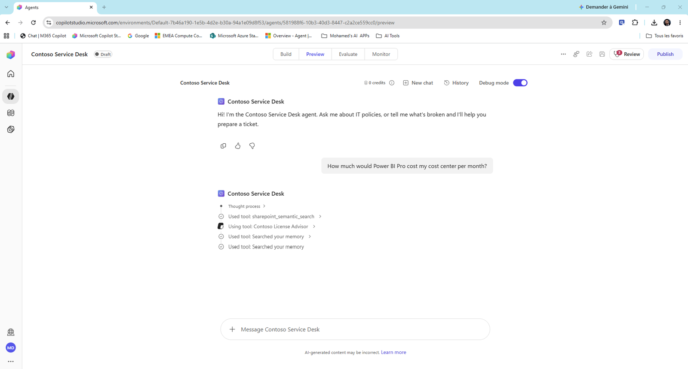

The answer: Power BI Pro is **EUR 13 per month**, sourced from the license catalog *via the License Advisor*. And it's in **French**: memory still works.

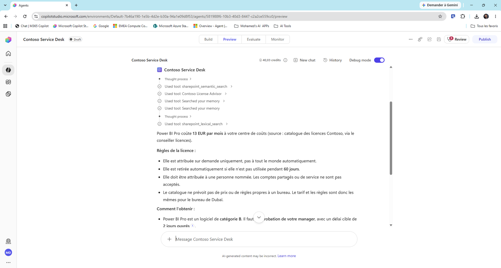

Read the end of the answer. The parent combined **two** sources: the License Advisor for the price, and its own Software Request Policy for the approval rule (Category B, manager, 2 business days). Then it offers to submit the request.

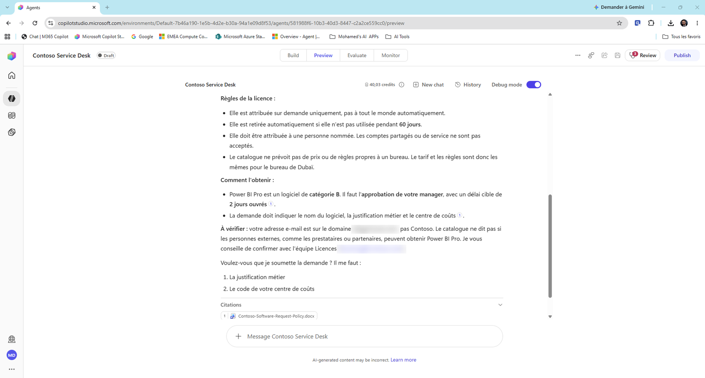

### Test 2: two specialists, one answer

The License Advisor gives the price (**EUR 14**). The parent applies its own policy (Category B) and builds the request summary. It asks **oui/non** before calling the workflow, exactly as the Lab 06 instructions require.

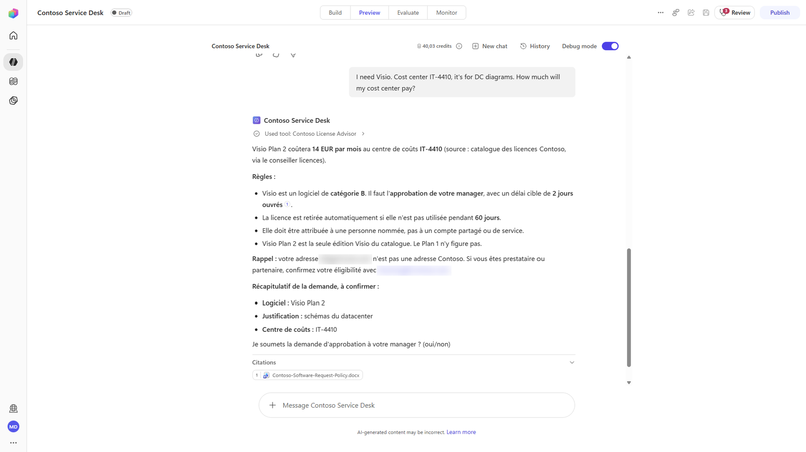

> Reply `oui` (or `yes`) to see the whole chain: connected agent → workflow → approval.

### Test 3: the skill

**Used skill: it-ticket-triage**: Network / **Critical** / Network team. The skill's rule says *more than 10 people blocked = Critical*. The agent even says it **assumed** a whole office means more than 10 people, then asks three questions before creating the ticket.

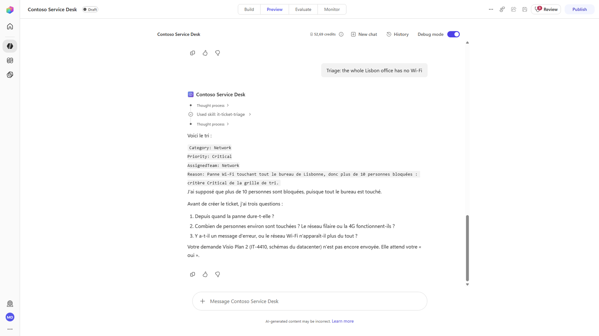

### Test 4: no delegation

Only **sharepoint_semantic_search** and **sharepoint_lexical_search**: the parent answered from its own knowledge (Password and MFA policy). Passwords aren't a license question, so it didn't call the License Advisor.

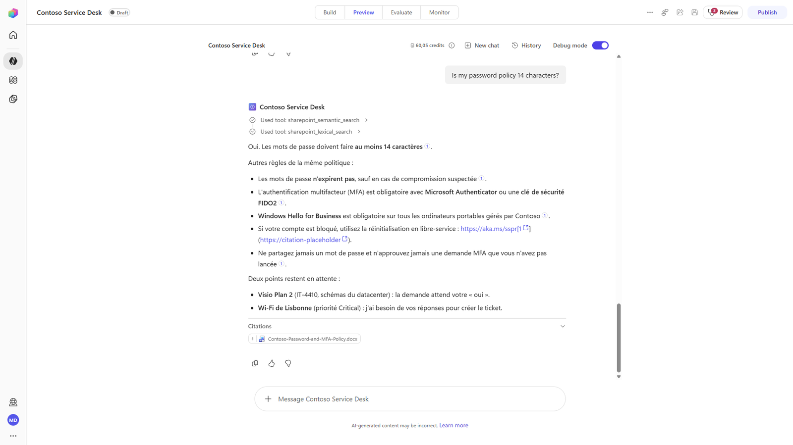

> **Question:** When should you build a connected agent instead of just adding the knowledge to your agent?
> **Answer:** When another team **owns** that knowledge and its rules, when it needs its **own** tools and permissions, or when **several** parent agents need it. One owner, one agent, many consumers.

---

## Check your work

- [ ] **it-ticket-triage** and **ticket-closure-message** are listed under Skills; step 4 of the instructions points to the skill.
- [ ] Memory is on, and a new conversation answers in French.
- [ ] **Contoso License Advisor** is published, and connected to the Service Desk agent.
- [ ] Test 1 shows **Used tool: Contoso License Advisor**; test 4 doesn't.

## Key takeaways

- **Skills** keep instructions small and procedures consistent. They travel from Agent Builder to Copilot Studio unchanged. Keep each rule in **one** place.
- The agent picks skills, tools and connected agents by reading their **descriptions**. Write *when*, not only *what*.
- **Memory** is per user, private, expires after 28 days, and should be a deliberate choice.
- **Connected agents** let each team own its specialist. To the parent, a connected agent is just another tool.
- Delegation doesn't bypass data permissions. The connection identity of each tool does.

**Next:** [Lab 08 - Build an autonomous agent with triggers](LAB_08-Build_an_autonomous_agent.md)
