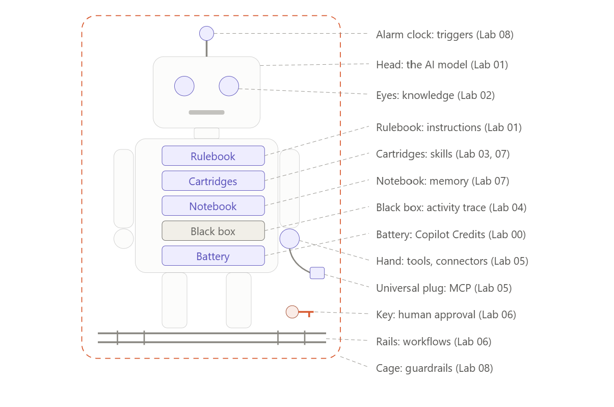

# From Simple Agents to Autonomous Agents
### Hands-on labs for Microsoft 365 Copilot Agent Builder and Microsoft Copilot Studio

Ten progressive labs. One storyline. You build the **Contoso IT Service Desk** step by step:

- first a simple agent that only follows instructions,
- then an agent that knows your documents,
- then an agent that **acts** (tools, workflows, MCP),
- then a team of agents that work together,
- and finally an **autonomous agent** that starts on its own when something happens, with a human in the loop where it matters.

> **Audience:** mixed workshop. Labs 00-03 are for anyone with Microsoft 365 Copilot (no technical background needed). Labs 04-09 are for makers, IT pros and pre-sales engineers who want to go deeper.

---

## The learning path

| # | Lab | Tool | Level | Time |
|---|---|---|---|---|
| 00 | [Prepare the lab environment](Instructions/Labs/LAB_00-Prepare_the_lab_environment.md) | SharePoint, Copilot Studio | Setup | 30 min |
| 01 | [Build your first agent with natural language](Instructions/Labs/LAB_01-Build_your_first_agent_with_Agent_Builder.md) | Agent Builder | ⭐ | 30 min |
| 02 | [Ground your agent in company knowledge](Instructions/Labs/LAB_02-Ground_your_agent_in_company_knowledge.md) | Agent Builder | ⭐ | 40 min |
| 03 | [Capabilities, skills and the jump to Copilot Studio](Instructions/Labs/LAB_03-Capabilities_skills_and_copy_to_Copilot_Studio.md) | Agent Builder | ⭐⭐ | 40 min |
| 04 | [Your first Copilot Studio agent](Instructions/Labs/LAB_04-Your_first_Copilot_Studio_agent.md) | Copilot Studio | ⭐⭐ | 45 min |
| 05 | [Give your agent hands: connectors and MCP tools](Instructions/Labs/LAB_05-Connectors_and_MCP_tools.md) | Copilot Studio | ⭐⭐⭐ | 60 min |
| 06 | [Workflows and human approval](Instructions/Labs/LAB_06-Workflows_and_human_approval.md) | Copilot Studio | ⭐⭐⭐ | 60 min |
| 07 | [Skills, memory and connected agents](Instructions/Labs/LAB_07-Skills_memory_and_connected_agents.md) | Copilot Studio | ⭐⭐⭐⭐ | 60 min |
| 08 | [Build an autonomous agent with triggers](Instructions/Labs/LAB_08-Build_an_autonomous_agent.md) | Copilot Studio | ⭐⭐⭐⭐⭐ | 75 min |
| 09 | [Evaluate, publish and govern your agents](Instructions/Labs/LAB_09-Evaluate_publish_and_govern.md) | Copilot Studio, M365 admin center | ⭐⭐⭐⭐ | 45 min |

Total: about **8 hours**. Split it into two days, or run Labs 00-04 as a half-day "business" track and Labs 05-09 as a full-day "maker" track.

---

## How the agent grows: think of it as a robot

Across the ten labs you build **one robot**, piece by piece. Each lab adds a part and tests it.

| Robot part | What it is in Copilot Studio | Lab |
|---|---|---|
| **Battery** | The environment and its **Copilot Credits**. No power, no robot | 00 |
| **Head** | The **AI model**, the brain | 01 |
| **Rulebook** | The **instructions**: who you are, what you do, what you never do | 01 |
| **Eyes** | **Knowledge**: it reads the Contoso policies and cites them | 02 |
| **Cartridges** | **Skills**: one precise procedure, loaded only when needed | 03, 07 |
| **Black box** | The **activity trace**: every thought and every move, recorded | 04 |
| **Hand** | **Tools** and connectors: it creates tickets and sends emails | 05 |
| **Universal plug** | **MCP**: any service that speaks MCP plugs straight in | 05 |
| **Rails** | **Workflows**: fixed steps, always in the same order | 06 |
| **Key** | **Human approval**: a person decides, not the robot | 06 |
| **Notebook** | **Memory**: it remembers each user's preferences | 07 |
| **A colleague robot** | **Connected agents**: it asks the License Advisor instead of copying its knowledge | 07 |
| **Alarm clock** | **Triggers**: it wakes up on its own when something happens | 08 |
| **Cage** | **Guardrails**: fixed inputs, limited tools, a shared account with only the access it needs | 08 |
| **Inspection** | **Evaluate, publish and govern** before it leaves the workshop | 09 |

The agents you build along the way: **Contoso IT Helper** (Labs 01-03, Agent Builder) → **Contoso Service Desk** (Labs 04-07, Copilot Studio) with its colleague **Contoso License Advisor** (Lab 07) → **Contoso Triage Agent** (Lab 08) → evaluated, published and governed (Lab 09).

---

## Prerequisites

| Requirement | Used in | Notes |
|---|---|---|
| Microsoft 365 tenant (E3/E5 or Business Premium) | All | A demo/test tenant is strongly recommended |
| **Microsoft 365 Copilot** license for each learner | 01-03 | Agent Builder also works with pay-as-you-go, but some knowledge sources (email, Teams chats) need the Copilot license |
| **Copilot Studio** access (license, trial, or Copilot Credits pay-as-you-go) | 03-09 | Agents on the Microsoft Copilot harness consume **Copilot Credits** while you build, test and evaluate |
| A Power Platform environment **with Dataverse** | 03-09 | Needed to copy agents from Agent Builder and to build in Copilot Studio |
| SharePoint site you own | 00-08 | Created in Lab 00 |
| Microsoft Teams | 05, 08, 09 | For notifications and publishing |
| Global admin or AI admin (trainer only) | 09 | To approve the agent in the Microsoft 365 admin center |

> **Heads-up about the UI.** These labs were written in **November 2026**. Copilot Studio now builds new agents on the **Microsoft Copilot harness** by default (Build / Preview / Evaluate tabs). Several features used here (triggers, memory, skills, evaluation) are marked **preview**. Labels can move. When a button isn't where the lab says, look for the same word in the **Build** tab components panel or in **Agent settings**.

---

## Lab files

**Download everything at once:** [Copilot-Studio-lab-main.zip](https://github.com/medyabi/Copilot-Studio-lab/archive/refs/heads/main.zip). Extract it, then open the `Allfiles/Labs` folder.

Or download only the file you need:

| Lab | File | What it's for |
|---|---|---|
| 00 | [Contoso-Laptop-and-Device-Policy.docx](https://github.com/medyabi/Copilot-Studio-lab/raw/main/Allfiles/Labs/00/Contoso-Laptop-and-Device-Policy.docx) | Policy uploaded to the SharePoint **Documents** library |
| 00 | [Contoso-Software-Request-Policy.docx](https://github.com/medyabi/Copilot-Studio-lab/raw/main/Allfiles/Labs/00/Contoso-Software-Request-Policy.docx) | Policy: software categories A to D (used again in Lab 06) |
| 00 | [Contoso-Remote-Access-and-VPN-Guide.docx](https://github.com/medyabi/Copilot-Studio-lab/raw/main/Allfiles/Labs/00/Contoso-Remote-Access-and-VPN-Guide.docx) | Policy uploaded to the SharePoint **Documents** library |
| 00 | [Contoso-Password-and-MFA-Policy.docx](https://github.com/medyabi/Copilot-Studio-lab/raw/main/Allfiles/Labs/00/Contoso-Password-and-MFA-Policy.docx) | Policy uploaded to the SharePoint **Documents** library |
| 03 | [Contoso-IT-Tickets-Q3-2026.csv](https://github.com/medyabi/Copilot-Studio-lab/raw/main/Allfiles/Labs/03/Contoso-IT-Tickets-Q3-2026.csv) | 240 tickets to analyze with the code interpreter |
| 03, 07, 08 | [it-ticket-triage.zip](https://github.com/medyabi/Copilot-Studio-lab/raw/main/Allfiles/Labs/03/it-ticket-triage.zip) | The triage **skill** package (upload the `.zip`). [View SKILL.md](https://github.com/medyabi/Copilot-Studio-lab/blob/main/Allfiles/Labs/03/it-ticket-triage/SKILL.md) |
| 07 | [Contoso-License-Catalog.docx](https://github.com/medyabi/Copilot-Studio-lab/raw/main/Allfiles/Labs/07/Contoso-License-Catalog.docx) | Knowledge for the **Contoso License Advisor** |
| 09 | [Contoso-ServiceDesk-TestSet.csv](https://github.com/medyabi/Copilot-Studio-lab/raw/main/Allfiles/Labs/09/Contoso-ServiceDesk-TestSet.csv) | Test set for **Evaluate** |

## Repository layout

| Folder | What's inside |
|---|---|
| [`Instructions/Labs`](https://github.com/medyabi/Copilot-Studio-lab/tree/main/Instructions/Labs) | The lab guides, one Markdown file per lab |
| [`Instructions/Labs/media`](https://github.com/medyabi/Copilot-Studio-lab/tree/main/Instructions/Labs/media) | The screenshots used in the labs |
| [`Instructions/Trainer`](https://github.com/medyabi/Copilot-Studio-lab/tree/main/Instructions/Trainer) | Trainer notes: agendas, team setup, troubleshooting |
| [`Allfiles/Labs`](https://github.com/medyabi/Copilot-Studio-lab/tree/main/Allfiles/Labs) | The lab files listed above, one folder per lab |

## Publish as a lab website

This repo uses the same layout as the Microsoft Learning lab sites (for example AZ-104). Turn on **GitHub Pages** (Settings > Pages > Deploy from branch > `main` / root) and the `index.md` page lists every lab automatically from the `lab:` front matter.

---

*Author: Mohamed Dyabi - Microsoft Certified Trainer. Contoso is a fictitious company used for training.*
